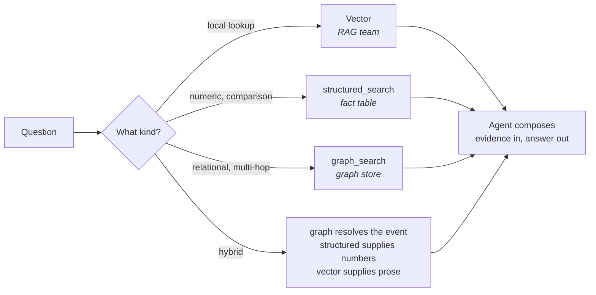
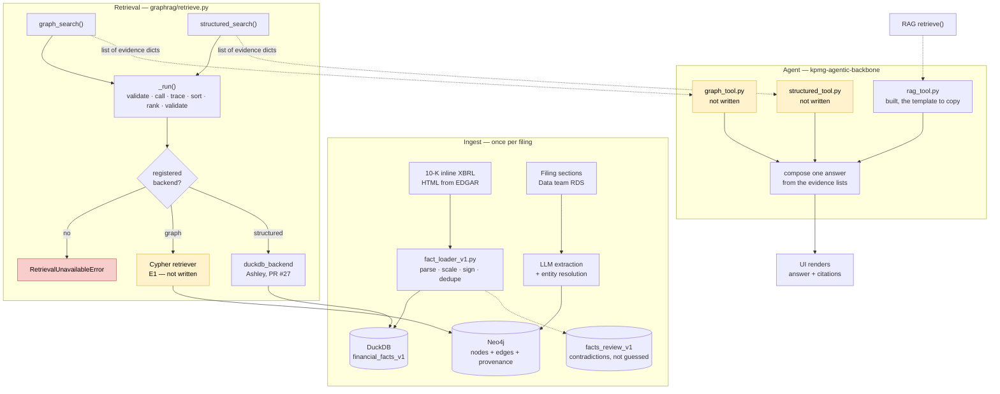
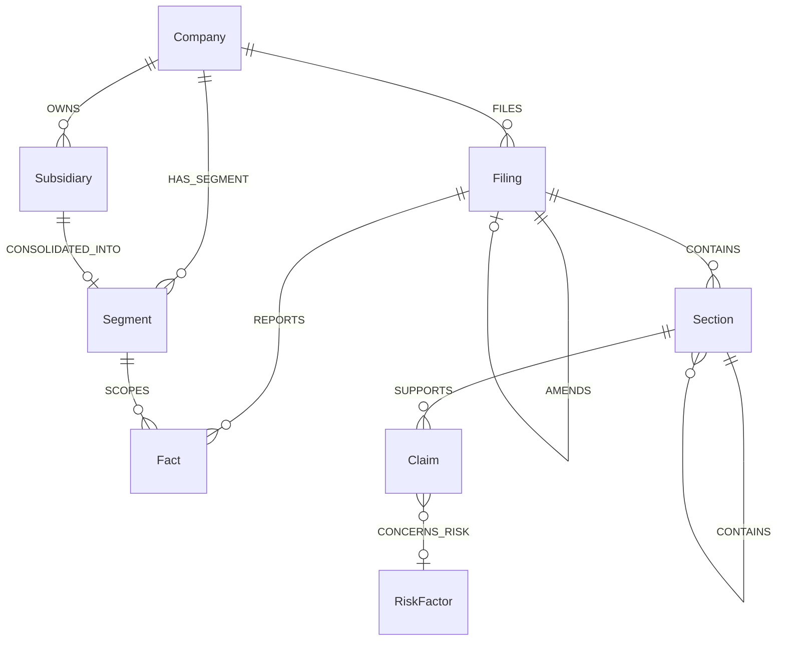

# KPMG-GraphRAG

The graph arm of the Columbia/KPMG SEC-filings project. We own the path from parsed
filing text to answers that need **relationships across filings** — the schema, the
graph, and two retrieval tools that sit beside the RAG team's `retrieve()`:
`graph_search` and `structured_search`.

**[Live project doc](https://docs.google.com/document/d/1oHCqDc29aqyNmlk_cPwBgwo1Ogmz6PrLpV6jcVyPAVs/edit?tab=t.0)**

> **This repo is canonical, not Notion.** The Columbia Notion workspace is out of free
> blocks — prose edits work, every table edit fails — so its pages are half-current.
> Change things here. Start with [`docs/action-items.md`](docs/action-items.md), then
> [`docs/README.md`](docs/README.md) for what every other document is and who agreed it.

---

## What the graph is for

Vector search retrieves spans. The graph retrieves relationships that no single span
contains. Four question shapes need it, and the fourth has no vector counterpart at all.

| Shape | Example | Why retrieval alone fails |
| --- | --- | --- |
| **Traversal to an unnamed entity** | Which segment absorbed S after X acquired it, and how did that segment's revenue move? | Exhibit 21, Note 7 and the segment discussion are three paragraphs. The answer — the segment — is never in the question |
| **Set operations across filings** | Which risk factors appear in X's later Item 1A that were absent in the earlier one? | Absence is unretrievable at any hop count |
| **Relationship negatives** | Does X own Y, for a pair with no ownership relationship? | The name is in the corpus, so retrieval surfaces it. The answer must not attach it to the wrong parent |
| **Supersession** | What did X report as FY2023 revenue as filed, and what did the 10-K/A restate it to? | Both values are in the corpus, both retrievable, both confident. Neither document says *I am the stale one* |

The nineteen candidate questions, the graph path each one takes, and the filings each
joins are in [`docs/eval-ask.md`](docs/eval-ask.md).

**The constraint on all of it:** traceability is not correctness. A pointer gets stamped
whether or not the span supports the claim. An invented relationship still carries a
valid key and a resolvable accession — the citation renders, the UI looks right, and the
edge is wrong. Provenance buys auditability, not accuracy.

## How a question gets routed



Retrieval returns evidence; the Agent composes. Our tools never return an `answers`
field. Scores are raw and comparable only within one call — **never between tools**.

## The pipeline, and what is still empty

**Yellow means nobody has written it.** Three boxes: the Cypher retriever, which is ours,
and two adapters on the Agent side. **Red is not a gap** — it is what the tools do when no
backend is registered, and it works today. Everything unmarked exists on `main`, except
`duckdb_backend`, which is written and waiting in PR #27.



**The two public tools retrieve nothing themselves.** They validate the caller's input,
dispatch to whatever backend is registered, then stamp the trace, sort, rank and check the
envelope. Swapping the backend keeps every one of those guarantees, which is what makes
comparing five retriever arms a loop rather than five rewrites.

**Nothing registered means retrieval is unavailable, and that is not no evidence.** A
backend that raises is re-raised as unavailable, never flattened into an empty list, so a
broken database cannot read as a missing fact.

## The ontology

Eight node types, agreed 17 Oct (decisions 2.1–2.8). A node needs a question it unlocks
or it does not earn its place.



**Still open:** `Document`, `Table` and `Cell`. All three came from reading the Data
team's schema rather than from a question, and each needs one named or it is cut.

**Numbers never live in the graph.** The graph holds `(Filing)-[:REPORTS]->(Fact)`
pointers; values, units, periods and `basis` live in a typed fact table. Period
arithmetic is awkward in a traversal language, exact-match numeric scoring is far easier
against a table, and a 10-K/A restatement would otherwise collide with the original on an
identical key.

**Supersession is judged at fact grain, not filing grain.** `AMENDS` is filing-level
because the source field is. Judge staleness there and every fact in the original goes
stale, including periods the amendment never touched. A number is superseded only when
the amendment replaces that same concept for that same period.

## Repo map

| Path | What |
| --- | --- |
| [`docs/`](docs/) | **The contracts.** Canonical. [`schema-ids-operations.md`](docs/schema-ids-operations.md) is what to build against |
| [`docs/sprints/`](docs/sprints/) | One file per week — owners, done conditions, decisions the week is waiting on |
| `graphrag/` | The package. `contract.py` is the evidence shape and validation, mirroring the RAG team's `rag/contract.py`; `retrieve.py` is the two public tools; `entity_resolution.py` is the conservative name matcher |
| `mock/` | INT-0 mocks for both tools. Standalone, standard library only |
| `tools/` | Two CLIs — read Data's database, and score entity resolution against the 50-pair key |
| `tests/` | 112 tests — 63 contract, 28 toy-graph fixture, 13 entity resolution, 8 retrieval adapter. Quote the scope with the number; the contract suite alone is 63 and the two get mistaken for each other |
| `toy_graph/` | A small Neo4j graph used to test the schema against a question needing several hops. It found two gaps; both are closed |
| `extraction_prototype/` | Saved runs of LLM extraction over real filings, with validators that re-check them offline |

## Quick start

```bash
# Contract conformance — no credentials, no network
python3 -m pytest tests/ -q

# Rebuild the toy graph and reproduce both schema findings
cd toy_graph && python3 toy_graph.py && python3 check_findings.py

# Re-check the saved extraction runs without an API key or a database
python3 extraction_prototype/validate_saved_pilot.py
python3 extraction_prototype/multi_filing/validate_saved_results.py
```

The saved JSON under `extraction_prototype/` is run output rather than source, and it is
committed deliberately: it is what lets anyone verify a result without credentials. The
latest run is `multi_filing/gap_recovery/` — 87 candidate Claims, 96 nodes, 93
relationships, all 87 source paths verified. Earlier generations are kept as a record.
All Claims remain `needs_review`; source checks confirm provenance, not meaning.

## Other teams

| Team | Repo | Note |
| --- | --- | --- |
| Data | `michaelliruoxi/data_engineering_kpmg` | AWS RDS Postgres. Read [`docs/data-team-state.md`](docs/data-team-state.md) before asking them for anything — most of our contract was already built |
| RAG | `Rachel-xs/KPMG_RAG` | Contract and working retriever are on branch `contract-v0`, not `main` |
| Agents | `yz5405/kpmg-agentic-backbone` | What changes for them is in [`docs/agent-notes.md`](docs/agent-notes.md) |

We adopted the RAG team's field names rather than defending our own — their contract
shipped first, with tests and three other consumers. We ask for two additive fields,
`section_id` and `quote`, and nothing else.
