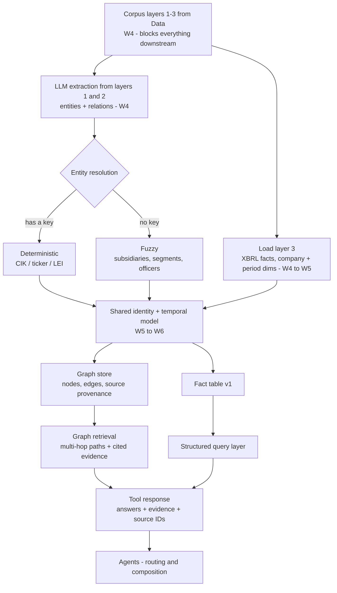
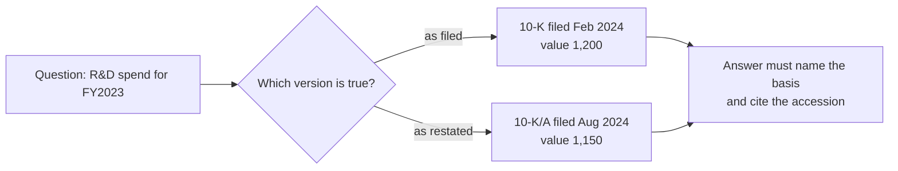
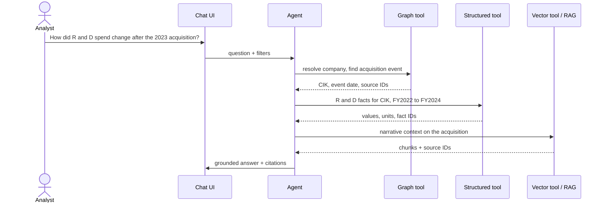
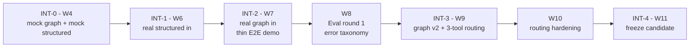

# Architecture & workflow — GraphRAG

> Ported from Notion on 2026-10-13. Everything inside the GraphRAG boundary is ours; everything outside is a contract with another team.

## 1 · One shared corpus, two projections

See the diagram in [data-contract.md](./data-contract.md#0--what-we-are-building) — same figure, same routing.

| Source | Destination | Label | Example |
|---|---|---|---|
| L1 | Graph store | L1 sections | Extract Apple → OPERATES_IN → China from the whole of Item 1, not a chunk of it |
| L2 | Graph store | L2 cell JSON | Extract Apple → HAS_SUBSIDIARY → Company B from a subsidiary table |
| L3 | Graph store | L3 identity edges | Link Apple's company node to its CIK / XBRL entity identifier |
| L3 | Fact table | L3 values | Store Apple, Revenue, FY2025, USD, $416B |
| L1 | Vector index | L1 chunks | Risk Factors paragraphs into embeddings |
| L2 | Vector index | L2 markdown | Financial tables as Markdown into embeddings |

The graph is a **projection of the corpus, not a parallel copy**. Every store points back, so no fact lives only in the graph — otherwise there are two sources of truth and citations from either path stop resolving.

### Working decision, 6 Oct: numbers live in a fact table and the graph points at them

The alternative was routing structured financials into the graph as `company-concept-value-period` triples — already triple-shaped, one store, one query language. We are splitting them instead: the graph holds `(Company)-[REPORTS]->(Fact)` identity edges, the fact table holds values, units, periods and basis.

Reasons: numeric aggregation and period-over-period arithmetic are awkward in a traversal language; exact-match numeric eval is far easier against a typed table; and `company-concept-value-period` has no room for `basis`, so a 10-K/A restatement collides with the original on an identical key.

Either way the graph stores a pointer, never a number.

**Confirmation test:** if numeric or comparative items fall under roughly a third of Business's sample questions, switch to triples and drop the separate query layer. *Status 2026-10-13: RAG's gold set is 10 quantitative and 10 comparative of 30 — over half. The fact table stands.*

## 2 · What the provenance line does and does not buy

**Traceability is not correctness.** A pointer gets stamped whether or not the span supports the claim. An extraction that invents a relationship still carries a valid key and a resolvable accession — the citation renders, the UI looks right, and the edge is wrong. Provenance buys auditability, not accuracy. Checking that the span supports the edge is what the W4 acceptance thresholds with Eval are for.

**The key has three shapes.** Graph edges cite `section_id + accession_number`, because we extract from whole sections. RAG cites `chunk_id + accession_number`, because chunks are what it retrieves. XBRL facts sit in neither — they live in the instance document and are identified by `accession_number + context_ref + unit_ref`. Specced once, it gets specced for chunks, and both the graph arm and the structured arm end up with a null key.

**XPath is the cross-team locator, not our offsets.** Revised 2026-10-13. Data requires an `xpath` in `source_locator` on table cells and sections, Eval's gold set locates evidence by XPath, and RAG reserves `source_locator` as a metadata key for it. We were the only team insisting on character offsets into normalized text. Settled position: XPath identifies a region across teams and is what Eval scores against; normalized offsets stay for extraction and highlighting; the verbatim `quote` is what UI matches on, so rendering never depends on either coordinate system. When they disagree, XPath wins and the offsets get rebuilt.

**It is a versioning contract with Data, and it is already at risk.** Data's plan runs refinement of extraction, cleaning, chunking and metadata from W6 through W9. The moment they re-chunk, every `chunk_id` built in W5 is stale. RAG's own contract says as much — `chunk_id` is "stable across rebuilds as long as `chunking_version` does not change" — which is exactly the guarantee the graph cannot rely on, and the reason we need `section_id`.

## 3 · Internal pipeline



The fuzzy branch has no safety net. CIK and ticker give a free deterministic key for registrants; subsidiaries from Exhibit 21, segment names across years and officer names have none.

## 4 · Ontology

See [schema-ids-operations.md](./schema-ids-operations.md) — that document is canonical for schema, IDs, operations and question routing.

## 5 · The temporal problem



Without a decision here every numeric answer is ambiguous and two correct-looking answers disagree. The *modelling* is a W3 gate; only the *ingestion* of amended filings is optional later work.

## 6 · A question moving through the system



The graph resolves *which* entity and *when*, the fact layer supplies the numbers, vector supplies the prose. No single projection answers it alone.

## 7 · Tool signature and evidence shape

**Aligned to RAG's Retrieval API v0 on 2026-10-13.** Their contract shipped first, has conformance tests and three other consumers, so we adopt their names and shape rather than asking four teams to carry two vocabularies. We ask for two additive fields and nothing else. See [interface-rag-gap.md](./interface-rag-gap.md) for what changed and why.

### Signatures

Same shape as `rag.retrieve.retrieve` — `query` not `question`, a `filters` dict, `top_k`, and a plain list back.

```python
def graph_search(
    query: str,
    filters: dict | None = None,
    top_k: int = 10,
    trace_id: str | None = None,
) -> list[Evidence]: ...

def structured_search(
    query: str,
    filters: dict | None = None,
    top_k: int = 10,
    trace_id: str | None = None,
) -> list[Evidence]: ...
```

**`trace_id`** was added on 2026-10-14 at Eval's request, so a log row still points at the
benchmark question after the Agent has rewritten the query. It is optional and opaque — we
echo it and never parse it. Until the `search()` envelope exists it is returned at
`metadata.trace_id` on every result, always present and null when unset. See
[eval-reply.md](./eval-reply.md).

**Filters.** Their ten keys exactly — `ticker`, `cik`, `form`, `accession_number`, `filing_date`, `reporting_period_end`, `fiscal_year`, `fiscal_period`, `section`, `is_table` — with the same rules: a list means OR within a key, AND across keys, `None` is ignored, and `section` matches whole-word prefix on the canonical key.

Ours add `max_hops` (graph) and `concept`, `segment`, `basis` (structured). Note `form`, not `form_type`; `reporting_period_end`, not `period_end`.

**Errors, ordering and scores are identical to theirs**, so the Agent has one rule across all three tools:

- Unknown filter key raises `ValueError("unsupported filter: <key>")` — never silently ignored
- A valid request with no matches returns `[]`; never `None`, never raises
- Store unavailable raises `RetrievalUnavailableError`
- `[]` means "no evidence found". An exception means "retrieval is broken". The Agent must not answer as though there is no evidence when an exception was raised
- Ordered by `score` descending, ties broken ascending by `chunk_id`, else `section_id`, else `fact_id`, so order is deterministic
- `score` is raw and not normalised, comparable only within one call. **Do not threshold on it, and do not compare scores across tools**

### Evidence

```python
Evidence = {
    # --- identical to RAG's RetrievedChunk ---
    "rank": int,
    "chunk_id": str | None,          # null for our two arms, non-null for RAG
    "text": str,                     # exact stored text, never rewritten
    "score": float,
    "section": str | None,           # canonical SEC key, "Part I Item 2"
    "ticker": str | None,
    "cik": str,                      # 10-digit zero-padded
    "company_name": str,
    "form": str,
    "accession_number": str,         # with dashes - the cross-team document key
    "filing_date": str,              # YYYY-MM-DD
    "reporting_period_end": str | None,
    "source_url": str | None,
    "chunking_version": str | None,  # null for our arms, we do not chunk
    "extraction_version": str,       # the Data corpus build we read
    "index_version": str,            # graph build hash / fact table build hash
    "metadata": dict,

    # --- the two additive fields we are asking RAG to carry as well ---
    "section_id": str | None,        # stable across re-chunking, what the graph anchors on
    "quote": str | None,             # the matched span inside `text`, for highlighting
}
```

`text` is always populated. For the structured arm it is a rendered statement of the fact — "Research and development expense, FY2023: USD 29,915 million" — because UI needs something to show and Eval needs something to match on.

**Documented `metadata` keys for our arms.** Read with `.get()`; do not depend on anything not listed.

| Key | Arm | Meaning |
|---|---|---|
| `section_title` | both | human-readable title, e.g. "Liquidity and Capital Resources" |
| `corpus_version` | both | Data's corpus build identifier |
| `path`, `hops`, `edge_types` | graph | nodes and edges traversed |
| `graph_version` | graph | graph build identifier |
| `fact_id`, `context_ref`, `unit_ref`, `basis` | structured | XBRL provenance; `basis` is `as_filed` or `as_restated` |
| `concept`, `period_start`, `period_end`, `dimensions`, `value_raw`, `value_num` | structured | the fact itself |
| `request_id` | both | joins to the call log |

### Three provenance shapes, unchanged in substance

Exactly one of `chunk_id` / `section_id` / `metadata.fact_id` identifies any evidence object. RAG populates `chunk_id`, the graph arm populates `section_id`, the structured arm populates `fact_id`. Specced once it gets specced for chunks, and two of the three arms end up with a null key and no substitute.

### What moved, and where latency went

The old `RetrievalResult` wrapper is gone, and `answers` with it — retrieval returns evidence, the Agent composes. `latency_ms` and `tokens` move to an internal envelope for Eval and the CLI, mirroring their `Retriever.search()`:

```python
search(query, filters, top_k, method) -> {
    "request_id", "index_version", "method", "top_k",
    "latency_ms", "tokens", "warnings", "results": [Evidence]
}
```

Internal API for Evaluation, not part of the Agent contract.

## 8 · Staged integration



If an arm is not ready its mock stays in place and the checkpoint still runs — the demo degrades instead of breaking, and the gap is known rather than discovered at Eval round 1.
