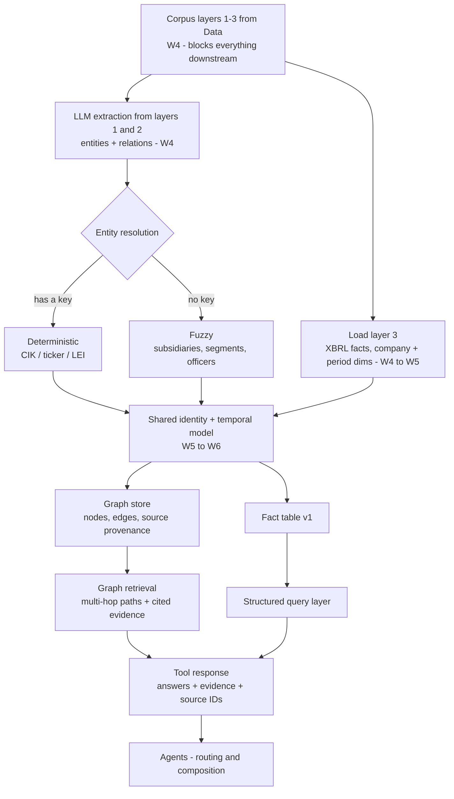
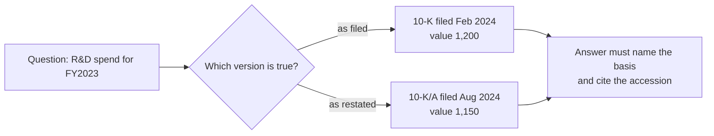
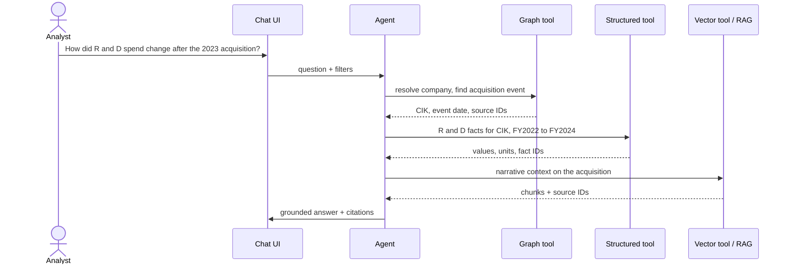
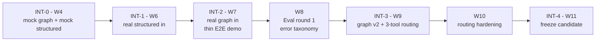

# Architecture & workflow — GraphRAG

> Ported from Notion on 2026-10-13. Everything inside the GraphRAG boundary is ours; everything outside is a contract with another team.

## 1 · One shared corpus, two projections

See the diagram in [data-contract.md](./data-contract.md#0--what-we-are-building) — same figure, same routing.

| Source | Destination | Label | Example |
|---|---|---|---|
| L1 | Graph store | L1 sections | Extract Apple → OPERATES_IN → China from the whole of Item 1, not a chunk of it |
| L2 | Graph store | L2 cell JSON | Extract Apple → HAS_SUBSIDIARY → Company B from a subsidiary table |
| L3 | Graph store | L3 identity edges | Link Apple's company node to its CIK / XBRL entity identifier |
| L3 | Fact table | L3 values | Store Apple, Revenue, FY2025, USD, $416B |
| L1 | Vector index | L1 chunks | Risk Factors paragraphs into embeddings |
| L2 | Vector index | L2 markdown | Financial tables as Markdown into embeddings |

The graph is a **projection of the corpus, not a parallel copy**. Every store points back, so no fact lives only in the graph — otherwise there are two sources of truth and citations from either path stop resolving.

### Working decision, 6 Oct: numbers live in a fact table and the graph points at them

The alternative was routing structured financials into the graph as `company-concept-value-period` triples — already triple-shaped, one store, one query language. We are splitting them instead: the graph holds `(COMPANY)-[REPORTS]->(FACT)` identity edges, the fact table holds values, units, periods and basis.

Reasons: numeric aggregation and period-over-period arithmetic are awkward in a traversal language; exact-match numeric eval is far easier against a typed table; and `company-concept-value-period` has no room for `basis`, so a 10-K/A restatement collides with the original on an identical key.

Either way the graph stores a pointer, never a number.

**Confirmation test:** if numeric or comparative items fall under roughly a third of Business's sample questions, switch to triples and drop the separate query layer. *Status 2026-10-13: RAG's gold set is 10 quantitative and 10 comparative of 30 — over half. The fact table stands.*

## 2 · What the provenance line does and does not buy

**Traceability is not correctness.** A pointer gets stamped whether or not the span supports the claim. An extraction that invents a relationship still carries a valid key and a resolvable accession — the citation renders, the UI looks right, and the edge is wrong. Provenance buys auditability, not accuracy. Checking that the span supports the edge is what the W4 acceptance thresholds with Eval are for.

**The key has three shapes.** Graph edges cite `source_section_id + accession + span`, because we extract from whole sections. RAG cites `source_chunk_id + accession + span`, because chunks are what it retrieves. XBRL facts sit in neither — they live in the instance document and are identified by `accession + context_ref + unit_ref`. Specced once, it gets specced for chunks, and both the graph arm and the structured arm end up with a null key.

**It is a versioning contract with Data, and it is already at risk.** Data's plan runs refinement of extraction, cleaning, chunking and metadata from W6 through W9. The moment they re-chunk, every `source_chunk_id` built in W5 is stale.

## 3 · Internal pipeline



The fuzzy branch has no safety net. CIK and ticker give a free deterministic key for registrants; subsidiaries from Exhibit 21, segment names across years and officer names have none.

## 4 · Ontology

See [schema-ids-operations.md](./schema-ids-operations.md) — that document is canonical for schema, IDs, operations and question routing.

## 5 · The temporal problem



Without a decision here every numeric answer is ambiguous and two correct-looking answers disagree. The *modelling* is a W3 gate; only the *ingestion* of amended filings is optional later work.

## 6 · A question moving through the system



The graph resolves *which* entity and *when*, the fact layer supplies the numbers, vector supplies the prose. No single projection answers it alone.

## 7 · Tool signature and evidence envelope

Agreed once at **INT-0 (W4)** and not renegotiated. Later checkpoints swap implementations behind it.

```python
def graph_search(
    question: str,
    filters: dict | None = None,   # cik, ticker, form_type, period_start, period_end
    max_hops: int = 3,
    top_k: int = 10,
) -> RetrievalResult: ...

def structured_search(
    question: str,
    filters: dict | None = None,   # cik, concept, fiscal_year, segment, basis
    top_k: int = 10,
) -> RetrievalResult: ...

RetrievalResult = {
    "answers": [...],
    "evidence": [
        {
            "source_section_id": str | None, # what the graph arm anchors on
            "section_path": str | None,      # "Item 7 > Liquidity and Capital Resources"
            "source_chunk_id": str | None,   # what RAG cites, null for XBRL facts
            "accession": str,                # always present
            "company_name": str,
            "source_url": str,               # EDGAR document, document-level, no deep anchors
            "span": [int, int],              # char offsets into the normalized doc
            "quote": str | None,             # verbatim span text - what UI highlights on
            "fact_id": str | None,
            "context_ref": str | None,
            "unit_ref": str | None,
            "basis": str | None,             # as_filed | as_restated
            "corpus_version": str,
        }
    ],
    "path": [...],            # traversed nodes and edges, graph arm only
    "latency_ms": int,
    "tokens": int,
}
```

Exactly one of `source_section_id` / `source_chunk_id` / `fact_id` is populated per evidence object.

> ⚠️ **This envelope does not currently match RAG's shipped v0 contract.** See [interface-rag-gap.md](./interface-rag-gap.md). Reconcile before building against it.

## 8 · Staged integration



If an arm is not ready its mock stays in place and the checkpoint still runs — the demo degrades instead of breaking, and the gap is known rather than discovered at Eval round 1.
