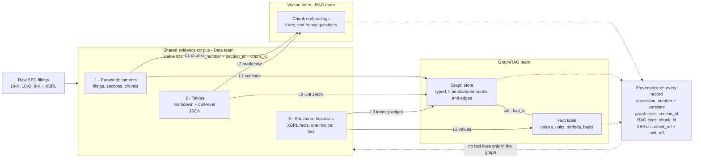

# Data contract — Data → GraphRAG

> Rewritten 2026-10-13 to use one vocabulary end to end. Field names now follow RAG's Retrieval API v0, so a concept has the same name in Data's files, RAG's index, our graph and the Agent's citations. Changes from the 9 Oct version are listed at the bottom.
>
> Ported from Notion, which has used all its free blocks and can no longer be edited. This file is the live version.

**From the GraphRAG team, for Data.** Our extraction work starts next week and we are depending on you.

This is a proposal, not a spec. If any of it conflicts with what RAG needs, say so — we can find another shape. The parts that are genuinely hard to change later are called out.

## 0 · What we are building

A **graph** of companies, subsidiaries, segments, filings and events for multi-hop questions, and a **fact table** of XBRL numbers for numeric and comparative questions. Both cite back to your corpus, so every record we create carries a pointer to one of yours.



## 1 · Exchange format

| Layer | Format | Shape |
|---|---|---|
| 1 · Parsed documents | JSONL | Three record types — one **filing**, its **sections**, their **chunks** · one record per line · one file per filing |
| 2 · Tables | JSONL | One record per table |
| 3 · XBRL facts | Parquet, or CSV / JSONL if easier | One record per **fact**, flat |

**On JSONL** — one JSON record per line, newline-delimited. A 400-chunk filing is a 400-line file. It streams and appends without re-reading the whole thing, and a malformed line fails on its own instead of breaking the file. Not the same as a `.json` file holding one big array.

**Files alongside the database, not instead of it.** The database is the system of record; the files are the interface. Files are versionable, diffable and portable, and we load into our own stores so your build and ours stay uncoupled.

**Why Parquet helps for layer 3.** We query facts with DuckDB, which reads Parquet directly off disk, so Parquet skips a loading step entirely. CSV or JSONL works and we will load it — it just costs us about a week.

## 2 · Record schema

### Which documents get parsed

The diagram says 10-K, 10-Q and 8-K. That covers the narrative and the numbers but leaves two of our node types with nothing behind them.

**Exhibits, and Exhibit 21 in particular.** Subsidiaries of the Registrant is a plain list of subsidiary names and jurisdictions, filed with every 10-K. It is the only place that relationship is stated outright, so it gives us subsidiary edges with no extraction step and nothing to verify afterwards. If parsing stops at the primary document we lose our most reliable edges and have to infer them from prose, badly. That is what `exhibit_type` is for — null for the primary document, `EX-21` and so on for exhibits.

**Officers and directors.** Our schema has an officer node and these three form types barely support it. Names and roles are in DEF 14A, insider transactions in Form 4. If those are out of scope, say so and we will drop officers from schema v1 rather than carry a half-empty node into the demo.

**The three small ones.** `sic`, `state_of_incorp` and `exchange` are free at parse time and are the filters analysts reach for first. Easy to add now, annoying to backfill.

### Layer 1 — three record types

```
FILING    accession_number  ← key, with dashes
          cik · ticker · company_name
          sic · state_of_incorp · exchange
          form · filing_date · reporting_period_end
          fiscal_year · fiscal_period
          amends_accession_number
          extraction_version

SECTION   section_id · accession_number  ← parent
          section · section_path · section_title · exhibit_type
          char_start · char_end · text (the whole section)
          source_url · normalized_doc_id
          extraction_version

CHUNK     chunk_id · section_id  ← parent
          char_start · char_end · text · is_table
          chunking_version · extraction_version
```

**Who reads what:** RAG reads chunks, we read sections, both read the filing record. UI can cite either level, because a chunk always resolves to its section and a section to its filing.

**Why a filing record rather than repeating it on every line.** Those values are constant across a whole file, so the filing record can be the first line of each filing's JSONL. It also gives `amends_accession_number` somewhere to live — the semantics section below says to put it on the filing record, and otherwise there isn't one.

`exhibit_type` sits on the section, not the filing, because an exhibit is a separate document with its own `source_url` and its own offsets. A 10-K and its Ex-21 share an accession number but not a coordinate system.

**If you index this, denormalise at load time rather than in the file.** RAG will want `cik`, `form` and `filing_date` on every vector for pre-filtering — that is a join at index build, not a reason to repeat filing metadata on 400 chunk records.

### Three fields for section, not one

This is the part most likely to be got wrong, and it is worth reading even if the rest is obvious.

Notes are **inside** the Item structure, not outside it. In a 10-Q, Part I Item 1 *is* "Financial Statements", and all twenty-odd notes live within it. So a single Item-level label returns `"Part I Item 1"` for the income statement, the balance sheet and every note alike — technically correct, useless in practice. Segment data lives in those notes, and segments are among the most valuable things in the filing for us.

| Field | Example | Purpose |
|---|---|---|
| `section` | `"Part I Item 1"` | Canonical SEC Item key, with the Part prefix. What RAG filters on. `None` if genuinely unassignable |
| `section_path` | `"Part I Item 1 > Note 16 — Segment Information and Geographic Data"` | Full path to the leaf. Our extraction unit, UI's breadcrumb, Eval's citation |
| `section_title` | `"Segment Information and Geographic Data"` | Human-readable leaf title |

`section_id` identifies the **leaf**, not the Item.

**Note boundaries are already in the markup.** The likely objection is that detecting notes means heuristics over bold headings. It does not — inline XBRL tags note blocks with `ix:continuation` and `ix:nonnumeric` elements, so the boundaries are structural. This is the same inline-XBRL work as the fact offsets below, serving two purposes.

Full reasoning and the open questions in [section-vocabulary.md](./section-vocabulary.md).

### Make sections first-class, and derive chunks from them

Chunks are sized for embeddings, which is RAG's call and not ours to reopen. But we extract *relationships*, and a relationship that straddles a chunk boundary is invisible to us — a subsidiary list split across two chunks yields half an answer, twice.

You already have sections: `section` and `section_path` mean the boundaries are already being detected. **If a boundary is good enough to label a chunk, it is good enough to emit a section.**

Why this helps everyone:

1. **Re-chunking stops breaking citations.** If our graph anchors on `section_id`, changing chunk size in W6 regenerates only chunk records. RAG's own contract says `chunk_id` is stable only while `chunking_version` is unchanged — which is exactly the guarantee we cannot build on.
2. **Nobody writes reassembly logic.** Otherwise we glue chunks back into sections ourselves and have to get the edge cases right.
3. **Sections are what the document actually has.** Chunks are a retrieval parameter. Model the real unit, derive the tunable one.

**What we are not asking for:** not a second chunking, not different chunk sizes, not more parsing work.

**If sections are harder than this sounds** — tell us. Section segmentation is genuinely the tricky part of parsing a 10-K. The fallback is chunks carrying `section_path` plus something we can order on within a section, and we reassemble. That works; it is just more moving parts and it leaves the re-chunking problem in place.

One consequence either way: a relationship spanning several chunks means one of our edges can carry several `chunk_id`s.

### Layer 2 — tables

```json
{
  "table_id": "...",
  "accession_number": "0000320193-23-000106",
  "section_id": "7b21...",
  "section": "Part I Item 1",
  "section_path": "Part I Item 1 > Note 16 — Segment Information and Geographic Data",
  "caption": "Segment operating results (in millions, except per share data)",
  "markdown": "| ... |",
  "cells": [{"row": 3, "col": 2, "raw": "(1,234)", "value": -1234, "is_header": false}],
  "char_start": 201884,
  "char_end": 204120,
  "extraction_version": "..."
}
```

**Financial tables put meaning in the formatting.** `(1,234)` means negative 1,234. A `$` or `%` changes the unit. Scale — "in millions" — usually lives in the caption, not in any cell. Keep the raw string next to the parsed number and keep the caption verbatim; if a cell is parsed to a float and the string discarded, sign convention and scale cannot be recovered.

**`table_id` plus cell coordinates is a provenance shape of its own.** Edges extracted from Exhibit 21 — our highest-confidence edges — come from table cells, not from text spans or XBRL contexts. They need a citable key, and right now the contract has no shape for them. `table_id` + `row` + `col` works. Please carry `section_id` on the table record so a cited cell resolves to a section the way a chunk does.

### Layer 3 — XBRL facts

One row per fact.

| Field | Example | Note |
|---|---|---|
| `fact_id` | hash | Deterministic |
| `accession_number`, `cik`, `form`, `filing_date` | — | Filing identity |
| `concept` | `us-gaap:ResearchAndDevelopmentExpense` | Keep the namespace prefix, not a friendly label |
| `taxonomy_version` | `us-gaap 2023` | Concepts get renamed and retired between years |
| `value_raw` and `value_num` | `"29915000000"`, `29915000000` | Both, same reason as tables |
| `unit_ref` | `iso4217:USD`, `shares`, `pure` | Currency, share counts and ratios are not interchangeable |
| `decimals` | `-6` | Precision as asserted by the filer |
| `context_ref` | `c-14` | Our provenance key for numbers |
| `period_type` | `instant` or `duration` | Balance sheet vs income statement |
| `period_start`, `period_end` | ISO dates | **The fact's period, not the filing's.** Distinct from the filing record's `reporting_period_end` |
| `fiscal_year`, `fiscal_period` | `2023`, `FY` | Fiscal, not calendar |
| `basis` | `as_filed` or `as_restated` | See below |
| `dimensions` | `{"StatementBusinessSegmentsAxis": "AmericasSegmentMember"}` | The one that matters most |
| `is_dimensional` | `true` | Convenience flag |
| `extraction_version` | — | — |

**`basis` is new in this version and we should have asked sooner.** Our evidence envelope carries it, our `FACT` node carries it, and the whole temporal model depends on it — but it was never in this contract. If deriving it from `amends_accession_number` is easier for you than asserting it, say so and we will derive it; we just need to know which.

**Please keep dimensions.** A filing reports revenue once consolidated and again broken out by segment or geography. Those rows share a concept and a period and differ only by dimension. Drop dimensions to flatten the table and we cannot tell a total from a part — summing double-counts, and the answer looks plausible, which is worse than an obvious error. This is the single most common way XBRL pipelines go wrong.

**Which parser are you using?** Some libraries carry dimensions through and some flatten them at parse time. If dimensions are gone when facts are written, no amount of schema agreement gets them back.

**If inline XBRL gives you an offset, keep it.** Filings since roughly 2019 tag numbers inside the primary HTML, so a fact usually has a position in the same text the layer 1 offsets address. A `char_start` / `char_end` on the fact row means a cited number highlights like a cited sentence. Optional — `context_ref` carries provenance either way.

### Identity and versioning

| ID | Where | Why it has to be deterministic |
|---|---|---|
| `section_id` | Layer 1 | **What our graph anchors on.** Survives re-chunking, which `chunk_id` does not |
| `chunk_id` | Layer 1, referenced from layer 2 | Text provenance at span level, and what RAG cites |
| `table_id` | Layer 2 | Provenance for edges extracted from table cells |
| `fact_id` | Layer 3 | Numeric provenance |

**Two version fields, not one.** This mirrors RAG's contract so one concept has one name everywhere:

- `extraction_version` — changes when parsed or normalised text changes. On every record, every layer.
- `chunking_version` — changes when chunk boundaries change. On chunk records.

The split matters because they fail differently. Re-chunking invalidates `chunk_id`s. **Re-normalising invalidates every character offset in the corpus** — a one-line whitespace or entity-decoding change shifts all of them, and nothing currently catches it. If only one version field exists, that second failure is silent.

**Four provenance shapes, not one.** Text that RAG cites is `chunk_id` + `accession_number`. Text that we cite is `section_id` + `accession_number`. Table cells are `table_id` + row + col. XBRL facts are `accession_number` + `context_ref` + `unit_ref`. Specced once, it gets specced for chunks and three of the four end up with a null key.

**`section_id` and `fact_id`: who computes them?** You emit them in this contract; our schema doc also describes hashing our own. Both cannot be canonical. Proposed: yours are canonical and we adopt them verbatim. Confirm, and we will delete our definitions.

## 3 · Semantics — four things to please not do

A format problem surfaces in ten minutes and a schema problem within a day. A semantics problem loads cleanly, queries cleanly, and produces a wrong answer in W8.

1. **Don't reconcile amendments.** When a 10-K/A restates a figure, pass through both the original and the amended fact, with `amends_accession_number` on the filing record. Deciding which wins is our modelling problem and we need both.
2. **Don't rename concepts** to readable labels. We need the taxonomy concept to join across years and companies.
3. **Don't drop dimensional facts** to tidy the table.
4. **Don't renumber IDs** on a re-parse of unchanged content.

## 4 · Delivery

Partition as `extraction_version / cik / accession_number /`, with a **manifest per build**: accession list, record counts, build timestamp, parser version, checksums.

**One thing to keep out.** `gold_set_v0.md` in `Rachel-xs/KPMG_RAG` holds Eval's questions, answers and grading metadata. It must never be indexed into the corpus. Your repo already holds the same MSFT filing, so the risk is live rather than theoretical.

## Open questions

- Which tickers and what years?
- Which form types are in scope — 10-K, 10-Q and 8-K, or more?
- Are exhibits parsed at all, and is Exhibit 21 among them?
- Are DEF 14A or Form 4 in scope, or should we drop officers from the graph?
- Which library are you parsing XBRL with, and does it keep dimensions?
- Is the normalized document text stored and retrievable, or only the chunks?
- **Can layer 1 emit sections as their own records, with chunks pointing at a parent `section_id`?** Our largest single ask.
- Can sections go below Item level, so a note is its own section? See [section-vocabulary.md](./section-vocabulary.md).
- Can you assert `basis` on facts, or should we derive it?
- Can table records carry `section_id`?
- Are `section_id` and `fact_id` yours to define, with ours deleted?
- Where does the corpus live, and how do we read it?

## What changed from the 9 Oct version

Naming now matches RAG's Retrieval API v0 so nobody maps between vocabularies.

| Was | Now |
|---|---|
| `accession` | `accession_number` |
| `form_type` | `form` |
| `filed_date` | `filing_date` |
| `period_end` (filing) | `reporting_period_end` |
| `item` | `section`, plus new `section_path` and `section_title` |
| `amends_accession` | `amends_accession_number` |
| `corpus_version` | `extraction_version` + `chunking_version` |

New asks: `ticker` and `fiscal_year` / `fiscal_period` on the filing record, `is_table` on chunks, `basis` on facts, `section_id` on tables, sub-Item sections, and a provenance shape for table cells.
