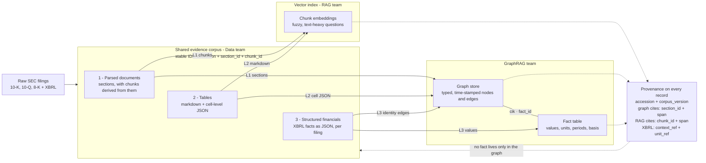

# Data contract — Data → GraphRAG

> Ported from Notion on 2026-10-13. The Columbia Notion workspace has used all its free blocks and can no longer take new content, so this repo is now the editable home for our contracts. The Notion page remains readable but should be treated as a snapshot.

**From the GraphRAG team, for Data.** Our extraction work starts next week and we are depending on you.

This is a proposal, not a spec. If any of it conflicts with what RAG needs, say so — we can find another shape. The parts that are genuinely hard to change later are called out.

**What we are asking for, and when**
- Agreement on the fields and formats below by **Fri 9 Oct**
- Two or three filings in the final format by **Mon 12 Oct**, so we can start extraction
- Answers to the open questions at the bottom whenever you have them

## 0 · What we are building

The Graph team builds two things from your corpus. A **graph** of companies, subsidiaries, segments, filings and events for multi-hop questions, and a **fact table** of XBRL numbers for numeric and comparative questions. Both cite back to your corpus, so every record we create carries a pointer to one of yours.



## 1 · Exchange format

| Layer | Format | Shape |
|---|---|---|
| 1 · Parsed documents | JSONL | Three record types — one **filing**, its **sections**, their **chunks** · one record per line · one file per filing |
| 2 · Tables | JSONL | One record per table |
| 3 · XBRL facts | Parquet, or CSV / JSONL if easier | One record per **fact**, flat |

**On JSONL** — one JSON record per line, newline-delimited. A 400-chunk filing is a 400-line file. It streams and appends without re-reading the whole thing, and a malformed line fails on its own instead of breaking the file. Not the same as a `.json` file holding one big array.

**Files alongside the database, not instead of it.** The database is the system of record; the files are the interface. Files are versionable, diffable and portable, and we load into our own stores so your build and ours stay uncoupled.

**Why Parquet helps for layer 3.** We query facts with DuckDB, which reads Parquet directly off disk, so Parquet skips a loading step entirely. CSV or JSONL works and we will load it — it just costs us about a week.

## 2 · Record schema

### Which documents get parsed

The diagram says 10-K, 10-Q and 8-K. That covers the narrative and the numbers but leaves two of our node types with nothing behind them.

**Exhibits, and Exhibit 21 in particular.** Subsidiaries of the Registrant is a plain list of subsidiary names and jurisdictions, filed with every 10-K. It is the only place that relationship is stated outright, so it gives us subsidiary edges with no extraction step and nothing to verify afterwards. If parsing stops at the primary document we lose our most reliable edges and have to infer them from prose, badly. That is what `exhibit_type` is for — null for the primary document, `EX-21` and so on for exhibits.

**Officers and directors.** Our schema has an officer node and these three form types barely support it. Names and roles are in DEF 14A, insider transactions in Form 4. If those are out of scope, say so and we will drop officers from schema v1 rather than carry a half-empty node into the demo.

**The three small ones.** `sic`, `state_of_incorp` and `exchange` are free at parse time and are the filters analysts reach for first. Easy to add now, annoying to backfill.

### Layer 1 — three record types

```
FILING    accession  ← key
          cik · company_name · sic · state_of_incorp · exchange
          form_type · filed_date · period_end
          amends_accession · corpus_version

SECTION   section_id · accession  ← parent
          item · section_path · exhibit_type
          char_start · char_end · text (the whole section)
          source_url · normalized_doc_id · corpus_version

CHUNK     chunk_id · section_id  ← parent
          char_start · char_end · text · corpus_version
```

**Who reads what:** RAG reads chunks, we read sections, both read the filing record. UI can cite either level, because a chunk always resolves to its section and a section to its filing.

**Why a filing record rather than repeating it on every line.** Those values are constant across a whole file, so the filing record can be the first line of each filing's JSONL. It also gives `amends_accession` somewhere to live — the semantics section below already says to put it "on the filing record", and until now there wasn't one.

`exhibit_type` sits on the section, not the filing, because an exhibit is a separate document with its own `source_url` and its own offsets. A 10-K and its Ex-21 share an accession but not a coordinate system.

**If you index this, denormalise at load time rather than in the file.** RAG will want `cik`, `form_type` and `filed_date` on every vector for pre-filtering — that is a join at index build, not a reason to repeat filing metadata on 400 chunk records.

### Make sections first-class, and derive chunks from them

Chunks are sized for embeddings, which is RAG's call and not ours to reopen. But we extract *relationships*, and a relationship that straddles a chunk boundary is invisible to us — a subsidiary list split across two chunks yields half an answer, twice.

You already have sections: `item` and `section_path` mean section boundaries are already being detected. **If a boundary is good enough to label a chunk, it is good enough to emit a section.**

Why this helps everyone:

1. **Re-chunking stops breaking citations.** If our graph anchors on `section_id`, changing chunk size in W6 regenerates only chunk records. Our provenance survives untouched instead of every pointer going stale.
2. **Nobody writes reassembly logic.** Otherwise we glue chunks back into sections ourselves and have to get the edge cases right.
3. **Sections are what the document actually has.** A 10-K has Items; chunks are a retrieval parameter. Model the real unit, derive the tunable one.

**What we are not asking for:** not a second chunking, not different chunk sizes, not more parsing work.

**If sections are harder than this sounds** — tell us. Section segmentation is genuinely the tricky part of parsing a 10-K. The fallback is chunks carrying `section_path` plus something we can order on within a section, and we reassemble. That works; it is just more moving parts and it leaves the re-chunking problem in place.

One consequence either way: a relationship spanning several chunks means one of our edges can carry several `source_chunk_id`s.

### Layer 2 — tables

```json
{
  "table_id": "...",
  "accession": "...",
  "item": "Item 8",
  "caption": "Segment operating results (in millions, except per share data)",
  "markdown": "| ... |",
  "cells": [{"row": 3, "col": 2, "raw": "(1,234)", "value": -1234, "is_header": false}],
  "char_start": 201884,
  "char_end": 204120
}
```

**Financial tables put meaning in the formatting.** `(1,234)` means negative 1,234. A `$` or `%` changes the unit. Scale — "in millions" — usually lives in the caption, not in any cell. Keep the raw string next to the parsed number and keep the caption verbatim; if a cell is parsed to a float and the string discarded, sign convention and scale cannot be recovered.

### Layer 3 — XBRL facts

One row per fact.

| Field | Example | Note |
|---|---|---|
| `fact_id` | hash | Deterministic |
| `accession`, `cik`, `form_type`, `filed_date` | — | Filing identity |
| `concept` | `us-gaap:ResearchAndDevelopmentExpense` | Keep the namespace prefix, not a friendly label |
| `taxonomy_version` | `us-gaap 2023` | Concepts get renamed and retired between years |
| `value_raw` and `value_num` | `"29915000000"`, `29915000000` | Both, same reason as tables |
| `unit_ref` | `iso4217:USD`, `shares`, `pure` | Currency, share counts and ratios are not interchangeable |
| `decimals` | `-6` | Precision as asserted by the filer |
| `context_ref` | `c-14` | Our provenance key for numbers |
| `period_type` | `instant` or `duration` | Balance sheet vs income statement |
| `period_start`, `period_end` | ISO dates | — |
| `fiscal_year`, `fiscal_period` | `2023`, `FY` | Fiscal, not calendar |
| `dimensions` | `{"StatementBusinessSegmentsAxis": "AmericasSegmentMember"}` | The one that matters most |
| `is_dimensional` | `true` | Convenience flag |
| `corpus_version` | `2026-10-12.1` | — |

**Please keep dimensions.** A filing reports revenue once consolidated and again broken out by segment or geography. Those rows share a concept and a period and differ only by dimension. Drop dimensions to flatten the table and we cannot tell a total from a part — summing double-counts, and the answer looks plausible, which is worse than an obvious error. This is the single most common way XBRL pipelines go wrong.

**Which parser are you using?** Some libraries carry dimensions through and some flatten them at parse time. If dimensions are gone when facts are written, no amount of schema agreement gets them back.

**If inline XBRL gives you an offset, keep it.** Filings since roughly 2019 tag numbers inside the primary HTML, so a fact usually has a position in the same text the layer 1 offsets address. A `char_start` / `char_end` on the fact row means a cited number highlights like a cited sentence. Optional — `context_ref` carries provenance either way.

### Identity and versioning

| ID | Where | Why it has to be deterministic |
|---|---|---|
| `section_id` | Layer 1 | **What our graph anchors on.** Survives re-chunking, which `chunk_id` does not |
| `chunk_id` | Layer 1, referenced from layer 2 | Text provenance at span level, and what RAG cites |
| `fact_id` | Layer 3 | Numeric provenance |
| `corpus_version` | Every record, every layer | Tells us whether a pointer we hold is still valid |

**Two provenance shapes, not one.** Text is `chunk_id` + `accession` + offsets. XBRL facts are `accession` + `context_ref` + `unit_ref`, with no `chunk_id`, because a fact is not in a text chunk. Specced once, it gets specced for text and the numeric arm ends up with a null key and no agreed substitute.

**Versioning.** Your plan runs refinement of extraction, cleaning, chunking and metadata from W6 to W9. The moment chunking changes, every pointer built in W5 goes stale. If sections are first-class this largely goes away — we anchor on `section_id` and chunk records regenerate underneath. If we end up chunk-only, we need either chunk IDs stable across re-parses or a versioned corpus.

## 3 · Semantics — four things to please not do

A format problem surfaces in ten minutes and a schema problem within a day. A semantics problem loads cleanly, queries cleanly, and produces a wrong answer in W8.

1. **Don't reconcile amendments.** When a 10-K/A restates a figure, pass through both the original and the amended fact, with `amends_accession` on the filing record. Deciding which wins is our modelling problem and we need both.
2. **Don't rename concepts** to readable labels. We need the taxonomy concept to join across years and companies.
3. **Don't drop dimensional facts** to tidy the table.
4. **Don't renumber IDs** on a re-parse of unchanged content.

## 4 · Delivery

Partition as `corpus_version / cik / accession /`, with a **manifest per corpus version**: accession list, record counts, build timestamp, parser version, checksums.

## Open questions

- Which tickers and what years?
- Which form types are in scope — 10-K, 10-Q and 8-K, or more?
- Are exhibits parsed at all, and is Exhibit 21 among them?
- Are DEF 14A or Form 4 in scope, or should we drop officers from the graph?
- Which library are you parsing XBRL with?
- Is the normalized document text stored and retrievable, or only the chunks?
- **Can layer 1 emit sections as their own records, with chunks pointing at a parent `section_id`?** Our largest single ask.
- If sections are in, should layer 2 tables carry `section_id` as well as `item`?
- Can chunk IDs be made deterministic, or should we plan for corpus versioning?
- Where does the corpus live, and how do we read it?

## Known gaps in this contract

Found 2026-10-13, not yet raised with Data:

- **`basis` is never requested.** The evidence envelope carries it, `FACT` carries it and the temporal model depends on it, but Layer 3 has no `basis` field. Either ask for it or state that we derive it from `amends_accession`.
- **Table-derived edges have no provenance shape.** The shapes cover section text, chunk text and XBRL. Nothing covers `table_id` plus cell coordinates — which is how Ex-21 subsidiary edges arrive.
- **Notes are not Items.** A 10-Q puts segment data in "Note 16", not an Item. Section segmentation must cover Parts, Items *and* Notes; `item` should be nullable with `section_path` required.
- **Benchmark leakage.** `gold_set_v0.md` must never be indexed into the corpus. Data's repo already holds the same MSFT filing.
