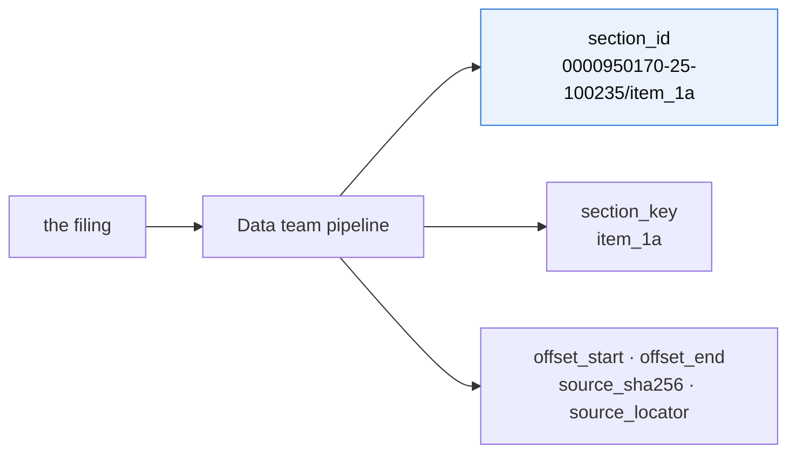
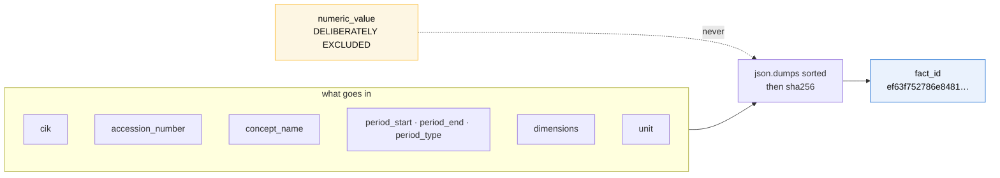
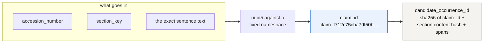
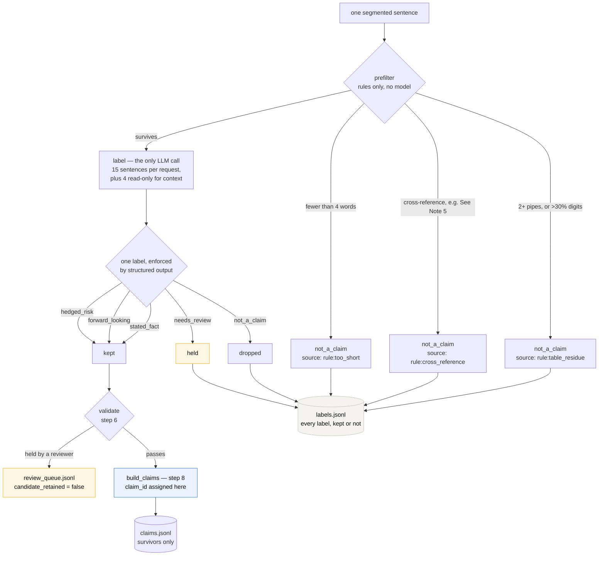
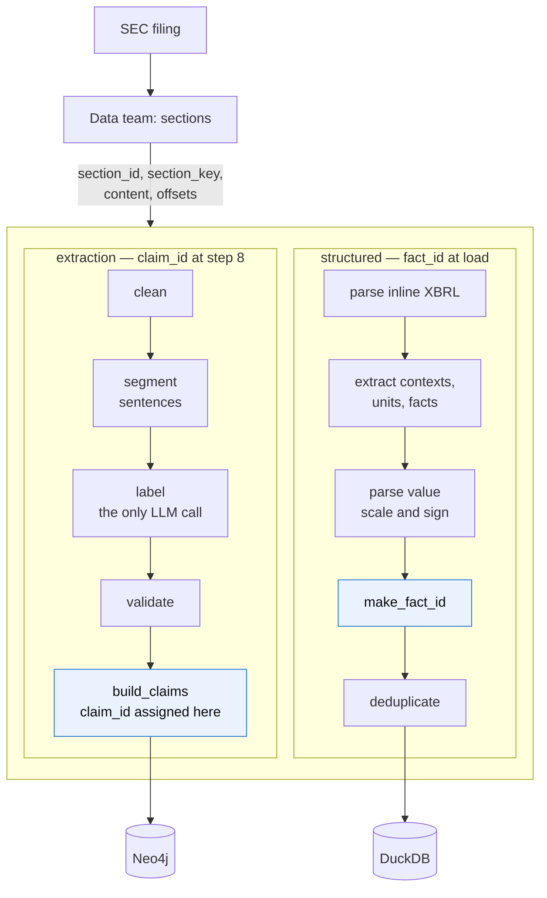
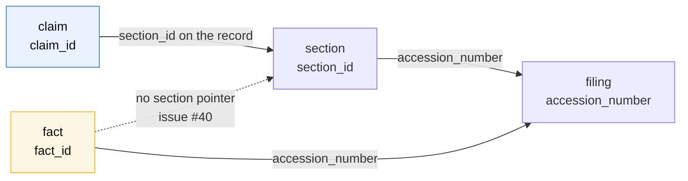

# Identity keys — where each one comes from, and what still needs reconciling

Written 2026-10-30, for Platform. [schema-ids-operations.md](./schema-ids-operations.md)
is the canonical decision record; this document says what the **code** currently does, where
it differs from that record, and what has to be settled before the stores are rebuilt
automatically.

Everything below was read from the code on `main` and from the open extraction branch, not
from the design documents.

## Why identity is the thing to get right

An ID is how two parts of the system agree they are talking about the same thing. Three
separate jobs depend on it, and they fail differently.

**Loading twice must not double the graph.** `MERGE` on a deterministic key means re-running
a filing updates a node instead of adding a second one. Without it, every prompt fix doubles
the graph and the W9 scale-up becomes a rebuild rather than an append.

**Two stores must join.** A question like "what did this segment earn, and which subsidiaries
report under it" needs the graph and the fact table to agree on what a company is.
`schema-ids-operations.md` puts it plainly: *`cik` and `fact_id` must mean the same thing in
Neo4j and DuckDB or the two arms cannot be combined in one answer.*

**Other teams keep our IDs.** Eval scores answers by joining on the provenance key. If our
IDs change when we rebuild, their benchmark does not error — our evidence simply scores as
missing. We look wrong rather than broken, which is harder to notice.

The failure mode shared by all three is that **nothing complains**. An ID is a string. A
changed string is still a valid string.

## What we already know changes

The fact database shared on 28 Oct was built with an older version of the loader now on
`main`. Its `dimensions` lack a `"type": "explicit"` key that the current code emits, so the
hashes differ: **792 of its 1,429 `fact_id`s cannot be reproduced from the committed code.**

Nothing was wrong with the data. The code moved on and the file did not. This is the concrete
argument for building the stores in CI rather than passing files around.

## Where each ID comes from

### `fact_id` — ours, computed at load time

`structured/fact_loader_v1.py:make_fact_id()`. A SHA-256 over eight fields:

```
cik · accession_number · concept_name · period_start · period_end
period_type · dimensions · unit
```

**The value is deliberately excluded.** That is correct and load-bearing: when a company
restates a figure, the fact keeps its ID, so the original and the restatement can be compared.
A fact ID containing the value would give a restated number a different ID and make
supersession unimplementable. There is a dead `generate_fact_id()` in the same file that keys
on `numeric_value`; it is unused and should be deleted before someone calls it.

### `claim_id` — ours, computed after labelling

`extraction_pipeline/src/build_claims.py` (PR #35, open). A UUID5 against a fixed namespace:

```
uuid5(NAMESPACE, "<accession_number>|<section_key>|<exact sentence text>")
```

**The full sentence text is in the key.** The same sentence twice in one section shares a
`claim_id`; the same sentence in another filing is a different Claim. A second ID,
`candidate_occurrence_id`, is a SHA-256 of `[claim_id, section content hash, raw_spans]` and
identifies *the place*. Step 8 merges occurrences sharing a `claim_id` into one node — which
is where "2,420 distinct Claims from 2,433 occurrences" comes from.

Claims are produced only for sentences the labeller marks `stated_fact`, `forward_looking` or
`hedged_risk`. Sentences marked `not_a_claim` or `needs_review`, or held in validation, get no
`claim_id`.

They are **not lost**. Every sentence is in `sentences.jsonl` and every label is in
`labels.jsonl`, including the dropped ones, and a prefiltered unit records which rule fired
(`{"label": "not_a_claim", "source": "rule:table_residue"}`). Units held for a person are in
`review_queue.jsonl` with a `candidate_retained` flag. So "what was dropped and why" is a join
of two files, not a gap — `claims.jsonl` is the filtered view, not the only record.

### `section_id` — the Data team's

Supplied in their section export alongside `section_key`, `accession_number`, `content`,
`offset_start`/`offset_end`, `source_sha256` and `source_locator`. We do not derive it. The
schema record is explicit that we adopt their natural keys rather than hashing our own.

### `entity_id` — three different mechanisms today

| Whose | Where | How it decides |
| --- | --- | --- |
| Alison | `graphrag/entity_resolution.py` | returns `match`, `no_match` or `ambiguous`; refuses to merge without evidence. The only one measured — precision 1.000, recall 0.789 with Exhibit 21 provenance |
| Alina | `extraction_pipeline/src/ex21/normalize.py` (`entity_key`) | strips legal suffixes and merges on the remaining core; stored on each Subsidiary node to spot renames across years |
| Kelly | `extraction_pipeline/src/entity_annotation.py` | exact normalised name or alias against its own `entity_catalog.json`, scoped to `issuer_cik` + accession |

All three are conservative and there are **no bad merges in the current corpus**. This is a
design decision to take deliberately, not a live defect.

## The three, side by side — one filing

All from Microsoft's FY2025 10-K, accession `0000950170-25-100235`.

**Section** — the Data team's, adopted whole:

```
section_id   0000950170-25-100235/item_1a
```

**Claim** — ours, computed at step 8 after labelling:

```
claim_id     claim_f712c75cba79f50b1adfae94
section_id   0000950170-25-100235/item_1a        <- carried on the record
claim_type   hedged_risk
quote        "We face intense competition across all markets for our products..."
```

**Fact** — ours, computed at load:

```
fact_id      ef63f752786e8481b12c27dfde2fcab277811dff181af51d766ccfccf8238c7b
accession    0000950170-25-100235
context_ref  C_e75f57b2-2610-48a5-87ed-6f45e6d2b334   <- an XBRL context, not a section
concept      us-gaap:RevenueFromContractWithCustomerExcludingAssessedTax
```

### Their shapes

| | form | built from |
| --- | --- | --- |
| `section_id` | `<accession>/<section_key>` — readable, not hashed | Data |
| `claim_id` | UUID5 against a fixed namespace | `accession` + `section_key` + the exact sentence |
| `fact_id` | SHA-256, 64 hex characters | cik, accession, concept, period start/end/type, dimensions, unit |

`section_id` is the only one you can read. Both of ours are one-way: the inputs cannot be
recovered from the hash, so a record has to carry its own pointers.

### Only one of them can be traced back to a section

**A claim can.** Its `section_id` is a field on the record, and `section_key` is also one of
the three inputs to the hash. So a claim always knows which section it came from, and
`quote` plus the source fragments locate it within that section. This is why retrieval cites
a claim's `section_id` and never its `claim_id` — the claim ID answers "is this the same
statement", not "where did it come from".

**A fact cannot.** `financial_facts_v1` has no `section_id`, no `section_key`, no offsets and
no `source_locator`. A fact is traceable to its **filing** and no further. `context_ref`
points at an XBRL context inside the document — the period and dimensions a number applies
to — which is not a section of the report.

In practice that means the two arms cite at different resolutions:

- graph arm → this filing, **this section**, this sentence
- structured arm → this filing, this concept, this period

Both satisfy the contract, because `section_id` and `metadata.fact_id` are each valid
provenance keys. But an answer that mixes the two cannot say where in the document the number
sits, and a question like "show me the paragraph this figure came from" cannot be answered
from the fact table today.

**To settle:** decide whether a fact needs a section pointer. Inline XBRL carries enough to
derive one — the tagged element has a position in the document — so this is a loading
decision rather than a missing-source problem.

## The mock returns values other teams cannot read safely

`mock/mock_retrieval_tools.py` is what Agents and Eval build against until the real tools are
registered, and three defects in it were found by Eval running it through their harness, not
by us. All three are confirmed:

- **`value_num` is in millions while nothing says so.** The mock returns `value_num: 34681`
  with **no `unit` key at all**; only the free-text `text` field mentions "million". A
  consumer reads thirty-four thousand dollars for a thirty-four billion dollar figure. The
  real loader gets this right — it stores `raw_value "106,265"`, `scale 6`, `unit "USD"` and
  `numeric_value 106265000000` — so the mock is less correct than the thing it stands in for.
- **Segments are human labels, not XBRL members.** `"segment": "Intelligent Cloud"` where the
  filing tags `msft:IntelligentCloudMember`.
- **Two rows share one `section_id`** (`sec-msft-26q3-note16`), so a consumer deduplicating on
  the provenance key loses one of them.

A mock that is wrong in ways the real system is right teaches other teams the wrong shape.
Worth fixing before the thin demo, since it is what the Agents router is coded against.

## How each one is derived

Three different shapes, drawn the same way so they can be compared. Boxes on the left are
inputs; the amber box is what is deliberately **left out**.

### `section_id` — adopted, not derived



We take it whole. No hash, readable by eye, and `schema-ids-operations.md` is explicit that
we adopt Data's natural keys rather than inventing our own.

### `fact_id` — SHA-256 over identity, never the value



Excluding the value is the load-bearing decision. A restated figure keeps its ID, so a 10-K
and its 10-K/A can be compared for the same concept and period — which is what `basis` is
for. A dead `generate_fact_id()` in the same file does include the value; it is unused and
should be deleted before anyone calls it.

Note what is **not** an input: nothing locates the fact in the document. See the traceability
section above.

### `claim_id` — UUID5 over the sentence itself



The text is in the key, so the same sentence twice in one section is one Claim with two
occurrences — that is where "2,420 distinct Claims from 2,433 occurrences" comes from. It
also means any change to cleaning or sentence-splitting changes every ID.

### How a sentence becomes a claim, or does not

`claim_id` is assigned at step 8, so what the labeller decides at step 5 is what decides
whether a sentence gets an identity at all.



Nothing is discarded. `claims.jsonl` is the filtered view; `sentences.jsonl` and
`labels.jsonl` hold every unit and every verdict, so "what was dropped and why" is a join.

**What the model returns per sentence**, enforced by a structured-output schema so the label
can only be one of five:

| field | what it carries |
| --- | --- |
| `label` | `stated_fact` · `forward_looking` · `hedged_risk` · `not_a_claim` · `needs_review` |
| `context_ids` | earlier sentences a reader needs to understand this one |
| `subject_scope` | what the statement is about when it is not the company |
| `annotation_note` | mixed content or ambiguity worth recording |
| `is_risk_heading` | Item 1A only: is this the sentence that names a risk |
| `entity_mentions` | segments and subsidiaries named, as exact substrings of the sentence |

The three claim types are an ontology decision (2.3). The other two are pipeline-only:
`not_a_claim` means "this is not a statement", `needs_review` means "it might be and I could
not tell". The second is an admission of uncertainty rather than a verdict, which is why it
is held for a person rather than dropped.

### Where each sits in its pipeline



The important asymmetry is visible here: `claim_id` is assigned **after** the model has
judged the sentence, so only surviving sentences get one. `fact_id` is assigned **before**
deduplication, so every raw fact has one and duplicates are reconciled afterwards.

### What can be traced back to what



A claim reaches a section and therefore a filing. A fact reaches only its filing. The dotted
edge is the gap.

## Three places the code and the decision record disagree

These are the reconciliation items. None is a bug today; all three bite when a second filing
or a second store arrives.

### 1 · `fact_id` is derived, and the record says not to derive it

`schema-ids-operations.md` says *"We adopt Data's natural keys rather than hashing our own …
Earlier versions defined competing hashes for `section_id` and `fact_id`; those are gone."*
It lists `Fact` under **adopted from Data — do not re-derive**:

```
Fact    source_document_id + extraction_version + occurrence_key
```

The loader on `main` hashes eight fields of its own and uses **none** of those three. A third
shape appears in the provenance table of the same document: `accession_number` · `context_ref`
· `unit_ref`.

So there are three definitions of `fact_id` in play. The loader's is a reasonable key — it is
identity-not-value, which is the property that matters — but it is not the one the record
specifies, and the cross-store join clause depends on a single meaning.

**To settle:** pick one and make the other two documents say it. If the loader's wins, revise
the record and note why re-deriving was correct here.

### 2 · `fact_id` and `claim_id` follow opposite rules

| | in the key | so a changed value… |
| --- | --- | --- |
| `fact_id` | identity only, **value excluded** | keeps its ID; restatements comparable |
| `claim_id` | **the full sentence text** | is a different Claim |

Both are defensible — a fact has an identity apart from its value, a sentence arguably does
not. They are different rules living in one graph and **nothing writes down that they
differ**, so someone will eventually assume one behaves like the other.

**To settle:** state both rules in one place, with the reason for each.

### 3 · Version fields exist but nothing compares them

Every record already carries its version: `claim_identity_version:
"exact_source_sentence_v1"`, `SEGMENTATION_VERSION`, `extraction_version`, `index_version`.
Eval keys reruns on all three version fields, which is exactly right.

Nothing on our side compares them. The 28 Oct drift was found by diffing two databases by
hand, not by a check.

**To settle:** on load, record the versions that produced the store, and fail or warn when a
store is read whose versions differ from the running code.

## What Platform can do about it

**Build both stores in CI, from the filing.** The fact store is two commands and about two
seconds:

```bash
export SEC_USER_AGENT="Name email"
curl -H "User-Agent: $SEC_USER_AGENT" \
  https://www.sec.gov/Archives/edgar/data/789019/000095017025100235/msft-20250630.htm \
  -o msft-10k.htm
python3 structured/fact_loader_v1.py --html msft-10k.htm \
  --cik 0000789019 --ticker MSFT --accession 0000950170-25-100235 \
  --output msft_financial_facts_v1.duckdb
```

Expect 1,551 raw facts, 1,429 canonical, 2 held for review. If those three numbers move, the
loader changed and every downstream ID moved with it.

**Make ID drift visible.** A build that prints the count of IDs unchanged since the previous
build turns a silent failure into a line of output. The check that found the 28 Oct drift is
four lines of SQL over two databases.

**Keep `.duckdb` and Neo4j dumps out of the repository.** A shared binary is a copy of the
code's output frozen at a moment nobody recorded. One was committed by mistake on 29 Oct and
removed again; `.gitignore` now covers it.

## Open questions, for whoever picks this up

- Which `fact_id` definition is canonical — the loader's, the adopted-from-Data one, or the
  provenance table's?
- Does `claim_id` need to survive a change to sentence segmentation? If yes, the text cannot
  be in the key and it needs a stable anchor such as section plus character offsets.
- Should a store record the code versions that built it, and should a mismatch warn or fail?
- Do we keep three entity-resolution mechanisms, or route all three through the measured one?
- Should a fact carry a section pointer, so both arms can cite at the same resolution?
