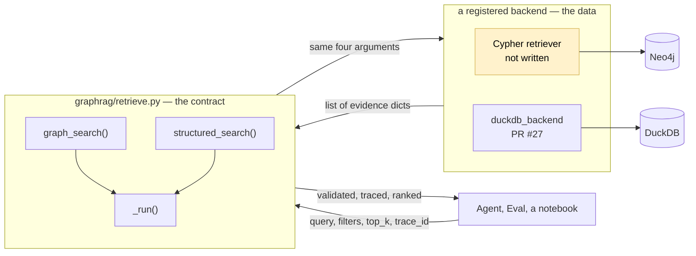
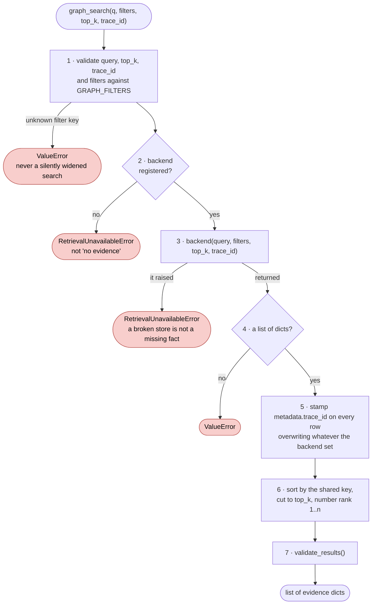
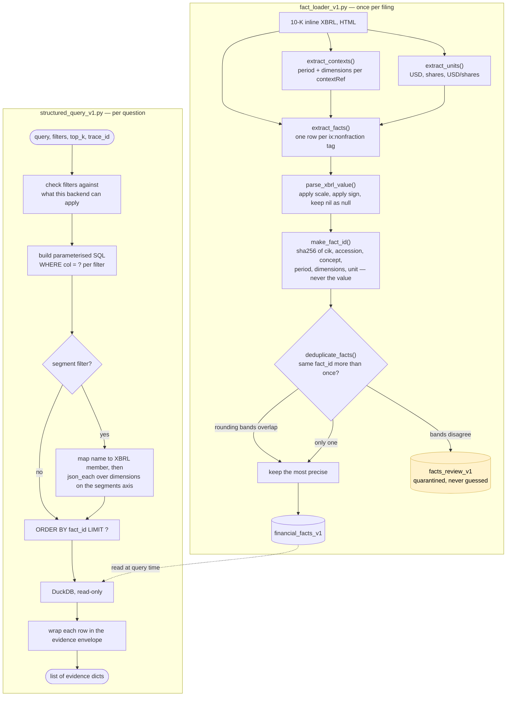

# How retrieval works, file by file

Written 2026-10-28, for anyone reading the retrieval code for the first time.
[architecture.md §3a](./architecture.md) shows where these pieces sit in the whole
pipeline; this document is the inside of two of those boxes.

Everything below was checked by running it, not by reading it. Where a number appears, it
came from a real query against a real database.

## The one idea

**Retrieval is split in two, and the seam is a function you register.**

The public tools enforce the contract and know nothing about any database. A backend
knows one database and nothing about the contract. Neither can do the other's job, and
that is the point — swapping the backend keeps every contract guarantee, which is what
turns comparing five retriever arms into a loop rather than five rewrites.



The contract between them is one line, `retrieve.py:22`:

```python
Backend = Callable[[str, dict, int, str | None], list[dict[str, Any]]]
```

Take those four arguments positionally, return a list of evidence dicts. Anything that
does is a backend.

---

## Alison's half — `graphrag/retrieve.py`

130 lines, no SQL, no Cypher, no connection string. Both public tools are fourteen lines
each and differ only in which slot they read and which filter keys they allow.



Steps 5, 6 and 7 are the reason the wrapper exists. **No backend can forget to do them.**
Five retriever arms written by five people still produce identically shaped, identically
ordered, identically traced results.

Two guarantees worth reading twice, because they are the ones that make scoring possible
later:

**An empty list and an exception mean different things.** `[]` is a real answer — we
looked and found nothing. An exception means retrieval is unavailable. A backend that
throws is re-raised as unavailable rather than flattened into `[]`, so a database being
down can never read as a fact being absent.

**Nothing falls back to mock data.** With no backend registered, every call raises. That
is deliberate: a tool that quietly serves fixture rows when the real store is missing is
worse than one that fails.

---

## Ashley's half — `structured/`

Two files, and they run at different times. The loader runs once per filing. The query
layer runs per question.



### What the loader is really doing

Three things in that diagram are subtler than they look, and all three are correct.

**`parse_xbrl_value()` is not a number parser.** A filing tags "2,451" with `scale="6"`,
meaning 2.451 billion, and often tags a negative as a positive with `sign="-"`. Both are
applied here, using `Decimal` rather than float so nothing drifts. A nil fact stays null
instead of becoming zero.

**`make_fact_id()` deliberately excludes the value.** It hashes cik, accession, concept,
period, period type, dimensions and unit — identity, not content. That is what makes
supersession possible: the same concept and period in a 10-K and its 10-K/A can be
matched and compared. A fact ID that included the value would give a restated figure a
different ID, and the comparison could never be made.

**Deduplication reconciles precision rather than picking.** The same number often appears
twice in one filing — once in a table rounded to millions, once in the text. The loader
turns `decimals` into a tolerance band (`decimals="-6"` means plus or minus 500,000),
checks whether all the bands overlap, and keeps the most precise if they do. **If they do
not overlap it keeps neither** and sends both to `facts_review_v1`.

On the MSFT FY2025 10-K that is 1,551 raw facts, 1,429 canonical, and **2 quarantined** —
a `us-gaap:CommercialPaper` pair where one copy reads `0` and the other reads `no`. One
of those is not a number, so the bands cannot be compared and neither is trusted. That is
the behaviour working.

### What the query layer is really doing

**The segment filter is the interesting part.** An XBRL fact can carry dimensions — axis
and member pairs that slice it. Revenue exists at company level *and* once per segment,
same concept, same period. So the filter maps `"Intelligent Cloud"` to
`msft:IntelligentCloudMember` and runs a `json_each` existence check against
`us-gaap:StatementBusinessSegmentsAxis`. It is asking *does this fact carry that member
on that axis*, not matching a label. Without it, summing results would add segment
revenue to the consolidated total.

**`ORDER BY fact_id` is the tie-break, not a ranking.** Every row scores `1.0`, because an
exact SQL match is not more or less relevant than another exact match. Everything ties, so
the order has to come from somewhere stable, and `fact_id` ascending is it.

---

## How to read an envelope builder

A useful habit, and the fastest way to find this class of bug.

For every field in the returned dict, ask: **does this come from the data, or did someone
type it?** Anything typed is an assumption with a shelf life.

In `structured_query_v1.py:92`, six fields are literals — `company_name`,
`reporting_period_end`, `form`, and three nulls — while `ticker`, `cik` and
`accession_number` three lines below are read from the row. Running one real query shows
what that costs:

```
reporting_period_end   2025-06-30     ← typed
metadata.period_end    2023-06-30     ← from the row
```

The same row says two different things, and nothing catches it: `validate_results()`
checks the envelope's shape, not whether its fields agree with each other. With one
company and one filing those literals were true. They stop being true the moment a second
filing lands, and they fail quietly rather than loudly.

## Running it yourself

```bash
pip install duckdb pandas

MSFT_FACT_DB_PATH=/path/to/msft_financial_facts_v1.duckdb python3 - <<'PY'
import sys; sys.path.insert(0, "structured")
from structured_query_v1 import structured_search
rows = structured_search(
    "Intelligent Cloud revenue",
    filters={"segment": "Intelligent Cloud",
             "concept": "us-gaap:RevenueFromContractWithCustomerExcludingAssessedTax"},
    top_k=3, trace_id="q-1")
for r in rows:
    print(r["rank"], r["metadata"]["period_end"], r["metadata"]["value_num"], r["unit"] if "unit" in r else "")
PY
```

The database file is not in the repository. Until it is reproducible in CI, reviewing this
code means reading it rather than running it — which is how the envelope mismatch above
survived review.
