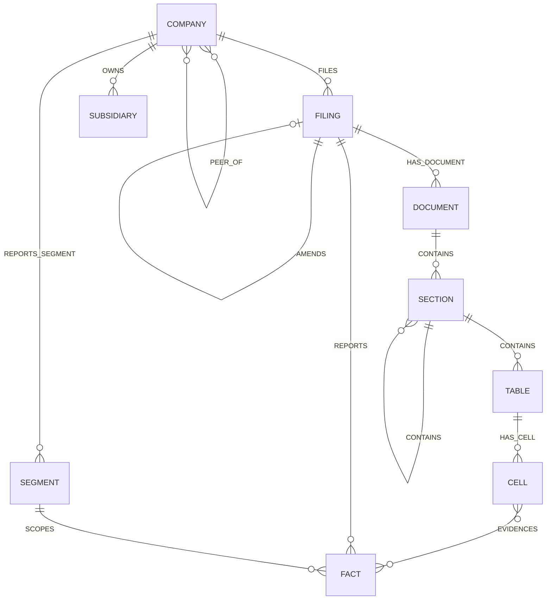

# Schema, IDs, operations and contracts

> **Canonical** for schema, IDs, operations and question routing. The Notion page of the same name is an archive as of 2026-10-14 and should not be cited — its tables froze at 6 Oct while its prose kept moving.

Three layers, deliberately separate. Merging them is the most common way a knowledge graph gets bloated.

**Ontology** — what exists in the filings. **Operations** — what we can ask of it. **Question types** — how a question routes to a tool. Comparisons, percentages and growth rates belong in the second layer, not the first.

## Layer 0 · Where things live, and how they are keyed

### Two stores, two jobs

| Store | Holds | Does not hold |
|---|---|---|
| **Neo4j** | Entities and relationships — Company, Filing, Section, Subsidiary, Segment, and the edges between them | Numbers |
| **DuckDB** | XBRL facts — concept, value, unit, period, basis, dimensions | Relationships |

They join on `cik` and `fact_id`. The graph stores `(COMPANY {cik})-[:REPORTS]->(FACT {fact_id})` — a pointer. The value lives in DuckDB.

### Deterministic keys

Revised 2026-10-13 after reading Data's migrations. **We adopt Data's natural keys rather than hashing our own.** Their primary keys are `gen_random_uuid()`, but every table carries a natural key underneath — `accession_number`, `section_key`, `cell_key`, `occurrence_key` — and those are what we anchor on. Earlier versions defined competing hashes for `section_id` and `fact_id`; those are gone. Only the keys we genuinely own are still derived here.

```
# adopted from Data - do not re-derive
COMPANY      cik
FILING       accession_number
DOCUMENT     accession_number + role          # primary doc, EX-21, EX-99 ...
SECTION      accession_number + section_key   # any level: Item, or a note inside one
TABLE        accession_number + table_key
CELL         table_key + cell_key             # row and column within a table
FACT         source_document_id + extraction_version + occurrence_key

# ours, because Data does not model them
SEGMENT      hash(cik + normalised_name)
SUBSIDIARY   hash(parent_cik + normalised_name)
EDGE         hash(source_key + type + target_key + source_section_id)
```

**Idempotent loading.** `MERGE` on a deterministic key means loading the same filing twice yields one node, not two. Without it every prompt fix or re-run doubles the graph, and the W9 scale-up becomes a rebuild instead of an append.

This is why the `EDGE` key hashes `source_section_id` and **not** `source_chunk_id`. Chunk IDs change whenever Data re-chunks in W6 to W9, so a chunk-keyed edge gets a new key on every re-parse and the same relationship, extracted from the same unchanged sentence, `MERGE`s as a second edge. Section IDs do not move, so the key holds. Keep `source_chunk_id` on the edge as an attribute for span-level citation — just never in the key.

**Cross-store joins.** `cik` and `fact_id` must mean the same thing in Neo4j and DuckDB or the two arms cannot be combined in one answer.

**Provenance.** A key derived from accession and offsets *is* the pointer back to the corpus.

### Three provenance key shapes

Field names follow RAG's Retrieval API v0 as of 2026-10-13.

| For | Key |
|---|---|
| Text, graph arm | `section_id` · `accession_number`. Survives re-chunking, which `chunk_id` does not |
| Text, RAG | `chunk_id` · `accession_number` |
| XBRL facts | `accession_number` · `context_ref` · `unit_ref`, giving `fact_id`. **No `chunk_id`** — facts are not in a text chunk |
| Everything, always | `extraction_version` and `index_version`, plus `metadata.corpus_version` for the Data build |

If the provenance contract gets specced once it will be specced for chunks, and then both the graph arm and the structured arm end up with a null `chunk_id` and no agreed substitute. Specify all three shapes in the same document.

`chunk_id` is **opaque** — RAG's §5 says do not parse it, and its format may change when Data's `sec.chunks` becomes the source of truth. Nothing of ours may derive meaning from it, which is a second reason the `EDGE` key below uses `section_id`.

### XPath, and which coordinate system wins

Revised 2026-10-13. Data's `source_locator` requires an `xpath` on both sections and table cells; Eval's gold set uses XPath; RAG reserves a key for it. **XPath is the shared locator and our normalized offsets were the outlier.**

- XPath identifies a region across teams, and is what Eval scores against
- Normalized offsets stay for extraction and for highlighting
- The verbatim `quote` is what UI matches on, so rendering depends on neither
- When XPath and offsets disagree, XPath wins and the offsets are rebuilt

### Known problems with Layer 0

Found 2026-10-13:

- ~~`SECTION hash(accession + item + char_start)` is offset-dependent~~ — **resolved.** We now adopt Data's `section_key`, which is not offset-derived.
- ~~Two definitions of the same ID~~ — **resolved.** Data's are canonical; ours are deleted.
- ~~Table-derived edges have no shape~~ — **resolved.** `CELL` is now a node, keyed `table_key + cell_key`.
- **Open: is `section_key` content-derived or positional?** If positional, inserting a section upstream shifts every key after it. This is the one question the whole scheme rests on.
- **Open: do Data's UUIDs survive a rebuild into a fresh database?** We anchor on natural keys to avoid depending on the answer, but `report_id` is itself a UUID, so `(accession_number, section_key)` needs exposing.

## Layer 1 · Ontology

### Settled

A node ships only if the third column is filled in. An empty cell means nobody has
named a question the node unlocks, and a node that answers no question is weight.
This rule was always written down and never enforced; the toy graph on 14 Oct is why
it is now a column.

| Node | Key | Question it answers |
|---|---|---|
| **COMPANY** | `cik` | M07 — "What was X called before FY2022, and what did it report under the earlier name?" One identity across two legal names, which is why it carries valid-from / valid-to |
| **FILING** | `accession` | M13 — "Which figures changed between X's 10-K and its 10-K/A?" Needs `amends_accession` |
| **SECTION** | `section_id` | M06 — "Which risk factors appear in X's FY2023 10-K that were absent in FY2021?" A set difference across two Item 1As |
| **FACT** | `fact_id` | M12 — "What did X report as FY2023 revenue as filed, and what did the 10-K/A restate it to?" Both versions must survive ingestion, which is what `basis` is for |
| **SEGMENT** | `segment_id` | M11 — "Which of X's segments contributed most to revenue growth between FY2022 and FY2023?" Dimensional facts, total versus part |
| **SUBSIDIARY** | `sub_id` | M01 — "Which subsidiaries does X list in Exhibit 21, and how many are incorporated outside the United States?" Settled in the reconciliation worksheet, 2.6 |
| **DOCUMENT** | `accession_number` + `role` | **Unnamed.** Added 13 Oct from reading Data's `source_documents`. The argument is that Exhibit 21 has its own offset space, which is a reason it is *correct*, not a question it answers |
| **TABLE** | `accession_number` + `table_key` | **Unnamed.** Added 13 Oct. Ex-21 and the segment note are tables rather than prose, but no question yet needs the table as an addressable thing |
| **CELL** | `table_key` + `cell_key` | **Unnamed.** Added 13 Oct. Carries a required XPath in Data's schema. The candidate is citing a rendered figure and its XBRL fact together — nobody has written it as a question |

The three unnamed rows are exactly the three nodes added by reading Data's migration
files rather than by asking something. Name a question for each before W5 or cut them.
`CELL` is the one most likely to survive, and it is also the one to put to KPMG: is
cell-level citation what an audit trail wants, or further than anyone needs?

### Contested — each needs a question to earn its place

| Candidate | For | Against |
|---|---|---|
| **EVENT** | Needed for anything phrased "after the 2023 acquisition" | Hard to extract reliably. May be better as typed edges with a date |
| **EXECUTIVE / OFFICER** | Named officers connect companies | No deterministic key. Is there a single business question that needs it? |
| ~~**RISKFACTOR**~~ | Item 1A is where comparative risk questions live | **Cut 2026-10-13.** Data's `section_types` already has a `risk_factors` code. The topic tag exists; the node is redundant |
| **FINANCIALMETRIC** | Named metrics like revenue | Overlaps FACT almost entirely |
| **PEER** | Cross-company comparison needs a peer set | Not a node — a relation |

### Edges



`PEER_OF` is sourced from the SIC code in EDGAR metadata, which is free and reliable. Self-declared peer groups live in DEF 14A proxies, which are not in scope. Sourced from SIC and stated as such, or it does not go in.

### Four changes on 2026-10-13, from reading Data's schema

The old sketch was flat and stopped at Item level, which is exactly where our most valuable content starts.

**`SECTION` now contains `SECTION`** — the granularity fix. A 10-Q labels the whole financial statements, statements and twenty-odd notes together, as Part I Item 1. So segment data sits in Note 16, a *child* of an Item rather than an Item itself. A flat list cannot reach it, which means we cannot filter to it, cite it precisely, or use it as an extraction unit. A hierarchy lets a note be addressed directly while the Item-level label RAG filters on stays exactly as it is. Data's `report_sections` already carries `section_order` and `offset_start`, so the ordering a split needs is present.

**`DOCUMENT` sits between `FILING` and `SECTION`.** A filing is several documents, the primary one plus exhibits, which Data models as `source_documents` with a `role`. Exhibit 21 is its own document with its own coordinate system — a 10-K and its subsidiary exhibit share an accession number but not an offset space.

**`TABLE` and `CELL` are nodes now.** Our highest-confidence edges come from the Exhibit 21 subsidiary list, which is a table, and the ontology had nowhere for a cell to live and no way for an edge to cite one. Data's `table_cells` carries row and column indices, spans, headings and a required XPath, so the provenance already exists — we just had no node for it.

**`CELL` evidences `FACT`.** Data's `cell_fact_links` ties a rendered table cell to the XBRL fact behind it by inline-XBRL id. That is the join that lets a cited number point at both the figure an analyst sees and the tagged fact underneath.

### What the toy graph found, 2026-10-14

Eleven nodes in Neo4j, one constructed 10-K and its amendment, one question needing
several hops. Schema v1 could not answer it, in two places. Both reproduce by running
`toy_graph/check_findings.py`.

**A number is superseded only when the amendment replaces that same concept for that
same period.** `AMENDS` is filing-level, and judging staleness by "was this filing
amended" marks every fact in the original out of date — including periods the
amendment never touched. In the toy filing that leaves FY2023 with no current value
and the year-on-year comparison with no baseline: +35.6% and +43.8% are both
defensible from the filing text, and only one is current.

This is a grain mismatch, not an oversight. The source gives supersession at filing
grain because that is what `amendment_of_id` is; the question needs it at
concept-and-period grain. **Check every edge for the same gap** — at what grain does
the source supply this, and at what grain does the question need it. `SCOPES`,
`EVIDENCES`, `REPORTS` and `CONTAINS` have not been checked.

It also lands on an existing ask. `basis` on facts is already our most load-bearing
gap; this is the demonstration of what it costs. Until Data either asserts `basis` or
confirms we derive it from `amendment_of_id`, the rule above is written down and not
enforceable.

**Nothing links a subsidiary to the segment it consolidates into.** The only route is
up to the parent and back down, which returns every segment the company has, so the
first hop fails. The toy graph loads a proposed `CONSOLIDATED_INTO` edge flagged
`in_schema_v1: false` purely so the rest of the question runs. It is not in the schema
above. Whether it becomes an edge or a property on `OWNS` is decision 2.8 in
[ontology-reconciliation.md](./ontology-reconciliation.md), due 17 Oct — and by the
rule at the top of Layer 1, it ships only if someone names the question first.

## Layer 2 · Operation catalog

Comparison, percentages and growth rates belong here. They are computations over facts at query time — not stored, not edges.

| Operation | Returns | Tool |
|---|---|---|
| `lookup_fact(cik, concept, period, basis)` | Value, unit, fact_id | Structured |
| `compare_periods(cik, concept, period_a, period_b)` | Both values, delta, percent change | Structured |
| `compare_entities(cik[], concept, period)` | One value per company, ranked | Structured |
| `trend(cik, concept, periods[])` | Ordered series, CAGR if asked | Structured |
| `ratio(cik, concept_a, concept_b, period)` | Derived ratio plus both inputs | Structured |
| `segment_breakdown(cik, concept, period)` | Facts by segment, consolidated total flagged separately | Structured |
| `find_path(entity_a, entity_b, max_hops)` | Path, edges traversed, evidence per hop | Graph |
| `neighbours(entity, relation_types, depth)` | Subgraph with provenance | Graph |
| `events_between(cik, date_a, date_b)` | Events and the filings that disclosed them | Graph |
| `community_summary(level, topic)` | Pre-generated summary, member entities | Graph |
| `search_text(query, filters)` | Chunks with source IDs | Vector — RAG team |

**Never store a computed value as a FACT.** A stored growth rate has no XBRL provenance, so it cannot be cited back to a filing. And when a 10-K/A restates one of its inputs, the stored derivative is silently wrong with nothing marking it stale. Compute at query time, return the derived number **and both inputs**, cite the inputs.

*Exception:* some ratios are themselves filed as XBRL facts — effective tax rate, for instance. Those are FACTs with their own concept. The test is whether the filer asserted it.

## Layer 3 · Question types

| Type | Example | Route |
|---|---|---|
| Local lookup | "What did Apple say about supply chain risk in 2023?" | Vector |
| Numeric lookup | "What was Apple's R&D spend in FY2023?" | Structured |
| Numeric comparison | "How did R&D spend change between FY2022 and FY2023?" | Structured |
| Relational / multi-hop | "Which subsidiaries did Apple acquire, and what did they report?" | Graph |
| Hybrid | "How did R&D spend change after the 2023 acquisition?" | Graph resolves the event, structured supplies numbers, vector supplies prose |
| Global synthesis | "What themes dominate risk disclosure across the corpus?" | Community summaries |

## Contracts — what is agreed with whom, and where it lives

| Contract | Defined in | Agreed with | Due |
|---|---|---|---|
| Corpus schema | [data-contract.md](./data-contract.md) | Data | W3 |
| XBRL fact schema | [data-contract.md](./data-contract.md) | Data | W3 |
| ID scheme, provenance shapes | This document, Layer 0 | Data, RAG | W3 |
| Evidence envelope | [architecture.md](./architecture.md#7--tool-signature-and-evidence-envelope) | RAG | W3 |
| Tool signature | [architecture.md](./architecture.md#7--tool-signature-and-evidence-envelope) | Agents | W4 · INT-0 |
| Operation catalog | This document, Layer 2 | Agents | W4–W6 |
| Question routing | This document, Layer 3 | Agents, RAG | W6, then W10 |
| Acceptance thresholds | Decision log | Eval | W4 |
| Gold set format | Eval owns it | Eval | W5–W6 |
| Chat API | Agents own it | Agents → UI | W5 |
| Trace schema | Agents + RAG own it | Eval | W6 |

The **evidence envelope** touches everything — UI renders from it, Eval scores from it, Agents compose from it. It is also the one that is contested: see [interface-rag-gap.md](./interface-rag-gap.md).
