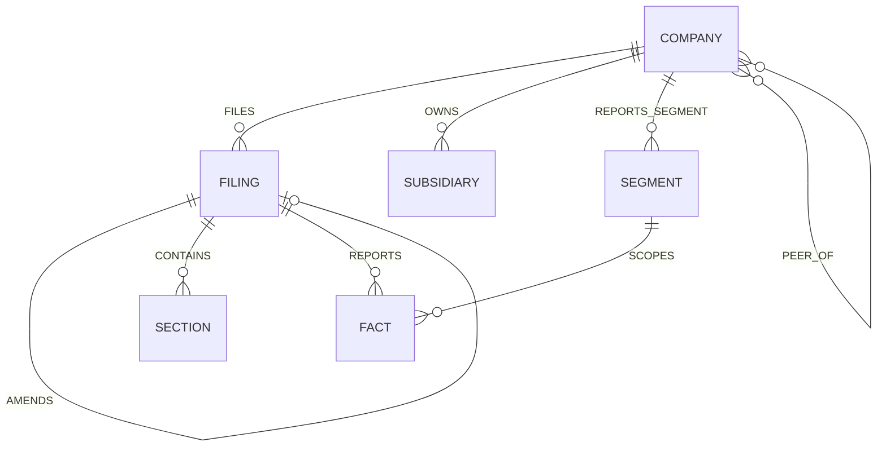

# Schema, IDs, operations and contracts

> Ported from Notion on 2026-10-13. **Canonical** for schema, IDs, operations and question routing.

Three layers, deliberately separate. Merging them is the most common way a knowledge graph gets bloated.

**Ontology** — what exists in the filings. **Operations** — what we can ask of it. **Question types** — how a question routes to a tool. Comparisons, percentages and growth rates belong in the second layer, not the first.

## Layer 0 · Where things live, and how they are keyed

### Two stores, two jobs

| Store | Holds | Does not hold |
|---|---|---|
| **Neo4j** | Entities and relationships — Company, Filing, Section, Subsidiary, Segment, and the edges between them | Numbers |
| **DuckDB** | XBRL facts — concept, value, unit, period, basis, dimensions | Relationships |

They join on `cik` and `fact_id`. The graph stores `(COMPANY {cik})-[:REPORTS]->(FACT {fact_id})` — a pointer. The value lives in DuckDB.

### Deterministic keys

Every key is derived from content. Never a counter, never a random UUID.

```
COMPANY      cik
FILING       accession
SECTION      hash(accession + item + char_start)
FACT         hash(accession + concept + context_ref + unit)
SEGMENT      hash(cik + normalised_name)
SUBSIDIARY   hash(parent_cik + normalised_name)
EDGE         hash(source_key + type + target_key + source_section_id)
```

**Idempotent loading.** `MERGE` on a deterministic key means loading the same filing twice yields one node, not two. Without it every prompt fix or re-run doubles the graph, and the W9 scale-up becomes a rebuild instead of an append.

This is why the `EDGE` key hashes `source_section_id` and **not** `source_chunk_id`. Chunk IDs change whenever Data re-chunks in W6 to W9, so a chunk-keyed edge gets a new key on every re-parse and the same relationship, extracted from the same unchanged sentence, `MERGE`s as a second edge. Section IDs do not move, so the key holds. Keep `source_chunk_id` on the edge as an attribute for span-level citation — just never in the key.

**Cross-store joins.** `cik` and `fact_id` must mean the same thing in Neo4j and DuckDB or the two arms cannot be combined in one answer.

**Provenance.** A key derived from accession and offsets *is* the pointer back to the corpus.

### Three provenance key shapes

Field names follow RAG's Retrieval API v0 as of 2026-10-13.

| For | Key |
|---|---|
| Text, graph arm | `section_id` · `accession_number`. Survives re-chunking, which `chunk_id` does not |
| Text, RAG | `chunk_id` · `accession_number` |
| XBRL facts | `accession_number` · `context_ref` · `unit_ref`, giving `fact_id`. **No `chunk_id`** — facts are not in a text chunk |
| Everything, always | `extraction_version` and `index_version`, plus `metadata.corpus_version` for the Data build |

If the provenance contract gets specced once it will be specced for chunks, and then both the graph arm and the structured arm end up with a null `chunk_id` and no agreed substitute. Specify all three shapes in the same document.

`chunk_id` is **opaque** — RAG's §5 says do not parse it, and its format may change when Data's `sec.chunks` becomes the source of truth. Nothing of ours may derive meaning from it, which is a second reason the `EDGE` key below uses `section_id`.

### Known problems with Layer 0

Found 2026-10-13:

- **`SECTION hash(accession + item + char_start)` is offset-dependent.** Offsets move when Data's *normalizer* changes, not just the chunker — so `section_id` survives re-chunking but not re-normalizing, which undercuts the reason we anchored on it. Key it off `accession + section_path + ordinal` instead.
- **Two definitions of the same ID.** The data contract has Data emitting `section_id` and `fact_id`; this page has us hashing our own. Pick one as canonical.
- **`normalized_doc_id` is missing from the provenance shapes.** A span is meaningless without naming the document it indexes into.
- **Table-derived edges have no shape.** Nothing covers `table_id` plus cell coordinates, which is how Ex-21 subsidiary edges arrive.

## Layer 1 · Ontology

### Settled

| Node | Key | Why it exists |
|---|---|---|
| **COMPANY** | `cik` | The join key for both arms. Ticker, legal name, SIC, valid-from / valid-to for renames |
| **FILING** | `accession` | Form type, filed date, period end, `amends_accession` for 10-K/A |
| **SECTION** | `section_id` | Item 1A, Item 7 and so on. `section_id` is the text provenance key our edges point at, carrying `section_path` and character offsets. Chunks hang off sections, not the other way round |
| **FACT** | `fact_id` | One XBRL fact. Concept, value, unit, period, `basis`, `context_ref` |
| **SEGMENT** | `segment_id` | Reportable segments. Facts are dimensioned by these |
| **SUBSIDIARY** | `sub_id` | Exhibit 21. The main source of cross-company multi-hop questions |

### Contested — each needs a question to earn its place

| Candidate | For | Against |
|---|---|---|
| **EVENT** | Needed for anything phrased "after the 2023 acquisition" | Hard to extract reliably. May be better as typed edges with a date |
| **EXECUTIVE / OFFICER** | Named officers connect companies | No deterministic key. Is there a single business question that needs it? |
| **RISKFACTOR** | Item 1A is where comparative risk questions live | Item 1A is already a SECTION. Probably a topic tag |
| **FINANCIALMETRIC** | Named metrics like revenue | Overlaps FACT almost entirely |
| **PEER** | Cross-company comparison needs a peer set | Not a node — a relation |

### Edges



`PEER_OF` is sourced from the SIC code in EDGAR metadata, which is free and reliable. Self-declared peer groups live in DEF 14A proxies, which are not in scope. Sourced from SIC and stated as such, or it does not go in.

## Layer 2 · Operation catalog

Comparison, percentages and growth rates belong here. They are computations over facts at query time — not stored, not edges.

| Operation | Returns | Tool |
|---|---|---|
| `lookup_fact(cik, concept, period, basis)` | Value, unit, fact_id | Structured |
| `compare_periods(cik, concept, period_a, period_b)` | Both values, delta, percent change | Structured |
| `compare_entities(cik[], concept, period)` | One value per company, ranked | Structured |
| `trend(cik, concept, periods[])` | Ordered series, CAGR if asked | Structured |
| `ratio(cik, concept_a, concept_b, period)` | Derived ratio plus both inputs | Structured |
| `segment_breakdown(cik, concept, period)` | Facts by segment, consolidated total flagged separately | Structured |
| `find_path(entity_a, entity_b, max_hops)` | Path, edges traversed, evidence per hop | Graph |
| `neighbours(entity, relation_types, depth)` | Subgraph with provenance | Graph |
| `events_between(cik, date_a, date_b)` | Events and the filings that disclosed them | Graph |
| `community_summary(level, topic)` | Pre-generated summary, member entities | Graph |
| `search_text(query, filters)` | Chunks with source IDs | Vector — RAG team |

**Never store a computed value as a FACT.** A stored growth rate has no XBRL provenance, so it cannot be cited back to a filing. And when a 10-K/A restates one of its inputs, the stored derivative is silently wrong with nothing marking it stale. Compute at query time, return the derived number **and both inputs**, cite the inputs.

*Exception:* some ratios are themselves filed as XBRL facts — effective tax rate, for instance. Those are FACTs with their own concept. The test is whether the filer asserted it.

## Layer 3 · Question types

| Type | Example | Route |
|---|---|---|
| Local lookup | "What did Apple say about supply chain risk in 2023?" | Vector |
| Numeric lookup | "What was Apple's R&D spend in FY2023?" | Structured |
| Numeric comparison | "How did R&D spend change between FY2022 and FY2023?" | Structured |
| Relational / multi-hop | "Which subsidiaries did Apple acquire, and what did they report?" | Graph |
| Hybrid | "How did R&D spend change after the 2023 acquisition?" | Graph resolves the event, structured supplies numbers, vector supplies prose |
| Global synthesis | "What themes dominate risk disclosure across the corpus?" | Community summaries |

## Contracts — what is agreed with whom, and where it lives

| Contract | Defined in | Agreed with | Due |
|---|---|---|---|
| Corpus schema | [data-contract.md](./data-contract.md) | Data | W3 |
| XBRL fact schema | [data-contract.md](./data-contract.md) | Data | W3 |
| ID scheme, provenance shapes | This document, Layer 0 | Data, RAG | W3 |
| Evidence envelope | [architecture.md](./architecture.md#7--tool-signature-and-evidence-envelope) | RAG | W3 |
| Tool signature | [architecture.md](./architecture.md#7--tool-signature-and-evidence-envelope) | Agents | W4 · INT-0 |
| Operation catalog | This document, Layer 2 | Agents | W4–W6 |
| Question routing | This document, Layer 3 | Agents, RAG | W6, then W10 |
| Acceptance thresholds | Decision log | Eval | W4 |
| Gold set format | Eval owns it | Eval | W5–W6 |
| Chat API | Agents own it | Agents → UI | W5 |
| Trace schema | Agents + RAG own it | Eval | W6 |

The **evidence envelope** touches everything — UI renders from it, Eval scores from it, Agents compose from it. It is also the one that is contested: see [interface-rag-gap.md](./interface-rag-gap.md).
