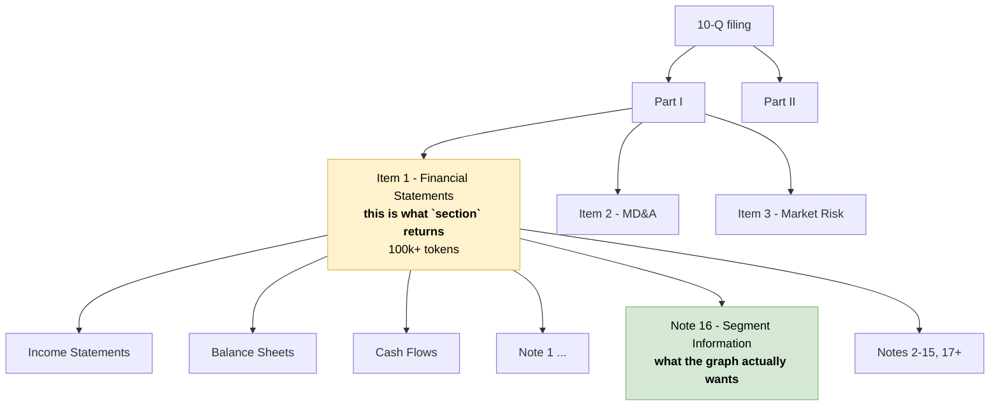

# Section vocabulary — one problem, three granularities

For a three-way conversation between Data, RAG and GraphRAG. Drafted 2026-10-13.

## The problem, stated correctly

Notes are **not** outside the Item structure. In a 10-Q, Part I Item 1 *is* "Financial Statements", and the notes live inside it. Note 16 is a child of Part I Item 1, not an orphan. Same for a 10-K: Item 8 contains the statements and all their notes.

So RAG's `section` does not return `None` for a note. It returns `"Part I Item 1"` — for the income statement, the balance sheet, the cash flow statement, and every one of the twenty-odd notes alike.

That is worse than a null. A null announces itself. A correct-but-useless label does not.



## This is our problem too

Section-first extraction has a ceiling we did not notice when we asked for it. "Extract from the whole section" works for Item 1A or Item 7. For Part I Item 1 of a 10-Q, or Item 8 of a 10-K, the section is the entire financial statements plus every note — well over 100k tokens, mixing the income statement with unrelated disclosures.

That is not an extraction unit. We need a hierarchy, not a flat label.

Our own data contract already had one — `section_path` as `"Item 7 > Liquidity and Capital Resources"`. Conforming to RAG's flat `section` is precisely what dropped it. Worth saying so in the room rather than presenting this as their gap.

## Three teams, three granularities, no actual conflict

| Team | Granularity needed | For |
|---|---|---|
| RAG | Item level | Pre-filtering before ranking. Coarse is correct here |
| GraphRAG | Leaf level | The extraction unit, and what edges anchor to |
| Eval | Leaf level | Their gold set already says "Note 16 — Segment Information and Geographic Data" |
| UI | Full path | A readable citation breadcrumb |

## Proposal — keep `section`, add two fields

`section` stays exactly as RAG defined it. Nothing of theirs breaks, the whole-word prefix filter is untouched, and `is_table` keeps working on the statement tables inside Item 1.

| Field | Example | Who uses it |
|---|---|---|
| `section` | `"Part I Item 1"` | RAG filtering — unchanged |
| `section_path` | `"Part I Item 1 > Note 16 — Segment Information and Geographic Data"` | Our extraction, UI breadcrumbs, Eval citations |
| `section_id` | hash of the **leaf** | Our edge anchor and citation target |

`section_path` can live top-level or in `metadata` — RAG's call, since `metadata` is additive and needs no contract version bump.

## What `section_types` is, and is not

Data's `section_types` is a topic taxonomy for Items, not a document hierarchy. Twenty-five codes — `business`, `risk_factors`, `mda`, `financial_statements`, `exhibits` and so on — grouped into seven topics. Each code names what an Item is *about*.

`risk_factors` is the code for Item 1A. `financial_statements` is the code for Item 8 in a 10-K, or Part I Item 1 in a 10-Q — which means the income statement, the balance sheet and all twenty-odd notes carry the same code.

There is no note-level code, and adding one has two parts. The vocabulary is an INSERT. The parser detecting note boundaries and emitting a row per note is the real work, even with inline XBRL marking them.

**Side effect worth taking:** `risk_factors` existing as a topic tag settles one of our contested ontology nodes. `RiskFactor` was a candidate node whose argument against was "Item 1A is already a Section, this may be a topic tag." Data built the tag. Cut the node.

## The lever for Data

The expected objection is that detecting note boundaries means heuristics over bold headings. It does not, and Eval's own gold set proves it. The XPath for the segment note is:

```
/html/body/div[84]/div/*[name()='ix:continuation']/div[2]/*[name()='ix:nonnumeric']/table
```

Those `ix:` elements are **inline XBRL tags**. Note blocks are already marked up in the filing — the boundaries are in the markup, not in the formatting. That holds for every filing in scope since roughly 2019.

This is the same inline-XBRL ask already in the data contract for fact offsets, so it is one piece of parser work serving two purposes.

## Six things to decide

1. **Is `section` Item-level only?** Proposed: yes, RAG's definition stands.
2. **Who emits sub-section boundaries** — Data once, or each consumer separately? Proposed: Data once, from inline XBRL.
3. **Does `section_path` sit top-level or in `metadata`?** RAG's call.
4. **What is the extraction unit when an Item is enormous?** Proposed: the leaf, not the Item.
5. **Do 10-K and 10-Q share one vocabulary?** A 10-K's Item 8 and a 10-Q's Part I Item 1 are the same content. Proposed: always include the Part prefix, in both forms.
6. **Does Eval score against `section`, `section_path`, or neither?** Their scorer currently uses `contains` strings, so possibly neither — but then `section` is dead weight as a filter for exactly the segment and note questions the graph needs.

## Why it cannot wait

Segment data and subsidiary lists are the graph's highest-value content, and both sit below Item level — segments in the notes, subsidiaries in Exhibit 21. If `section` is all anyone has:

- We cannot filter to them
- We cannot cite them precisely
- Our extraction unit is the whole financial statements
- Eval's gold set already names a granularity the contract cannot express, so grading silently falls back to string matching and nobody notices the filter is useless
