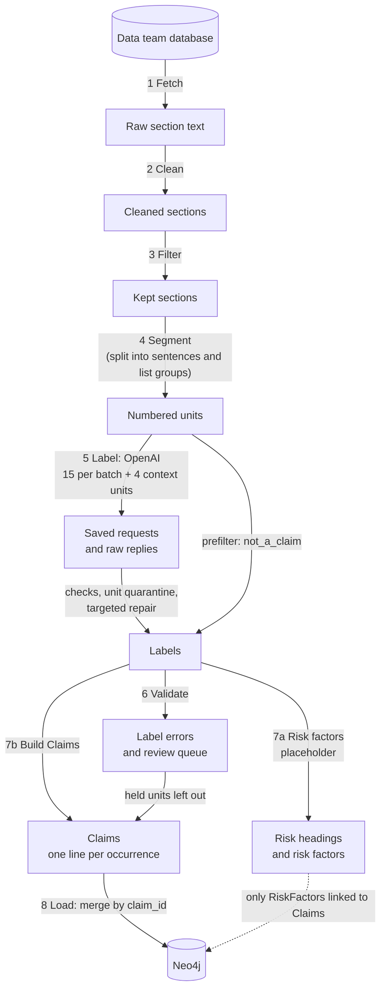

# Claim extraction pipeline

Turns Data-team section text from SEC 10-K and 10-Q filings into `Claim` nodes in Neo4j,
following the ontology in `docs/ontology-reconciliation.md` (decisions 2.3 and 2.4).

Pilot scope: five filings (Apple FY2025 10-K and two FY2026 10-Qs; Microsoft Q3 FY2026 10-Q
and FY2026 10-K), listed in `config/filings.yaml`.

```
Company -[:FILES]-> Filing -[:CONTAINS]-> Section -[:SUPPORTS]-> Claim -[:CONCERNS_RISK]-> RiskFactor
```

## Contents

- [How it works](#how-it-works)
- [Setup](#setup)
- [Run](#run)
- [Tests](#tests)
- [Cost tracking](#cost-tracking)
- [What to review](#what-to-review)
- [Remaining issues to be fixed](#remaining-issues-to-be-fixed)
    1. [Needs a decision within the team and across teams](#1-needs-a-decision-within-the-team-and-across-teams)
    2. [Found, not fixed in this frozen version](#2-found-not-fixed-in-this-frozen-version)
    3. [Not built yet](#3-not-built-yet)
    4. [Rules that fit only this data](#4-rules-that-fit-only-this-data)
- [Open decisions](#open-decisions)
    1. [\[Filter\] Which sections to extract from](#1-filter-which-sections-to-extract-from)
    2. [\[Segment\] Item 1A is not split into individual risk factors](#2-segment-item-1a-is-not-split-into-individual-risk-factors)
    3. [\[Segment\] Sentence or paragraph as the unit for extraction](#3-segment-sentence-or-paragraph-as-the-unit-for-extraction)
    4. [\[Claims\] Repeated sentences across filings](#4-claims-repeated-sentences-across-filings)
    5. [\[Claims\] Sentences that restate figures](#5-claims-sentences-that-restate-figures)
- [Appendix A: Output fields](#appendix-a-output-fields)
- [Appendix B: Merge notes with Claudia's code](#appendix-b-merge-notes-with-claudias-code)

## How it works



Code does everything that must be exact and repeatable. The LLM only judges meaning.

| # | Step | Module | Output (under `data/`) | LLM |
|---|------|--------|------------------------|-----|
| 1 | Fetch | `fetch.py` | `sections/*.jsonl` (from the Data-team database) | no |
| 2 | [Clean](#step-2-clean) | `clean.py` | `interim/clean/*.jsonl` | no |
| 3 | [Filter](#step-3-filter) | `filter_sections.py` | `output/section_manifest.csv` | no |
| 4 | [Segment](#step-4-segment) | `segment.py` | `output/sentences.jsonl` | no |
| 5 | [Label](#step-5-label) | `label.py` | `output/labels.jsonl`, `output/usage.jsonl`, `checked_pilot/`, `targeted_repair/` | yes |
| 6 | [Validate](#step-6-validate) | `validate.py` | `output/errors.jsonl`, `output/review_queue.jsonl` | no |
| 7a | [Risk factors](#step-7a-risk-factors) | `risk_factors.py` | `output/risk_headings.csv`, `output/risk_factors.csv` | no |
| 7b | [Build Claims](#step-7b-build-claims) | `build_claims.py` | `output/claims.jsonl` | no |
| 8 | [Load](#step-8-load) | `load.py` | Neo4j | no |

- <a id="step-2-clean"></a>**[2] Clean** removes page headers, page numbers and page labels, attaches lone bullets to their
  text and rejoins paragraphs split by a page break. It never rewrites words: every cleaned
  character maps back to the original `content`, so each Claim's quote can be found in the source.
- <a id="step-3-filter"></a>**[3] Filter** keeps Item 1A, MD&A and Business (`config/sections.yaml`). Everything else is
  dropped with a reason, or marked `review` for a person to decide.
- <a id="step-4-segment"></a>**[4] Segment** splits kept sections into numbered units:
  - Each sentence is one unit with an id such as `s0042`, numbered in order within its section.
  - An intro ending in ":" plus a list of fragments is one unit (Alina's interim list convention).
    A list whose items are full sentences is split item by item.
  - Headings, cross-references and table fragments are marked `not_a_claim` here and are not sent to the LLM.
  - In Item 1A, single-sentence paragraphs followed by their discussion are proposed as risk
    headings (`rule_heading`); step 7a settles them.
  - Each unit gets a `source_unit_key`, a hash of its filing, section, source spans and text.
    Ids shift when a boundary changes earlier in the section; the key does not, so it shows
    whether a unit is really the same.
- <a id="step-5-label"></a>**[5] Label** sends numbered sentences to OpenAI:
  - Batches of up to 15 consecutive sentences per section, with the 4 units before them as
    read-only context. The prompt is one file, `prompts/label_v2.txt`; the label definitions
    are filled in from `config/claim_types.yaml`.
  - Before sending, every sentence is rebuilt from the Data team text at its `raw_spans`; a
    mismatch stops the step.
  - The model returns, per number: a label (`stated_fact`, `forward_looking`, `hedged_risk`, or
    the pipeline-only `not_a_claim` and `needs_review`), `context_ids`, `subject_scope`,
    `annotation_note`, `is_risk_heading` and `entity_mentions` (segments and subsidiaries named).
  - A reply fails, and publishes no labels, when it is incomplete or a refusal, is not the
    expected JSON, or breaks the JSON schema. By default the run stops sending there for a
    person to look (`max_retries: 0`, `stop_on_failure: true`); replies already saved are still
    used. Set `max_retries` above 0 to send a follow-up request listing the problems.
  - Problems with single sentences do not fail the whole reply. The rest of
    the reply is kept; a sentence that cites invalid context (later, unknown, repeated or out
    of order), or whose number is missing or repeated, becomes `needs_review` and does not
    become a Claim. Rows with numbers not in the batch are ignored; nothing is guessed from row
    order. Details are saved in `unit_quarantine.json` in the request folder.
  - Once every batch has a reply, the sentences whose number was missing or repeated are sent
    again in one repair request (`prompts/repair_v1.txt`, saved in `data/targeted_repair/`).
    Each sentence goes under a key the code assigns, with its own 4 preceding units as context,
    so the model cannot mix up numbers. Their labels replace `needs_review`.
  - Nothing is resent automatically. Each request gets a folder `checked_pilot/<hash>/`; a
    reply saved there is never requested again. If a request was sent but no reply was saved
    (timeout, crash), the run stops, because it may have been charged.
  - The run stops before a request could take total estimated spend past `budget_usd`.
- <a id="step-6-validate"></a>**[6] Validate** checks that every unit has exactly one valid label (`errors.jsonl`), then writes
  `review_queue.jsonl` for a person to look at. A held unit keeps its label
  but does not become a Claim. Rules (hers, in `source_review.py` and `validate.py`):
  - Held, flag in `claim_review_flags`:
    - `list_intro_dependency_boundary_review`: a Claim whose context includes an intro ending
      in ":", i.e. a list item that may not stand alone.
    - `mixed_existing_and_prospective_statement_review` ("have passed … considering"),
      `current_cost_or_past_action_with_possible_future_review` ("causes / has required … may"),
      `existing_legal_condition_may_be_stated_fact` (`hedged_risk` for "is subject to … laws"
      with no may/could).
    - `known_product_list_fragment_boundary_review`: starts with a product-line name listed in
      `config/settings.yaml` (`review.known_list_fragment_prefixes`) shortly after a ":" intro.
  - Held, with `source_fragments`: the label is `needs_review`, or the text is not one
    continuous piece of the source (a list group, or a sentence joined across a page break).
  - Retained (`candidate_retained: true`, flag in `flags`): doubtful entity mentions (quote not
    in the sentence, "the Company" as an entity, uncertain type, a named subsidiary with no
    catalog, a "segment" that is not among the segment names defined in the filing, a defined
    segment the model missed). The Claim is still built. The defined segment names are read by
    `source_review.py` and written to `output/provisional_segment_definitions.json`.
- <a id="step-7a-risk-factors"></a>**[7a] Risk factors**: each risk-factor heading becomes a RiskFactor, and every sentence after it
  belongs to it. Headings of the same company are matched across filings by text (exact, or
  fuzzy for review).
- <a id="step-7b-build-claims"></a>**[7b] Build Claims** writes one record per occurrence (a Claim sentence at one place in a
  section): the ontology fields, provenance (sentence ids, source spans,
  XPath, section hash, request hash, model, prompt id), the source fragments and paragraph, and
  entity mentions checked against the sentence and the entity catalog (`entity_annotation.py`).
  `not_a_claim` and `needs_review` units, and units held in step 6, do not become Claims.
  - `claim_id`: uuid5 of `<accession>|<section_key>|<exact sentence text>`.
    The same sentence twice in one section shares one `claim_id`; `candidate_occurrence_id`
    tells the occurrences apart.
  - `risk_factor_id` is always null for now (see Open decisions, [2. Item 1A is not split into individual risk factors](#2-segment-item-1a-is-not-split-into-individual-risk-factors)).
- <a id="step-8-load"></a>**[8] Load** merges occurrences with the same `claim_id` into one Claim node and keeps every
  occurrence's sentence id and source spans on `SUPPORTS`. Entity mentions and review fields
  stay in `claims.jsonl`; they are not loaded into the graph.

## Setup

Python 3.10 or later.

```bash
cd extraction_pipeline
uv venv                          # or: python3 -m venv .venv
source .venv/bin/activate
uv pip install -r requirements.txt   # or: pip install -r requirements.txt
cp .env.example .env             # then add your OpenAI key, and Neo4j details for step 8
```

The pipeline reads the Data team section exports, one file per filing:
`data/sections/<TICKER>_<accession>.jsonl`. Step 1 only checks that they exist. To export them
from the database instead, run `python run_pipeline.py --steps fetch --from-db <folder>`,
where the folder holds the Data team's `graphrag_data.py` and `.env.aws`
(`docs/data-access.md`); that tool's own packages are not in `requirements.txt`.

`config/settings.yaml` holds the data folder (`data_dir`, default `../data`), the model name,
batch sizes, token prices, the spending limit (`budget_usd`), what happens to a failed reply
(`max_retries`, `stop_on_failure`), the step 6 product names
(`review.known_list_fragment_prefixes`) and the Neo4j scope (`load.scope`). Set `label.model`
to a model your OpenAI account can use that supports structured outputs. `label.base_url` defaults to OpenAI's US data-residency endpoint
(`https://us.api.openai.com/v1`); if your key is refused there, use
`https://api.openai.com/v1`.

## Run

```bash
python run_pipeline.py --until segment      # steps 1-4: free, no API
# review data/output/section_manifest.csv and a sample of sentences.jsonl

python run_pipeline.py --steps label --dry-run                           # batches, sentences, worst-case cost
python run_pipeline.py --steps label --filing 0000320193-25-000079 --limit 3   # a first, small paid run
python run_pipeline.py --steps label --filing 0000320193-25-000079       # one full filing
python run_pipeline.py --steps label                                     # all filings

python run_pipeline.py --steps validate,risk_factors,build_claims
python run_pipeline.py --steps load --dry-run     # writes output/load_preview.cypher
python run_pipeline.py --steps load
```

Each module also runs on its own, e.g. `python -m src.label --report`.
Use `python -m src.load --wipe` to delete everything this pipeline loaded
(every node and edge carries `pipeline_scope`).

If step 5 stops, the message names the request folder: `validation_errors.json` there says why
a reply was rejected; an `attempt.json` without `raw_response.json` means a request was sent but
no reply was saved (check usage before sending it again).

## Tests

```bash
python -m unittest discover tests
```

The tests run every step on a small synthetic filing (`tests/fixtures/`), with a fake model in
place of OpenAI. They need no API key or database. `test_sentence_entities.py` is Claudia's
(sentence boundaries and entity matching).

## Cost tracking

- Every API call is logged to `data/output/usage.jsonl`, and to `usage.json` in its request
  folder, with its tokens (including cached input tokens), request id, latency and estimated cost.
- `python -m src.label --report` prints the totals. Prices are set in `config/settings.yaml`
  (published gpt-4.1-mini rates); update them when changing the model.
- `budget_usd` (default 3.0) stops the run before a request could take total estimated spend
  past it.
- Each request is saved in `data/checked_pilot/<first 24 characters of request_hash>/`
  (`request.json`, `attempt.json`, `raw_response.json`, `usage.json`, and
  `validation_errors.json` for a rejected reply). The hash covers the request and the source
  versions it depends on. Rerunning with the same model, prompt and sentences costs nothing;
  changing any of them sends new requests. The repair request is saved the same way in
  `data/targeted_repair/`.
- The dry run reports a worst-case cost: each request's full size as input, plus the full
  `max_completion_tokens` as output.

## What to review

| File | Check |
|------|-------|
| `output/section_manifest.csv` | `review` rows (Item 1C Cybersecurity); add overrides in `config/sections.yaml` |
| `output/sentences.jsonl` | sentence boundaries, list groups, `prefilter` reasons |
| `output/labels.jsonl` | units the model labelled `not_a_claim` (`source` is `llm`); they appear neither in the review queue nor in `claims.jsonl` |
| `output/errors.jsonl` | should be empty after step 6 |
| `output/review_queue.jsonl` | held units (no `candidate_retained`), their `reason` and `claim_review_flags`; retained Claims with entity `flags` |
| `output/risk_headings.csv` | `needs_review` rows: rules and LLM disagree, or a fuzzy match |
| `output/claims.jsonl` | sample Claims per section for the type-fit test |

## Remaining issues to be fixed

### 1. Needs a decision within the team and across teams

1. **Non-continuous text holds list groups and page-break sentences.**
   - A list group joins its intro and items; a sentence split by a page break is rejoined after
     the page header is removed. Their `raw_spans` still locate every part exactly.
   - The rule exists because the UI finds a quote by searching for it as one string
     (`docs/data-contract.md`). It also overrides Alina's interim convention (a list group is one
     candidate Claim).
   - The quote-matching comes from the cross-team data contract, so changing it needs the other
     teams as well as ours.
   - To decide: drop the rule if the UI can highlight by `raw_spans`.

### 2. Found, not fixed in this frozen version

1. **Bullets without a space are missed.**
   - `segment.py` treats a paragraph as a list item only when the bullet is followed by a space
     ("• iPhone"); Apple writes "•MacBook Pro".
   - These items become headings, so their intro ("First Quarter 2025:") is left on its own
     instead of forming one `list_group`.
   - Affects the four quarterly product lists in Apple's 10-K MD&A.
2. **List items that end with a period.**
   - `segment.py` makes an intro ending in ":" and its items one `list_group` only when the items
     look like fragments (lower-case or "-ing" start, ending in ";" or no final punctuation).
   - Items that start with a capital and end with a period are labelled one by one, even when
     they cannot stand alone (e.g. "Growth of the AI PC category." after "Windows OEM revenue is
     impacted by:"). In the five-filing run 28 were labelled as Claims: about 18 fragments, about
     10 complete (e.g. "Microsoft Cloud revenue increased 27% to $214.4 billion.").
   - Step 6 now holds every Claim whose context includes a ":" intro, the complete ones too.
   - To decide: fix it in step 4 (fragment lists become `list_group` units before the LLM), keep
     the step 6 rule, or both; together with Alina's list convention and the `list_group` quote
     question.
3. **Remove the `too_short` rule.**
   - It removed 6 units, none correctly: the four list intros above, the Microsoft sub-heading
     "Piracy." and the table fragment "Satya Nadella |".
   - Without it they go to the LLM; table fragments should be caught by `table_residue`.
4. **Sentence splits after abbreviations.**
   - After "U.S.", "Inc." and similar, a new sentence starts only if the next word is on a list
     of common sentence openers (`OPENERS` in `segment.py`); otherwise the two sentences are
     joined into one unit.
   - Only one case is fixed: "Restrictions" was added for one Apple 10-K sentence. Other cases
     need the same one-off fix, or a general rule.

### 3. Not built yet

1. **Release held units.**
   - A unit held in `review_queue.jsonl` stays out of `claims.jsonl`. After review, the only way
     through is editing files by hand, and the next step 6 run holds it again.
   - To do: a release list that step 6 reads (sentence ids, or `source_unit_key` so it survives
     id shifts), and who signs off on a release.
2. **Clean and link risk factors.**
   - Split Item 1A into individual risk factors, clean their headings, and link Claims to them
     (`CONCERNS_RISK`).
   - For now `risk_factors.py` is a placeholder and `risk_factor_id` is always null (Open
     decisions 2).
3. **Link Claims to subsidiaries and segments.**
   - Entity mentions are checked and kept in `claims.jsonl`, but no graph links are made:
     `related_segment_ids` and `related_subsidiary_ids` are empty, and so is the entity catalog.

### 4. Rules that fit only this data

1. **Hard-coded Microsoft product names (`known_product_list_fragment_boundary_review`).**
   - Step 6 holds a Claim that starts with "Windows and Devices," or "XBOX (formerly Gaming),"
     shortly after a ":" intro.
   - The names (in `config/settings.yaml`) fit one filing only; the model labelled both
     sentences `needs_review` anyway.
   - To do: replace with a general fix for list fragments (see List items that end with a
     period, above).
2. **Segment names read from the filing text (`source_review.py`).**
   - Two regular expressions read segment names from the Business section (Apple: "reportable
     segments consist of …"; Microsoft: "Our … segment consists of"). Step 6 flags model
     "segment" mentions not among them, and defined names the model missed.
   - Other companies get no names, so all their segment mentions are flagged.
   - The names duplicate the entity catalog's job (`data/entity_catalog.json`, still empty).
     To do: switch the check to the catalog once it is filled.

## Open decisions

### 1. [Filter] Which sections to extract from

The rules in `config/sections.yaml` are a first pass. They key on `section_type`, so they carry
over to new companies.

- **Dropped:** usually empty sections (mine safety, changes in accountants, defaults on senior
  securities), and `unknown` (here only Items 1B, 6 and 9C).
- **Undecided:** the three sections below.

| Section | What it holds | For keeping | Against keeping |
|---------|---------------|-------------|-----------------|
| Legal proceedings (10-K Item 3, 10-Q Part II Item 1) | Lawsuits and investigations, e.g. Apple's EU Digital Markets Act and antitrust cases | Concrete events and possible penalties that support Item 1A legal risks | Microsoft refers to its notes instead (about 200 characters) |
| Market risk (10-K Item 7A, 10-Q Part I Item 3) | Interest-rate and currency exposure, with sensitivity figures | Some narrative risk sentences | Mostly numbers that belong to `Fact`; decide together with the MD&A type-fit question |
| Cybersecurity (10-K Item 1C) | How the company governs and manages cyber risk | Answers "how does the company manage cybersecurity?" | The risks themselves are already in Item 1A; mostly process descriptions |

### 2. [Segment] Item 1A is not split into individual risk factors

- **Available:** the risk categories the filing text itself carries (e.g. `Business Risks`),
  stored in each unit's `category`. Found in both 10-Ks and the Microsoft 10-Q; Apple's 10-Qs
  have none.
- **Not available:** a more granular split into individual risk factors (one per risk heading
  sentence). The Data team text drops formatting, so plain-text rules cannot find these headings
  reliably; `rule_heading` and `risk_factors.py` are rough placeholders.

### 3. [Segment] Sentence or paragraph as the unit for extraction

Each unit is one sentence (ontology decision 2.3). Whether paragraphs would work better is an
open, ontology-level question, to be decided later with the retrieval team.

### 4. [Claims] Repeated sentences across filings

1. The same sentence in another filing is a separate Claim (`claim_id` includes the accession
   number); within one section it is one Claim.
2. Repeats are common: in the five-filing run 1,223 of about 2,400 Claims share their text with
   a Claim in another filing of the same company, mostly between a 10-K and a 10-Q (448
   Microsoft sentences), mainly in Risk Factors and MD&A. No sentence repeats across companies.
3. To decide: keep one Claim per filing, or link or merge repeats across filings.

### 5. [Claims] Sentences that restate figures

1. Sentences that restate table figures (e.g. "Microsoft Cloud revenue increased 27% to $214.4
   billion.") are kept as Claims.
2. The figures themselves belong to `Fact`, so these Claims may duplicate the structured data.
3. To decide: keep them, or drop them where a `Fact` holds the same figure.

## Appendix A: Output fields

### `sentences.jsonl` (step 4)

One line per unit. "Data team" fields are copied from the section export; the rest are made by
`segment.py`.

| Field | Source | Meaning |
|-------|--------|---------|
| `sentence_id` | segment | `<accession>\|<section_key>\|s0042`; numbered in order within the section |
| `accession_number`, `ticker`, `form` | Data team | Filing the unit comes from |
| `section_id`, `section_key`, `section_type` | Data team | Section the unit comes from; `section_type` is the shared Item code (`risk_factors`, `mda`, ...) |
| `section_label` | segment | `Part I Item 1A`; always with the Part prefix |
| `category` | segment | Risk category heading above the unit in Item 1A (e.g. `Business Risks`); null elsewhere |
| `subheading` | segment | Nearest short heading above the unit (e.g. `iPhone` in MD&A) |
| `section_path` | segment | `section_label > category > subheading` |
| `role` | segment | `body` (sentence), `list_group` (intro plus fragment list), `heading`, `category_heading`, `section_title` |
| `text` | segment | The unit's text, unchanged from the source except whitespace; list-group fragments joined by one space |
| `char_start`, `char_end` | segment | Position in the cleaned section text |
| `raw_spans` | segment | Position(s) in the Data team `content`; one `[start, end]` per fragment |
| `paragraph_index` | segment | Paragraph number in the cleaned section |
| `list_paragraphs` | segment | List groups only: the paragraphs the group covers |
| `prefilter` | segment | Why the unit is `not_a_claim` before the LLM: `section_title`, `heading`, `table_residue`, `cross_reference`, `too_short`; null if sent to the LLM |
| `rule_heading` | segment | Item 1A only: `high` or `medium` if the rules propose the unit as a risk heading; else null |
| `processing_set_id` | Data team | Version of the Data team parse the unit was cut from |
| `source_locator` | Data team | XPath of the section in the SEC HTML |
| `source_unit_key` | segment | Hash of filing, section, `raw_spans` and `text`; stable when ids shift |
| `segmentation_version` | segment | Version of the splitting rules |

### `claims.jsonl` (step 7b, input to step 8)

One line per occurrence: a Claim sentence at one place in a section. Step 8 merges lines with the
same `claim_id` into one Claim node. "Loaded" shows where a field ends up in Neo4j.

| Field | Meaning | Loaded |
|-------|---------|--------|
| `claim_id` | uuid5 of `<accession>\|<section_key>\|<exact sentence text>` | `Claim.claim_id` |
| `quote` | The sentence, exactly as in the Data team `content` | `Claim.quote` |
| `claim_type` | `stated_fact`, `forward_looking` or `hedged_risk` | `Claim.claim_type` |
| `accession_number`, `section_id` | Filing and section the Claim comes from | `Claim`; `Section-[:SUPPORTS]->Claim` |
| `extraction_status` | Always `needs_review` (no Claim is approved yet) | `Claim.extraction_status` |
| `context` | Text of the context units the model cited, joined | `Claim.context` |
| `subject_scope`, `annotation_note` | From the model | `Claim` |
| `risk_factor_id` | Always null for now | would create `CONCERNS_RISK` |
| `provenance` | Sentence ids, section key and path, XPath, Data team versions (`processing_set_id`, `report_id`, source hashes), section content hash, `raw_spans`, context sentence ids, `request_hash`, `runner_version`, `model`, `prompt_version` | Part, on `SUPPORTS`: sentence ids, section key and path, context sentence ids, `raw_spans` (as JSON), XPath, source file, `processing_set_id`, `model`, `prompt_version`; step 8 adds the unit's `role` |
| `candidate_occurrence_id` | sha256 of claim id, section content hash and `raw_spans`; one per occurrence | no |
| `claim_identity_version` | How `claim_id` is made (`exact_source_sentence_v1`) | no |
| `section_logical_key`, `section_type` | `<accession>/<section_key>`; the section's Item code | no |
| `context_evidence` | The cited context units: ids, `raw_spans` and text | no |
| `risk_heading_candidate` | The model's `is_risk_heading` | no |
| `source_fragments`, `parent_paragraph_context` | Start, end and text of the sentence and of its paragraph in the Data team `content` | no |
| `entity_mentions`, `entity_review_flags`, `entity_annotation_version`, `graph_relations_created` | The model's entity mentions checked against the sentence and catalog (`entity_annotation.py`) | no |
| `proposed_entity_mentions`, `entity_review`, `postcheck_policy_version` | Segment names found by rule, and the review of the model's mentions (`source_review.py`) | no |
| `related_segment_ids`, `related_subsidiary_ids` | Always empty: no confirmed entity links yet | no |

## Appendix B: Merge notes with Claudia's code

Claudia ran steps 5 to 8 on the five filings with her own version of this pipeline (handoff
package `GraphRAG_Five_Filing_Handoff`). Her changes were merged into this code as below.
The merged step 5 builds the same 173 requests as her run, byte for byte.

### Taken into this code

- Step 4 (`segment.py`): her version, as is ("Restrictions" sentence split, "no material changes"
  exception, `source_unit_key`).
- Steps 5 to 7b (`entity_annotation.py`): her module, kept; its prompt text moved into
  `label_v2.txt`.
- Steps 4, 6 and 7b (`tests/test_sentence_entities.py`): her test file (sentence boundaries,
  the step 4 prefilter, entity matching).
- Step 5 (`label.py`), set up so outputs equal her run:
  - **Prompt**
    - Her four prompt pieces (`label_v1.txt`, text in `checked_pilot.py`, text in
      `entity_annotation.py`, `batch_review_v3.txt`) joined into one file,
      `prompts/label_v2.txt`; `label_v1.txt` is kept for the record.
    - `prompt_id` (`kelly_label_v1_entity_mentions_batch_review_v3`) recorded as the prompt
      version, as in her records; the prompt text is the same.
  - **Requests**
    - Batches of 15 sentences, halved when a request is over 35,000 bytes.
    - US endpoint as the default `base_url`, configurable.
    - Same request identity and `request_hash`, same cache folder layout (`data/checked_pilot/`).
    - `store: false`, `max_completion_tokens`, temperature only for gpt-4.1 and gpt-4o models.
  - **Cost and safety**
    - No automatic retry by default; the run stops at a rejected reply (`max_retries: 0`,
      `stop_on_failure: true`).
    - No automatic resend: the OpenAI client does not retry; a request with no saved reply
      stops the run (`attempt.json`).
    - Source check before sending; request and raw reply saved before parsing.
    - Fuller usage records, cost estimate with cached-token price, `budget_usd`.
  - **Reply checks and recovery**
    - Her reply checks: one complete answer (`finish_reason` "stop"), no refusal, exactly
      `{"results": [...]}`, JSON schema check, then id and context checks.
    - `needs_review` label, pipeline-only like `not_a_claim`; `entity_mentions` in the reply.
    - Her fixes for faulty replies, from `Resume_Five_Filing_Batch_v2.py` and
      `Run_Three_Target_Repair.py`: unit quarantine (problem sentences become `needs_review`,
      the rest of the reply is kept) and one targeted repair request for sentences whose number
      was missing or repeated. Her repair was written for her 3 sentences; here it works for
      any number. The repair prompt (`prompts/repair_v1.txt`) is her text. Two names are
      general instead of hers: the schema name `target_gap_repair` (hers
      `three_target_gap_repair`) and the version `target_repair_v1` (hers
      `three_target_repair_v1`). Her earlier recovery script (`Resume_Five_Filing_Batch.py`,
      context only) is covered by the v2 rules.
- Step 6 (`validate.py`), following her `source_review.py` and `checked_pilot.py`:
  - Her context checks: no duplicate context ids, context in source order.
  - A review queue (`output/review_queue.jsonl`); held units do not become Claims.
  - Her `source_review.py` functions, unchanged. Hold rules: `needs_review`, list intro,
    non-continuous text, mixed tense, past action with possible future, existing law as risk,
    and her hard-coded Microsoft product names (moved to `config/settings.yaml`).
  - Review queue entries in her format, with her flag names and reasons.
  - Entity checks taken: quote not in the sentence, "the Company" or "we" as an entity, generic
    references get no id, uncertain type, named subsidiary needing the catalog, and her segment
    names read from the filing text (`source_review.py`) with the two checks built on them.
  - On her labels, these rules hold 48 of the 49 units she held. The 49th she held by hand (an
    impairment-process sentence in Microsoft's 10-Q MD&A); hand decisions are not coded.
  - Kept, with open points recorded under Remaining issues to be fixed: the list-intro rule also holds about 10
    complete sentences (see Remaining issues to be fixed, List items that end with a period); the non-continuous rule
    depends on how the UI highlights quotes and overrides Alina's list convention; held units
    cannot be released yet.
  - The same 119 units carry entity flags as in her run.
  - Taken but specific to these filings (Remaining issues to be fixed): the product names and the
    segment-name patterns.
- Step 7b (`build_claims.py`): her Claim record, field for field (one record per occurrence,
  `candidate_occurrence_id`, source fragments, paragraph context, entity review), and her
  `claim_id` algorithm (exact text, no normalization).
- Step 8 (`load.py`): reads her record format and merges occurrences by `claim_id`. Her
  `candidate_occurrences.jsonl` loads directly when copied to `data/output/claims.jsonl` (2,420
  Claims, as in the graph loaded earlier).

### Not taken; kept in the handoff package as the record of her run

| File | What it does | Why not taken |
|------|--------------|---------------|
| `checked_pilot.py` | Her API-call path | Merged into `label.py` |
| `five_filing_batch.py` | Locked plan of the 173 batches; refuses to run if any code or input changes | Suited to one fixed run; blocks normal development. Its budget cap is merged |
| `source_review.py` (her full file) | Rule checks after the LLM, plus an offline review of three earlier entity pilots | Her four rule functions are in `source_review.py` unchanged. The offline pilot review and its hard-coded batch ids are not taken |
| `tests/test_batch_review_v3.py`, `tests/test_checked_pilot.py` | Tests of checked_pilot.py and five_filing_batch.py | Those two files are not taken; the merged code is tested in tests/test_pipeline.py |
| `02_code/Run_Five_Filing_Batch.py` | Colab launcher with the whole package embedded in base64 | Replaced by `run_pipeline.py` |
| `02_code/Load_Five_Filing_Graph.py` | Loads her results with `GRBatch*` labels | `load.py` uses ontology labels with `pipeline_scope` and reads her results directly |
| Guards in her `label.py`, `build_claims.py`, `load.py` | Disabled the original paths in favour of hers | Not needed with one path |
| Summary reports: `summary.json`, `section_coverage.json`, `model_target_ledger.jsonl` (written by `five_filing_batch.py` and `Resume_Five_Filing_Batch_v2.py`; final versions `resolved_*` by `Run_Three_Target_Repair.py`) | Counts for the run and per section, and one ledger row per sentence sent to the model | Not written by this code. The same counts can be read from `labels.jsonl`, `review_queue.jsonl` and `claims.jsonl` |