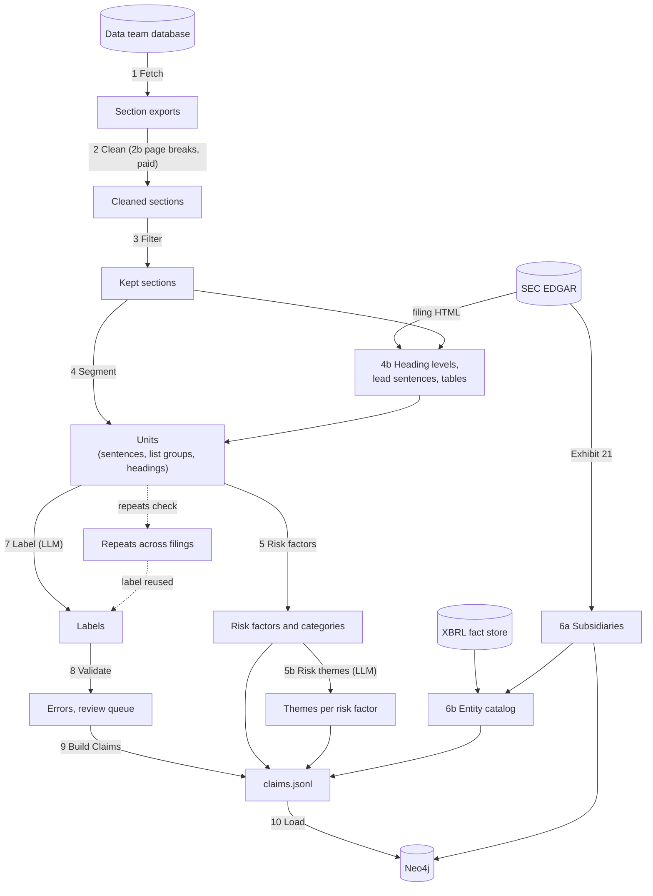
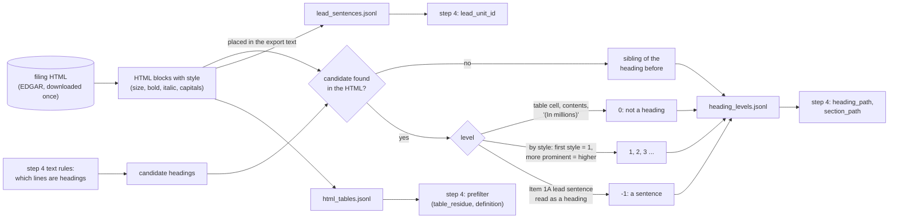
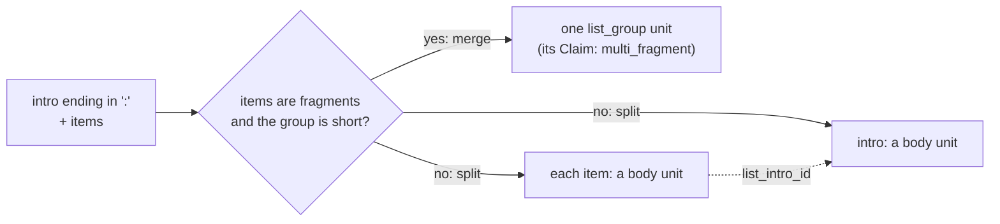
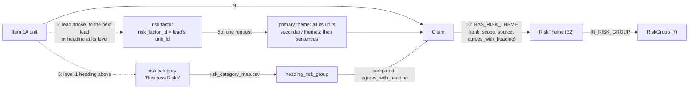
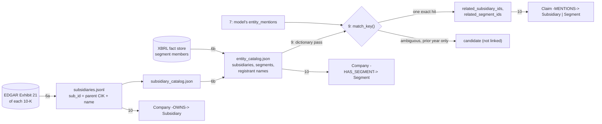
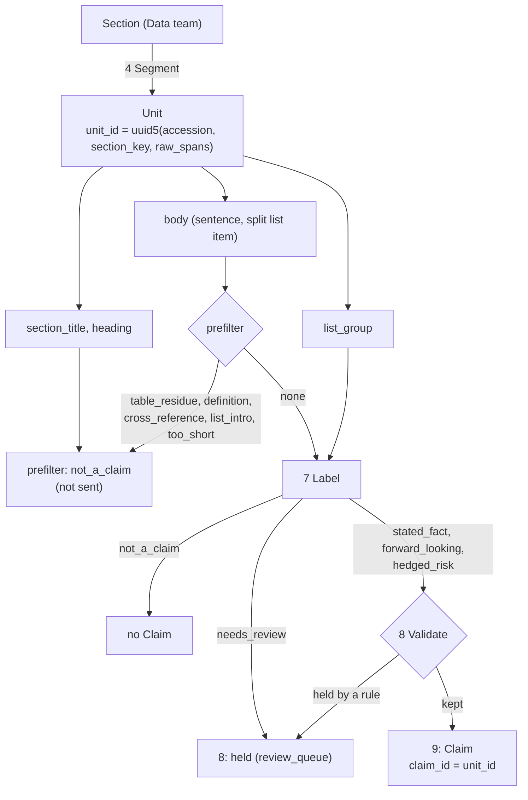
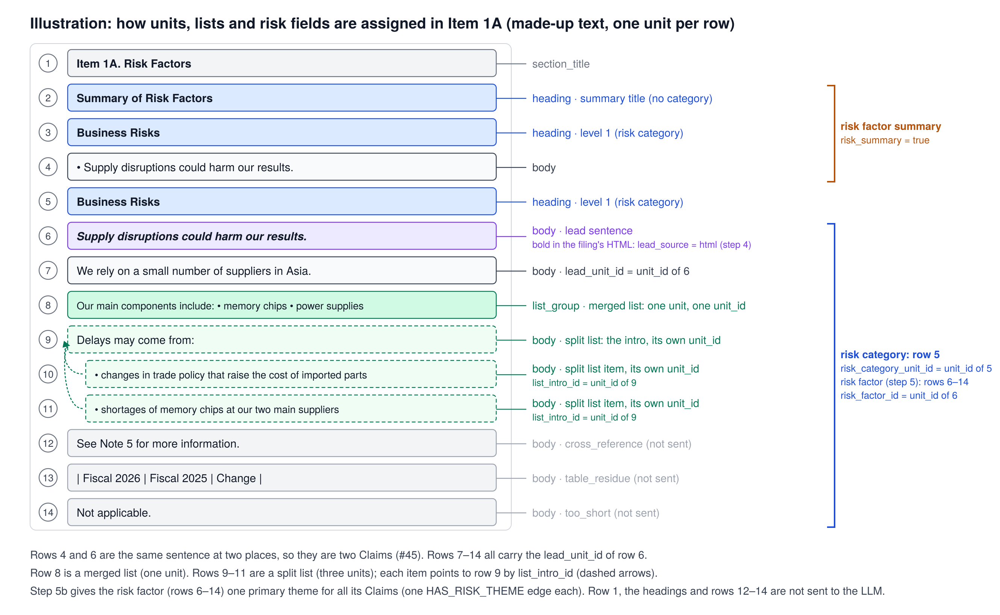

# Claim extraction pipeline

- Turns the Data team's section text of SEC 10-K and 10-Q filings ([Form 10-K][form-10k],
  [Form 10-Q][form-10q]) into `Claim` nodes in Neo4j.
- Ontology: [`docs/ontology-reconciliation.md`](../docs/ontology-reconciliation.md) (decisions
  [2.3](../docs/ontology-reconciliation.md#23-claim-with-a-type--take-it-from-the-proposal) and
  [2.4](../docs/ontology-reconciliation.md#24-riskfactor--its-own-node-or-a-label-on-a-section)).
- Code does everything that must be exact and repeatable; the LLM only judges meaning.
- Last updated 26 Nov 2026 by Kelly Zhou (segmentation `kelly_sentence_v15`).

```
Company -[:FILES]-> Filing -[:CONTAINS]-> Section -[:SUPPORTS]-> Claim -[:HAS_RISK_THEME]-> RiskTheme -[:IN_RISK_GROUP]-> RiskGroup
Company -[:OWNS]-> Subsidiary      Company -[:HAS_SEGMENT]-> Segment      Claim -[:MENTIONS]-> Subsidiary | Segment
```

## Contents

- [Data](#data)
- [How it works](#how-it-works)
    1. [Workflow](#1-workflow)
    2. [Steps](#2-steps)
    3. [Diagrams](#3-diagrams): [heading levels](#a-heading-levels-step-4b), [lists](#b-lists-step-4), [risk factors and themes](#c-risk-factors-and-themes-steps-5-and-5b), [segments and subsidiaries](#d-segments-and-subsidiaries-step-6), [ids](#e-unit_id-and-claim_id), [illustration](#f-illustration)
    4. [Step details](#4-step-details)
- [Unit ID and Claim ID](#unit-id-and-claim-id)
- [Setup](#setup) · [Run](#run) · [Tests](#tests) · [Cost tracking](#cost-tracking)
- [What to review](#what-to-review)
- [Remaining issues](#remaining-issues)
- [Appendix A: Output fields](#appendix-a-output-fields)
- [Appendix B: Risk taxonomy](#appendix-b-risk-taxonomy)
- [References](#references)

## Data

The scope is every 10-K and 10-Q of 16 companies in the Data team database
([`docs/data-access.md`](../docs/data-access.md)), listed in
[`config/filings.yaml`](config/filings.yaml). 313 filings of 14 companies are `status: passed`;
the 40 filings of CAH and INTC are `on_hold` until the Data team fixes them, and every step skips
them. The pipeline reads one export per filing, `data/sections/<TICKER>_<accession>.jsonl`, and
keeps Item 1A (Risk Factors, [Reg. S-K Item 105][sk-105]), MD&A ([Item 303][sk-303]) and Business
([Item 101][sk-101]).

## How it works

### 1. Workflow



- Steps 1–6 need no labels; their results are checked in one [review report](#what-to-review)
  ([`src/checks/report.py`](src/checks/report.py), [#122][pr-122]), which follows the numbers
  and names of the table below.
- Results the next steps read are in `data/output/` and `data/interim/`; review files are in
  `data/checks/<step>/` (no step reads them).

### 2. Steps

| # | Step (`--steps` name) | Code | Main output (under `data/`) | LLM |
|---|---|---|---|---|
| [1](#step-1) | Fetch (`fetch`) | [`fetch.py`](src/fetch.py) | `sections/*.jsonl` | no |
| [2](#step-2) | Clean (`clean`) | [`clean.py`](src/clean.py) | `interim/clean/*.jsonl` | no |
| [2b](#step-2b) | Page breaks (`page_breaks`) | [`page_breaks.py`](src/page_breaks.py) | `interim/page_break_decisions.jsonl` | paid, run on purpose |
| [3](#step-3) | Filter (`filter`) | [`filter_sections.py`](src/filter_sections.py) | `output/section_manifest.csv` | no |
| [4b](#step-4b) | Heading levels (`headings`) | [`headings/`](src/headings/) | `interim/heading_levels.jsonl`, `lead_sentences.jsonl`, `html_tables.jsonl` | no |
| [4](#step-4) | Segment (`segment`) | [`segment/`](src/segment/) | `output/sentences.jsonl` | no |
| [5](#step-5) | Risk factors (`risk_factors`) | [`risk/factors.py`](src/risk/factors.py) | `output/risk_categories.csv`, `interim/risk_factors.jsonl`, `risk_assignments.jsonl` | no |
| [5b](#step-5b) | Risk themes (`risk_themes`) | [`risk/themes.py`](src/risk/themes.py) | `interim/risk_themes.jsonl` | paid, sends only when named |
| [6a](#step-6a) | Subsidiaries (`subsidiaries`) | [`entities/subsidiaries.py`](src/entities/subsidiaries.py), [`entities/ex21/`](src/entities/ex21/) | `output/subsidiaries.jsonl`, `subsidiary_catalog.json` | no |
| [6b](#step-6b) | Entity catalog (`entity_catalog`) | [`entities/catalog.py`](src/entities/catalog.py) | `entity_catalog.json` | no |
| [7](#step-7) | Label (`label`) | [`label/`](src/label/) | `output/labels.jsonl` | paid |
| [8](#step-8) | Validate (`validate`) | [`validate.py`](src/validate.py), [`source_review.py`](src/source_review.py) | `output/errors.jsonl`, `review_queue.jsonl` | no |
| [9](#step-9) | Build Claims (`build_claims`) | [`build_claims.py`](src/build_claims.py), [`entities/annotation.py`](src/entities/annotation.py) | `output/claims.jsonl` | no |
| [10](#step-10) | Load (`load`) | [`load.py`](src/load.py) | Neo4j | no |

- Run order: 2b runs before 2, 4b before 4 (each feeds the step it belongs to).
- Code paths are under `src/`; output paths under `data/` (git-ignored, so not linked here; the
  review report links them).
- Shared code: [`common.py`](src/common.py) (paths, settings, ids), [`llm/`](src/llm/) (the
  OpenAI client and costs of steps 2b, 5b and 7), [`checks/`](src/checks/) (the review report and
  the checks behind it; no step reads them).
- **Repeats** are a check, not a step: after step 4 the run writes `checks/unit_repeats/`
  ([`checks/unit_repeats.py`](src/checks/unit_repeats.py)), and step 7 finds the same repeats
  itself to reuse labels (`label.reuse_repeats`, [`label/reuse.py`](src/label/reuse.py); [#88][pr-88]).

### 3. Diagrams

#### a. Heading levels (step 4b)



#### b. Lists (step 4)



#### c. Risk factors and themes (steps 5 and 5b)



#### d. Segments and subsidiaries (step 6)



#### e. unit_id and claim_id



#### f. Illustration



### 4. Step details

Each module's docstring has the full rules; below is what each step does and what to know.

<a id="step-1"></a>
**[1] Fetch**
- Checks that each passed filing has its export; `--from-db <folder>` exports it from the
  database ([`docs/data-access.md`](../docs/data-access.md)).

<a id="step-2"></a>
**[2] Clean**
- Removes page furniture: page numbers, repeated page headers, "Table of Contents" and navigation
  lines, "(Continued)" running headers.
- Rejoins paragraphs cut by a page break (next starts lower case, first ends on "the" / "of" / a
  comma, an open quote or parenthesis, an amount next). Never joins table rows, list items ending
  "; and", titles.
- Never rewrites words: every character maps back to the export, so each quote can be found in
  the source.
- <a id="step-2b"></a>**2b Page breaks** (paid, on purpose; [`page_breaks.py`](src/page_breaks.py)): asks the model about the "gray" boundaries the rules
  leave open (62 on the 233 filings); step 2 reads the answers on every later run.

<a id="step-3"></a>
**[3] Filter**
- Keeps Item 1A, MD&A and Business ([`config/sections.yaml`](config/sections.yaml), by `section_type`); drops the rest
  with a reason or marks it `review`.

<a id="step-4b"></a>
**[4b] Heading levels** ([`src/headings/`](src/headings/); [diagram](#a-heading-levels-step-4b))
- Levels come from the filing's own HTML on EDGAR (needs `SEC_USER_AGENT`, [SEC fair access][edgar-access]); the LLM version was removed
  on 25 Nov 2026.
- Gives a level only to headings step 4 found; it cannot add one.
- Also writes the lead sentences (bold / italic / underlined sentence followed by plain text)
  and the HTML table rows (`data`, `layout` or `definition` table) that step 4 reads.
- Flags for review only: `risk_sentence` (a 10+ word Item 1A heading), `before_table`.
- Review: `checks/headings/` (`heading_summary.csv`, `heading_review.csv` with `open_in_edgar`
  links, `heading_html_diff.csv`). Read them with `read_output()` in [`src/headings/step.py`](src/headings/step.py).

<a id="step-4"></a>
**[4] Segment** ([`src/segment/`](src/segment/), one module per part; [lists](#b-lists-step-4), [ids](#e-unit_id-and-claim_id))
- One unit per sentence; abbreviations ("U.S.", "Inc.") end a sentence only before a typical
  opener (`OPENERS`, [`segment/sentences.py`](src/segment/sentences.py)).
- **Lists:** a ":" intro with bullets or numbered items. Short fragment lists become one
  `list_group`; other lists are split, each item pointing to its intro (`list_intro_id`).
- **Headings:** short lines without sentence punctuation, title-case lines ending ":" or ".".
  With step 4b levels, `heading_path` / `section_path` keep every heading above the unit.
- **Item 1A:** a level-1 heading is a risk category (Item 105 asks for risks under headings and
  subcaptions, [Reg. S-K Item 105][sk-105]); the risk factor summary (MU, TTWO) is marked
  `risk_summary`.
- **Lead sentences** (every section): from the HTML (`html`, `html_runin`), or the rule
  (`rule_heading`) for filings without HTML. `lead_unit_id` links each unit to the lead above it,
  up to the next lead or heading.
- **Prefilter** ([`segment/prefilter.py`](src/segment/prefilter.py); `not_a_claim`, not sent to the LLM): headings, `table_residue` (data-table rows
  that are no full sentence), `definition` (definition-table rows), `cross_reference`,
  `list_intro`, `too_short`.
- `segmentation_version` records the rules; it is not in the label request hash.
- Review: `checks/segment/lead_summary.csv`, `lead_review.csv`.

<a id="step-5"></a>
**[5] Risk factors** ([`src/risk/factors.py`](src/risk/factors.py); [diagram](#c-risk-factors-and-themes-steps-5-and-5b))
- **Risk category:** the Item 1A level-1 heading above each unit, mapped to groups by
  [`config/risk_taxonomy/risk_category_map.csv`](config/risk_taxonomy/risk_category_map.csv) (`heading_risk_group`; `broad` headings name none).
- **Risk factor:** a lead sentence and the units after it, up to the next lead or heading at its
  level (sub-headings below the lead stay inside; wider than `lead_unit_id`).
- Units under no lead get no risk factor and no theme.
- Review: `checks/risk_factors/category_checks.csv` (missing or doubtful categories); a new
  company's categories show up as `unmapped` ([#125][pr-125]).

<a id="step-5b"></a>
**[5b] Risk themes** (paid; [`src/risk/themes.py`](src/risk/themes.py))
- One request per risk factor: its sentences and the 32 themes ([`config/risk_taxonomy/themes.csv`](config/risk_taxonomy/themes.csv)). The model returns one primary
  theme (or `unknown`) and up to two secondary themes with their sentences; it never sees the
  heading.
- A default run only reads saved replies; it sends when named (`--steps risk_themes`).
- Same text in another filing = same request: paid once per distinct risk text.
- A taxonomy change touches only these requests, never step 7's.
- Review: `checks/risk_themes/risk_factor_themes.csv` (`review`: `not_classified`, `unknown`,
  `differs_from_reference`, `overrules_heading`).

<a id="step-6a"></a>
**[6a] Subsidiaries** ([`src/entities/subsidiaries.py`](src/entities/subsidiaries.py); [diagram](#d-segments-and-subsidiaries-step-6))
- Reads Exhibit 21 (subsidiaries of the registrant, [Reg. S-K Item 601(b)(21)][sk-601]) of every
  10-K in `filings.yaml` from EDGAR (needs `SEC_USER_AGENT`, [SEC fair access][edgar-access]); no LLM
  ([#34][pr-34]).
- `sub_id` = uuid5 of parent CIK + normalised name; a renamed subsidiary gets a new id.
  Reviewed renames go in [`config/subsidiary_aliases.yaml`](config/subsidiary_aliases.yaml) (`same_entity` / `distinct`).
- [`src/entities/ex21/`](src/entities/ex21/) is a library: `edgar.py` downloads, `parse.py` reads, `normalize.py`
  maps jurisdictions and builds the keys.
- Review: `checks/subsidiaries/subsidiary_qa.csv` (CHECK rows), `subsidiary_renames.csv`;
  `python -m src.checks.entity_inputs` ([`checks/entity_inputs.py`](src/checks/entity_inputs.py)) for year-to-year changes.

<a id="step-6b"></a>
**[6b] Entity catalog** ([`src/entities/catalog.py`](src/entities/catalog.py))
- `entity_catalog.json`: the subsidiaries of 6a, the XBRL segment members of a fact store
  (`--facts`, `PIPELINE_FACT_STORE`), and the registrant's own names (never linked); settings in
  [`config/entity_linking.yaml`](config/entity_linking.yaml).
- Without a fact store the catalog has no segments.

<a id="step-7"></a>
**[7] Label** (paid; [`src/label/`](src/label/))
- Batches of up to 15 sentences per section, with 4 context units before them and any missing
  list intro. The model sees short numbers (`s1`, `c1`), mapped back to `unit_id`.
- Returns a label (`stated_fact`, `forward_looking`, `hedged_risk`, `not_a_claim`,
  `needs_review`), cited context, `subject_scope`, `annotation_note`, `entity_mentions`.
  `is_risk_heading` is still asked but no longer read.
- Repeats of an earlier filing (same sentence, 4 units before, `section_path`) reuse its label
  (`llm_reused`; [#88][pr-88]).
- Each sentence is rebuilt from the source before sending; a mismatch stops the step.
- A bad reply stops the run (`stop_on_failure`); single bad sentences become `needs_review`
  (quarantine), and missing ones go into one targeted repair request.

<a id="step-8"></a>
**[8] Validate** ([`src/validate.py`](src/validate.py))
- `errors.jsonl`: every unit has exactly one valid label (should be empty).
- `review_queue.jsonl`: held units (no Claim) with `claim_review_flags` (Claudia's rules in
  [`source_review.py`](src/source_review.py)), and retained Claims with doubtful entity mentions.

<a id="step-9"></a>
**[9] Build Claims** ([`src/build_claims.py`](src/build_claims.py))
- One record per Claim: ontology fields, provenance (spans, context, request hash, model,
  prompt), lead fields, risk fields (step 5) with themes (step 5b), entity links (6b; matching in
  [`docs/claim-entity-linking.md`](../docs/claim-entity-linking.md), [#91][pr-91], which still uses
  the old step numbers).
- `claim_id` = `unit_id`; a multi-fragment Claim (list group, page-break join) is matched by
  `source_fragments`, not `quote`.
- `output/claim_id_report.json`: ids added, gone, or with a changed quote since the last build.

<a id="step-10"></a>
**[10] Load** ([`src/load.py`](src/load.py))
- One Claim node per `claim_id`; all `RiskTheme` / `RiskGroup` nodes; `HAS_RISK_THEME` per theme.
- `Subsidiary` + `OWNS` per 10-K (cited by accession + Exhibit 21 URL), `Segment` + `HAS_SEGMENT`,
  `MENTIONS` for matched links.
- Only adds and updates (Cypher [`MERGE`][neo4j-merge]); every node and edge carries `pipeline_scope`
  (`python -m src.load --wipe` deletes them).

## Unit ID and Claim ID

- `unit_id` = [uuid5][py-uuid5] of `<accession>|<section_key>|<raw_spans>` (`unit_id()` in
  [`common.py`](src/common.py), [#45][pr-45]); the
  text is not part of it. `claim_id` = the unit's `unit_id` (`source_span_position_v1`).
- The same sentence at another place or in another filing is another Claim.

| Change | `unit_id` / `claim_id` |
|---|---|
| Whitespace or one-for-one character changes that keep the spans | same |
| An earlier unit split differently | same for units whose spans are unchanged |
| Step 2 removes, joins or trims differently inside a unit | new |
| Step 4 splits sentences or lists differently | new, for the units affected |
| The Data team re-exports and `content` moves | new where the spans move |

## Setup

```bash
cd extraction_pipeline
uv venv --python 3.11 && source .venv/bin/activate
uv pip install -r requirements.txt pytest
cp .env.example .env     # OpenAI key (2b, 5b, 7), SEC_USER_AGENT (4b, 6a), Neo4j (10)
```

- Settings: [`config/settings.yaml`](config/settings.yaml) (one block per step: model, budget,
  limits); risk taxonomy: [`config/risk_taxonomy/`](config/risk_taxonomy/).
- If the OpenAI key is refused on the US endpoint, set `label.base_url` to `https://api.openai.com/v1`.
- Never commit `.env` or `.env.aws`.

## Run

```bash
python run_pipeline.py --until entity_catalog        # steps 1-6; ends with the review report
python run_pipeline.py --steps page_breaks,clean,filter   # 2b (paid), once before labelling at scale
python run_pipeline.py --steps risk_themes --dry-run # 5b cost; then --limit 3, then without (--workers 8)
python run_pipeline.py --steps label --dry-run       # 7 cost; then --filing <acc> --limit 3, then all
python run_pipeline.py --steps validate,build_claims
python run_pipeline.py --steps load --dry-run        # writes output/load_preview.cypher; then without
```

- `python run_pipeline.py --help` lists the steps. Each module also runs alone
  (`python -m src.label --report`, `python -m src.risk.themes --dry-run --compare`).
- In zsh, paste commands without the `#` comments.
- If step 7 stops: `validation_errors.json` in the named request folder says why; an
  `attempt.json` without `raw_response.json` may have been charged (check usage first).

## Tests

```bash
uv run python -m pytest tests -q
```

- No API key, database or network needed: a fake model stands in for OpenAI, and
  [`tests/fixtures/`](tests/fixtures/) holds a small synthetic filing.

## Cost tracking

- Paid steps: 2b, 5b, 7. Each has its own `budget_usd` and ledger (`output/usage.jsonl` for 7,
  `output/usage_<step>.jsonl` for 2b and 5b) and stops before a request could pass the budget.
- Prices: the `prices:` table of `config/settings.yaml` ([OpenAI API pricing][openai-pricing], per
  1M tokens); `regional_uplift` models cost more on a regional endpoint ([data residency][openai-data]).
- A saved reply is never requested again; nothing is resent automatically.
- The request hash covers only what reaches the model (request + runner version): changing the
  model, prompt, a sentence, its context or `section_path` sends new requests.
- `--dry-run` shows the worst case (full output allowance); real cost is about a fifth of it
  (MSFT FY2026 10-K: $0.14 against $0.79, [#47][pr-47];
  [`docs/extraction-run-msft-fy2026.md`](../docs/extraction-run-msft-fy2026.md)).

## What to review

- Open `data/checks/report/report.md` (written after every run up to step 6;
  `python -m src.checks.report`, [`src/checks/report.py`](src/checks/report.py)). It lists failing
  checks, stale steps and changes since the last report; then one section per step, numbered and
  named as in the [step table](#2-steps), with its code, results and check files linked and a link
  back to its [step details](#4-step-details). Limits: `config/settings.yaml` `report:`.
- After labelling: `output/errors.jsonl` (empty), `review_queue.jsonl`, `claims.jsonl`,
  `claim_id_report.json`.

## Remaining issues

### 1. Improvement

1. **Sections to extract** (step 3): undecided for legal proceedings (concrete legal events vs
   MSFT refers to notes), market risk (mostly numbers for `Fact`) and cybersecurity Item 1C
   (process descriptions; the risks are already in Item 1A).
2. **Release held units** (step 8): a held unit stays out of `claims.jsonl`, and the next run
   holds it again. To do: a release list by `unit_id`, and who signs off.
3. **Id changes counted too late:** `claim_id_report.json` comes in step 9, after paying for
   step 7. To do: the same report in step 4 (units added, gone, changed).
4. **Old Claims after a rebuild** (step 10): load only MERGEs, so Claims whose ids changed stay.
   For now `python -m src.load --wipe` before loading; to do: delete this scope's Claims that are
   not in `claims.jsonl`.

### 2. Decide but can be open

1. **`multi_fragment` Claims:** the merge rule (under 600 characters); step 8 holds every split
   item that cites its intro, complete sentences too; bullets after a non-intro paragraph get no
   `list_intro_id` (mostly full sentences; PH product lists are the cut ones).
2. **Sentence or paragraph** as the extraction unit (ontology decision 2.3): later, with the
   retrieval team.

### 3. Todo

1. Tell the UI and Eval teams (and the data contract) that a `multi_fragment` Claim is matched by
   `source_fragments`, not `quote`.

### Note: rules that fit only this data

1. `review.known_list_fragment_prefixes` ([`config/settings.yaml`](config/settings.yaml)): MSFT product names that step 8 holds after a
   ":" intro. To do: a general fix for list fragments.
2. [`source_review.py`](src/source_review.py) reads segment names from Apple's and Microsoft's Business text only; other
   companies' segment mentions are all flagged. To do: check against the entity catalog.
3. Hand-written lists: `TABLE_NOTES` ([`segment/prefilter.py`](src/segment/prefilter.py)), `OPENERS`
   ([`segment/sentences.py`](src/segment/sentences.py)),
   [`risk_category_map.csv`](config/risk_taxonomy/risk_category_map.csv) (a new company's categories are `unmapped` until added).

## Appendix A: Output fields

### `sentences.jsonl` (step 4)

One line per unit; "Data team" fields come from the export.

| Field | Meaning |
|---|---|
| `unit_id` | uuid5 of accession, section key and `raw_spans`; every later file points at a unit by it |
| `accession_number`, `ticker`, `form` | Filing (Data team) |
| `section_id`, `section_key`, `section_type` | Section (Data team); `section_type` is the Item code (`risk_factors`, `mda`, ...) |
| `section_label` | `Part I Item 1A` |
| `role` | `body`, `list_group`, `heading`, `section_title` |
| `heading_level` | Headings: 1, 2, ... from step 4b (0 = not a heading); in Item 1A level 1 is a risk category |
| `category` | Item 1A: the level-1 heading above the unit; null elsewhere |
| `subheading`, `heading_path`, `section_path` | Nearest heading; all open headings, outermost first; `section_label > heading_path` |
| `text` | The unit's text (whitespace normalised; list-group fragments joined by one space) |
| `char_start`, `char_end`, `raw_spans` | Position in the cleaned text; position(s) in the Data team `content` |
| `paragraph_index`, `list_paragraphs`, `list_intro_id` | Paragraph; a list group's paragraphs; a split item's intro `unit_id` |
| `prefilter` | Why the unit is `not_a_claim` before the LLM; null if sent |
| `html_table` | Kind of HTML table row the unit sits in: `data`, `layout`, `definition`, or null |
| `rule_heading`, `lead_source`, `lead_unit_id` | Rule-proposed lead; lead source (`html`, `html_runin`, `rule`); the lead above |
| `risk_summary` | Inside the risk factor summary of Item 1A |
| `processing_set_id`, `source_locator` | Data team parse version; XPath of the section |
| `segmentation_version` | The splitting rules (`kelly_sentence_v15`) |

### Risk files (steps 5 and 5b)

| File | One row per | Fields |
|---|---|---|
| `output/risk_categories.csv` | category heading | `risk_category_unit_id`, `category_text`, `risk_summary`, `n_units`, `heading_risk_group`, `map_status` (`group`, `broad`, `not_a_category`, `unmapped`) |
| `interim/risk_factors.jsonl` | risk factor | `risk_factor_id`, filing and section, `lead_text`, `level`, `unit_ids` |
| `interim/risk_assignments.jsonl` | Item 1A unit | `unit_id`, `risk_category_unit_id`, `risk_category_text`, `heading_risk_group`, `risk_factor_id`, `risk_summary` |
| `interim/risk_themes.jsonl` | answered risk factor | `risk_factor_id`, `unit_ids`, `primary_theme`, `secondary_themes` (with `unit_ids`), `notes`, `request_hash`, `model`, `taxonomy_version` |

### `claims.jsonl` (step 9, input to step 10)

| Field | Meaning | In Neo4j |
|---|---|---|
| `claim_id` | The unit's `unit_id` | `Claim.claim_id` |
| `quote` | The sentence as in the source; fragments joined by one space | `Claim.quote` |
| `multi_fragment` | Several source fragments: match `source_fragments`, not `quote` | `Claim.multi_fragment` |
| `claim_type` | `stated_fact`, `forward_looking`, `hedged_risk` | `Claim.claim_type` |
| `accession_number`, `section_id` | Filing and section | `Section-[:SUPPORTS]->Claim` |
| `extraction_status` | Always `needs_review` | `Claim` |
| `context`, `subject_scope`, `annotation_note` | Cited context text; from the model | `Claim` |
| `is_lead_sentence`, `risk_summary` | Lead sentence (step 4); in the risk factor summary | `Claim` |
| `risk_factor_id`, `risk_category_text`, `risk_category_unit_id`, `heading_risk_group` | Step 5 | `Claim` |
| `risk_theme_status` | `classified`, `unknown`, `not_classified`, `no_risk_factor`, `risk_summary`; null outside Item 1A | `Claim` |
| `risk_themes` | Step 5b: `theme_id`, `rank`, `scope`, `source`, `agrees_with_heading`, `model`, `taxonomy_version` | one `HAS_RISK_THEME` edge each |
| `related_subsidiary_ids`, `related_segment_ids` | Matched entity links (6b catalog) | `MENTIONS` edges |
| `provenance` | Section path, XPath, Data team versions, `raw_spans`, `context_unit_ids`, `lead_unit_id`, `lead_source`, `request_hash`, `model`, `prompt_version` | part, on `SUPPORTS` |
| `claim_identity_version` | `source_span_position_v1` | no |
| `context_evidence`, `source_fragments`, `parent_paragraph_context` | Cited units; source pieces and paragraph with positions | no |
| `entity_mentions`, `entity_review_flags`, `proposed_entity_mentions`, `entity_review` | Model mentions checked against sentence and catalog | no |

## Appendix B: Risk taxonomy

[`config/risk_taxonomy/`](config/risk_taxonomy/) (decided 26 Nov 2026, EY / IRRCi 2016 as the
reference [[EY 2016]][ey-2016]; details in [its README](config/risk_taxonomy/README.md)):

| File | Holds | In the graph |
|---|---|---|
| [`groups.csv`](config/risk_taxonomy/groups.csv) | 7 coarse groups | `RiskGroup {group_id}` |
| [`themes.csv`](config/risk_taxonomy/themes.csv) | 32 themes, each in one group, with the definition the model sees | `RiskTheme {theme_id}` `-[:IN_RISK_GROUP]->` group |
| [`risk_category_map.csv`](config/risk_taxonomy/risk_category_map.csv) | Item 1A category text -> groups (`group`, `broad`, `not_a_category`) | `Claim.heading_risk_group` |
| [`reference_labels.csv`](config/risk_taxonomy/reference_labels.csv) | a draft primary theme per lead text (title only) | not loaded; compared in step 5b's review file |

- The model picks themes, never groups. One primary theme per risk factor on all its Claims;
  up to two secondaries on their sentences only.
- **To add a company:** run step 5, add its `unmapped` category texts to `risk_category_map.csv`,
  run step 5b for its risk factors (saved replies are reused).
- Merge notes with Claudia's code (the five-filing handoff):
  [`docs/merge-notes-claudia.md`](docs/merge-notes-claudia.md).

## References

External sources the pipeline and this README rely on (repository docs and code are linked
where they are named).

- [EY 2016] EY / Investor Responsibility Research Center Institute (IRRCi), *The Corporate Risk
  Factor Disclosure Landscape*, January 2016. Full copy: [as filed with the SEC][ey-2016]. Basis of
  the risk taxonomy (Appendix B).
- SEC, Regulation S-K: [Item 101][sk-101] (description of business: Item 1), [Item 105][sk-105]
  (risk factors: Item 1A), [Item 303][sk-303] (MD&A: Item 7), [Item 601][sk-601] (exhibits;
  (b)(21) subsidiaries of the registrant: Exhibit 21).
- SEC, [Form 10-K][form-10k] and [Form 10-Q][form-10q] (general instructions and items).
- SEC, [Accessing EDGAR Data][edgar-access]: declare a User-Agent (`SEC_USER_AGENT`) and keep to
  the request rate limit (steps 4b and 6a).
- OpenAI, [API pricing][openai-pricing] (the `prices:` table) and [Your data][openai-data]
  (regional endpoints).
- Python, [`uuid.uuid5`][py-uuid5] (`unit_id`); Neo4j, [Cypher `MERGE`][neo4j-merge] (step 10).
- Team pull requests and issues: [#34][pr-34] (Exhibit 21 pipeline), [#45][pr-45] (ids anchored to
  source spans), [#47][pr-47] (a real run and its cost), [#88][pr-88] (repeats across filings),
  [#91][pr-91] (Claim entity linking), [#122][pr-122] (review report), [#125][pr-125] (risk
  category checks).

[ey-2016]: https://www.sec.gov/comments/s7-06-16/s70616-5.pdf
[sk-101]: https://www.ecfr.gov/current/title-17/chapter-II/part-229/subpart-229.100/section-229.101
[sk-105]: https://www.ecfr.gov/current/title-17/chapter-II/part-229/subpart-229.100/section-229.105
[sk-303]: https://www.ecfr.gov/current/title-17/chapter-II/part-229/subpart-229.300/section-229.303
[sk-601]: https://www.ecfr.gov/current/title-17/chapter-II/part-229/subpart-229.600/section-229.601
[form-10k]: https://www.sec.gov/files/form10-k.pdf
[form-10q]: https://www.sec.gov/files/form10-q.pdf
[edgar-access]: https://www.sec.gov/os/accessing-edgar-data
[openai-pricing]: https://developers.openai.com/api/docs/pricing
[openai-data]: https://developers.openai.com/api/docs/guides/your-data
[py-uuid5]: https://docs.python.org/3/library/uuid.html#uuid.uuid5
[neo4j-merge]: https://neo4j.com/docs/cypher-manual/current/clauses/merge/
[pr-34]: https://github.com/ZiyiClaudiaWang/KPMG-GraphRAG/issues/34
[pr-45]: https://github.com/ZiyiClaudiaWang/KPMG-GraphRAG/issues/45
[pr-47]: https://github.com/ZiyiClaudiaWang/KPMG-GraphRAG/issues/47
[pr-88]: https://github.com/ZiyiClaudiaWang/KPMG-GraphRAG/issues/88
[pr-91]: https://github.com/ZiyiClaudiaWang/KPMG-GraphRAG/issues/91
[pr-122]: https://github.com/ZiyiClaudiaWang/KPMG-GraphRAG/issues/122
[pr-125]: https://github.com/ZiyiClaudiaWang/KPMG-GraphRAG/issues/125
