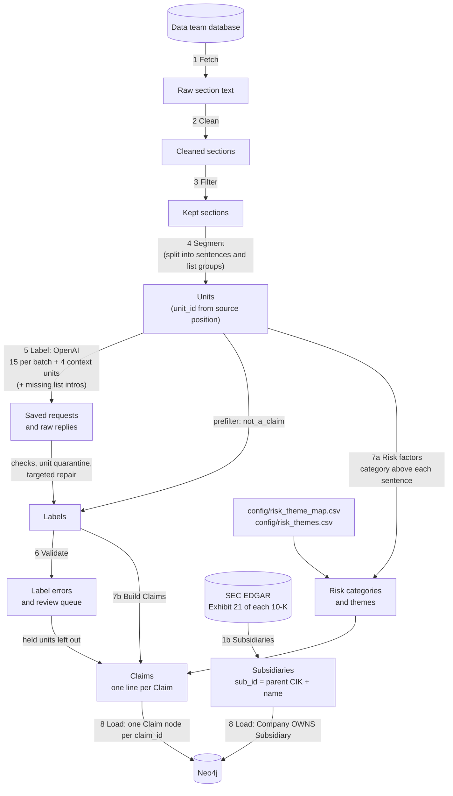
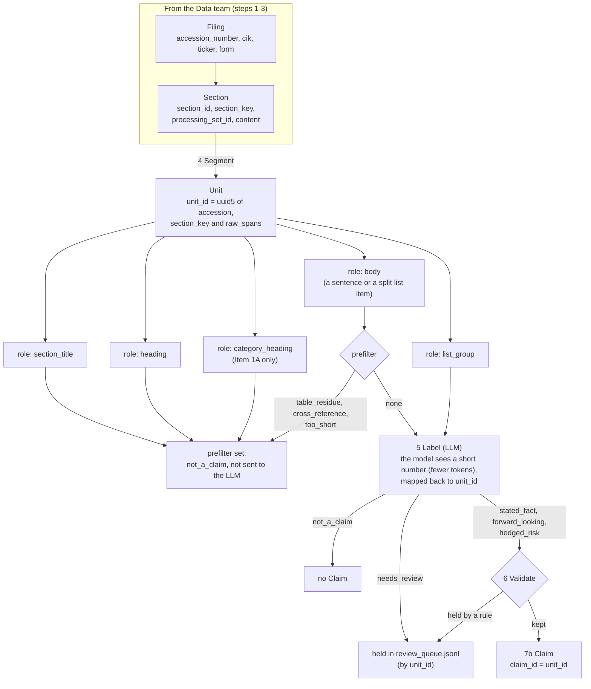
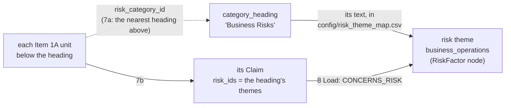
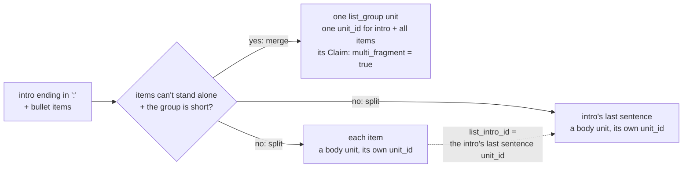
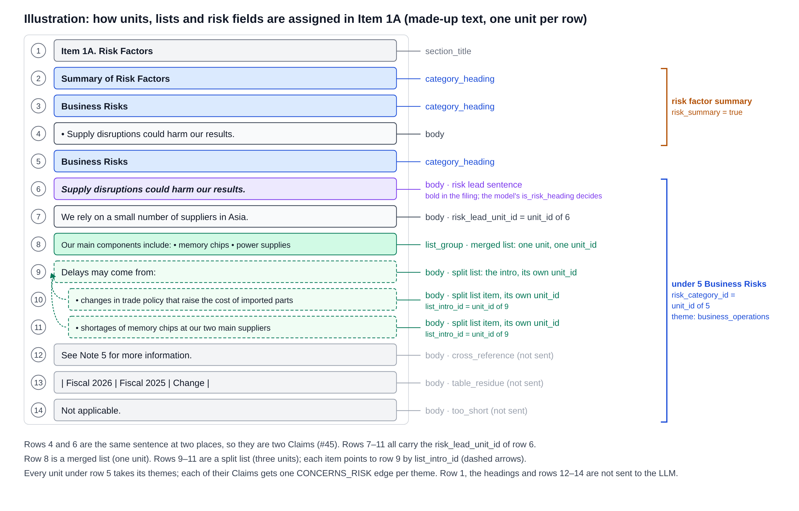

# Claim extraction pipeline

Turns Data-team section text from SEC 10-K and 10-Q filings into `Claim` nodes in Neo4j,
following the ontology in `docs/ontology-reconciliation.md` (decisions 2.3 and 2.4).

> **Last updated:** 4 November 2026, 2pm, by Kelly Zhou (wenyu-kelly-zhou), on branch
> `kelly/claim-extraction-pipeline` (PR #35).
>
> **Based on** the version merged with Claudia's code (five filings, [Appendix C](#appendix-c-merge-notes-with-claudias-code)), plus:
> - the fix for #46 (openai/httpx)
> - the expansion to 10 companies / 20 filings
> - fixes to steps 2 and 4 found on them
> - the link from Claims to risk themes (#53)
> - ids by source position instead of text (#45)
> - list groups and sentences rejoined across a page break now become Claims (they used to be held for review)

```
Company -[:FILES]-> Filing -[:CONTAINS]-> Section -[:SUPPORTS]-> Claim -[:CONCERNS_RISK]-> RiskFactor
```

## Contents

- [Data Scope](#data-scope)
- [How it works](#how-it-works)
    1. [Extraction workflow](#1-extraction-workflow)
    2. [ID workflow](#2-id-workflow): [unit_id and claim_id](#a-unit_id-and-claim_id), [risk factors](#b-risk-factors), [lists](#c-lists), [illustration](#d-illustration)
    3. [Details of each step](#3-details-of-each-step)
- [Unit ID & Claim ID](#unit-id--claim-id)
- [Setup](#setup)
- [Run](#run)
- [Tests](#tests)
- [Cost tracking](#cost-tracking)
- [What to review](#what-to-review)
- [Remaining issues to be fixed](#remaining-issues-to-be-fixed)
    1. [Needs a decision within the team and across teams](#1-needs-a-decision-within-the-team-and-across-teams)
    2. [Found, not fixed yet](#2-found-not-fixed-yet)
    3. [Not built yet](#3-not-built-yet)
    4. [Rules that fit only this data](#4-rules-that-fit-only-this-data)
- [Open decisions](#open-decisions)
    1. [\[Filter\] Which sections to extract from](#1-filter-which-sections-to-extract-from)
    2. [\[Risk\] How fine the risk themes are](#2-risk-how-fine-the-risk-themes-are)
    3. [\[Segment\] Sentence or paragraph as the unit for extraction](#3-segment-sentence-or-paragraph-as-the-unit-for-extraction)
    4. [\[Claims\] Repeated sentences across filings](#4-claims-repeated-sentences-across-filings)
    5. [\[Claims\] Sentences that restate figures](#5-claims-sentences-that-restate-figures)
- [Appendix A: Output fields](#appendix-a-output-fields)
- [Appendix B: Risk themes](#appendix-b-risk-themes)
- [Appendix C: Merge notes with Claudia's code](#appendix-c-merge-notes-with-claudias-code)

## Data Scope

20 filings from 10 companies based on Data Team's list: every 10-K and 10-Q in the Data team database with
`validation_status` passed, listed in `config/filings.yaml`. The NTAP 10-Q
0001193125-26-380207 is left out (`review_required`).

| Company | Industry | Form | Reporting period end | Accession | Filing |
|---------|----------|------|------------|-----------|--------|
| AAPL | Technology | 10-K | 2025-09-27 | 0000320193-25-000079 | [aapl-20250927.htm](https://www.sec.gov/Archives/edgar/data/320193/000032019325000079/aapl-20250927.htm) |
| AAPL | Technology | 10-Q | 2026-03-28 | 0000320193-26-000013 | [aapl-20260328.htm](https://www.sec.gov/Archives/edgar/data/320193/000032019326000013/aapl-20260328.htm) |
| AAPL | Technology | 10-Q | 2026-06-27 | 0000320193-26-000020 | [aapl-20260627.htm](https://www.sec.gov/Archives/edgar/data/320193/000032019326000020/aapl-20260627.htm) |
| CASY | Retail | 10-K | 2026-04-30 | 0000726958-26-000046 | [casy-20260430.htm](https://www.sec.gov/Archives/edgar/data/726958/000072695826000046/casy-20260430.htm) |
| CASY | Retail | 10-Q | 2026-07-31 | 0000726958-26-000085 | [casy-20260731.htm](https://www.sec.gov/Archives/edgar/data/726958/000072695826000085/casy-20260731.htm) |
| MCK | Healthcare | 10-K | 2026-03-31 | 0000927653-26-000069 | [mck-20260331.htm](https://www.sec.gov/Archives/edgar/data/927653/000092765326000069/mck-20260331.htm) |
| MCK | Healthcare | 10-Q | 2026-06-30 | 0000927653-26-000234 | [mck-20260630.htm](https://www.sec.gov/Archives/edgar/data/927653/000092765326000234/mck-20260630.htm) |
| MDT | Healthcare | 10-K | 2026-04-24 | 0001628280-26-044354 | [mdt-20260424.htm](https://www.sec.gov/Archives/edgar/data/1613103/000162828026044354/mdt-20260424.htm) |
| MDT | Healthcare | 10-Q | 2026-07-31 | 0001628280-26-060473 | [mdt-20260731.htm](https://www.sec.gov/Archives/edgar/data/1613103/000162828026060473/mdt-20260731.htm) |
| MSFT | Technology | 10-Q | 2026-03-31 | 0001193125-26-191507 | [msft-20260331.htm](https://www.sec.gov/Archives/edgar/data/789019/000119312526191507/msft-20260331.htm) |
| MSFT | Technology | 10-K | 2026-06-30 | 0001193125-26-323660 | [msft-20260630.htm](https://www.sec.gov/Archives/edgar/data/789019/000119312526323660/msft-20260630.htm) |
| MU | Technology | 10-Q | 2026-05-28 | 0000723125-26-000015 | [mu-20260528.htm](https://www.sec.gov/Archives/edgar/data/723125/000072312526000015/mu-20260528.htm) |
| MU | Technology | 10-K | 2026-09-03 | 0000723125-26-000023 | [mu-20260903.htm](https://www.sec.gov/Archives/edgar/data/723125/000072312526000023/mu-20260903.htm) |
| NKE | Apparel | 10-K | 2026-05-31 | 0000320187-26-000088 | [nke-20260531.htm](https://www.sec.gov/Archives/edgar/data/320187/000032018726000088/nke-20260531.htm) |
| NKE | Apparel | 10-Q | 2026-08-31 | 0000320187-26-000193 | [nke-20260831.htm](https://www.sec.gov/Archives/edgar/data/320187/000032018726000193/nke-20260831.htm) |
| NTAP | Technology | 10-K | 2026-04-24 | 0001193125-26-259683 | [ntap-20260424.htm](https://www.sec.gov/Archives/edgar/data/1002047/000119312526259683/ntap-20260424.htm) |
| PH | Industrial manufacturing | 10-Q | 2026-03-31 | 0000076334-26-000073 | [ph-20260331.htm](https://www.sec.gov/Archives/edgar/data/76334/000007633426000073/ph-20260331.htm) |
| PH | Industrial manufacturing | 10-K | 2026-06-30 | 0000076334-26-000105 | [ph-20260630.htm](https://www.sec.gov/Archives/edgar/data/76334/000007633426000105/ph-20260630.htm) |
| TTWO | Video games | 10-K | 2026-03-31 | 0001628280-26-037434 | [ttwo-20260331.htm](https://www.sec.gov/Archives/edgar/data/946581/000162828026037434/ttwo-20260331.htm) |
| TTWO | Video games | 10-Q | 2026-06-30 | 0001628280-26-054870 | [ttwo-20260630.htm](https://www.sec.gov/Archives/edgar/data/946581/000162828026054870/ttwo-20260630.htm) |


## How it works
### 1. Extraction workflow



Code does everything that must be exact and repeatable. The LLM only judges meaning.

| # | Step | Module | Output (under `data/`) | LLM |
|---|------|--------|------------------------|-----|
| 1 | Fetch | `fetch.py` | `sections/*.jsonl` (from the Data-team database) | no |
| 1b | [Subsidiaries](#step-1b-subsidiaries) | `subsidiaries.py`, `ex21/` | `output/subsidiaries.jsonl`, `output/subsidiary_qa.csv`, `output/subsidiary_catalog.json`, `ex21/raw/` | no |
| 2 | [Clean](#step-2-clean) | `clean.py` | `interim/clean/*.jsonl` | no |
| 3 | [Filter](#step-3-filter) | `filter_sections.py` | `output/section_manifest.csv` | no |
| 4 | [Segment](#step-4-segment) | `segment.py` | `output/sentences.jsonl` | no |
| 5 | [Label](#step-5-label) | `label.py` | `output/labels.jsonl`, `output/usage.jsonl`, `checked_pilot/`, `targeted_repair/` | yes |
| 6 | [Validate](#step-6-validate) | `validate.py` | `output/errors.jsonl`, `output/review_queue.jsonl` | no |
| 7a | [Risk factors](#step-7a-risk-factors) | `risk_factors.py` | `output/risk_categories.csv`, `interim/risk_assignments.jsonl` | no |
| 7b | [Build Claims](#step-7b-build-claims) | `build_claims.py` | `output/claims.jsonl` | no |
| 8 | [Load](#step-8-load) | `load.py` | Neo4j | no |

On the 20 filings, steps 1 to 4 give 15,053 units, of which 11,854 go to the LLM.

### 2. ID workflow
#### a. unit_id and claim_id



How each id is made and when it changes: [Unit ID & Claim ID](#unit-id--claim-id). Roles and
prefilter reasons: [step 4](#step-4-segment); the LLM's short numbers: [step 5](#step-5-label);
the hold rules: [step 6](#step-6-validate).

#### b. risk factors


Details: [step 7a](#step-7a-risk-factors); the themes and the map: [Appendix B](#appendix-b-risk-themes); whether
only lead sentences should link to a theme: [Remaining issues 1.3](#1-needs-a-decision-within-the-team-and-across-teams).

#### c. lists


The merge rule: [step 4](#step-4-segment). Open questions: the list rule and the step 6 hold
([Remaining issues 1.2](#1-needs-a-decision-within-the-team-and-across-teams)) and lists without a ":" intro ([2.2](#2-found-not-fixed-yet)). In step 5 every split item
sees its intro, even when a batch boundary cuts the list ([step 5](#step-5-label)).

#### d. Illustration



### 3. Details of each step

- <a id="step-1b-subsidiaries"></a>**[1b] Subsidiaries** reads the Exhibit 21 subsidiary list of every
  `form: 10-K` row in `config/filings.yaml` (10-Qs carry none). It does not use the Data team's
  export or the LLM, and changes no label request hash.
  - **Source:** SEC EDGAR, by the exact accession in `filings.yaml`. Each exhibit is downloaded once
    into the git-ignored `data/ex21/raw/` (listed in `data/ex21/manifest.csv`); later runs read the
    saved copy. Everyone downloads with their own `SEC_USER_AGENT="Name email"` (environment or
    `.env`); an accession's documents on EDGAR do not change, so nothing is stored in the repo.
    A 10-K that cannot be downloaded is a CHECK row in `subsidiary_qa.csv`, and the run goes on.
  - **Keep `config/filings.yaml` current:** the outputs cover exactly the 10-Ks listed there. Each row carries `reporting_period_end` (the Data team's and the Filing node's name); the step reads `reporting_period_end` (the name the graph and retrieval use).
  - **Code layout:** `src/subsidiaries.py` runs the step only. `src/ex21/` is a library that imports
    nothing from the pipeline: `edgar.py` downloads, `parse.py` reads an exhibit, `normalize.py`
    maps jurisdictions and builds the identity keys. A change to SEC's site touches only
    `edgar.py`; a parsing change only `parse.py`.
  - **Parsing:** HTML tables (a row holding several subsidiaries in stacked paragraphs is split),
    `Name (Delaware)`, `Name ...... Japan`, and `Name, LLC, an Iowa limited liability company`.
    Title, date and group-heading rows are skipped, and so is a row that names the registrant itself
    (counted in `registrant_rows_dropped`). A file that gives no rows (image or PDF exhibit, an
    unusual layout) is a CHECK row; read `subsidiary_qa.csv` after each run.
  - **Jurisdiction:** `country` and `state_or_region` come from the text as filed, which stays in
    `jurisdiction_raw`. US states and Canadian provinces give the country and the state/province.
    A value that cannot be mapped leaves `country` empty and makes the 10-K a CHECK row, so a
    count of subsidiaries by country never takes a province or a typo for a country.
  - **Identity:** `sub_id` = uuid5 of `<parent CIK>|<normalised name>` (case, accents and punctuation
    removed, legal form kept), as agreed in `docs/schema-ids-operations.md`. The same name under the
    same parent is one node across filings; a renamed subsidiary gets a new `sub_id`. Each node also
    stores `entity_key` (legal form removed too): across years, a subsidiary that disappears and one
    that appears under the same parent with the same `entity_key` is likely a rename.
  - `subsidiary_catalog.json` holds the same subsidiaries in the entity-catalog format (all
    `needs_review`, scoped to every filing of the parent), for linking Claims to subsidiaries later.
    No step reads it yet; step 7b reads `data/entity_catalog.json`.

- <a id="step-2-clean"></a>**[2] Clean** removes page furniture and rejoins text split by a page break. It never
  rewrites words: every cleaned character maps back to the original `content`, so each Claim's
  quote can be found in the source.
  - Removed:
    - page numbers and page labels ("Part II", "Item 7")
    - short paragraphs repeated across sections of a filing (page headers)
    - "Table of Contents" lines, including navigation lines such as "Table of Contents | MD&A Index |",
      and Microsoft's page-footer links to the next items ("Item 1B, 1C", "Item 9B, 9C, 10, 11")
    - running headers ending "(Continued)" or "(Concluded)" (McKesson's "FINANCIAL REVIEW (Continued)"), which repeat in one section only
    - the "(UNAUDITED)" label under McKesson's 10-Q headers
  - Lone bullets ("•" on its own line) are attached to the text after them.
  - A paragraph cut by a page break is joined to the next when:
    - the next starts in lower case, or
    - the first ends on a word no sentence ends on ("the", "of", "and"), or
    - the next starts with an amount ("$19.7 billion", "€500 million"), or with a parenthesis
      the sentence goes on after ('("Information Technology Systems"), may'). A table caption
      such as "(In millions)" ends its paragraph and is not joined.

  - A list item ending "; and" is not joined, and neither is a short heading.
- <a id="step-3-filter"></a>**[3] Filter** keeps Item 1A, MD&A and Business (`config/sections.yaml`). Everything else is
  dropped with a reason, or marked `review` for a person to decide.
- <a id="step-4-segment"></a>**[4] Segment** splits kept sections into units, written in source order:
  - **Sentences.** Each sentence is one unit.
    - After an abbreviation that can also end a sentence ("U.S.", "Inc.", "plc"), a new sentence
      starts only if the next word is a typical sentence opener (`OPENERS`, e.g. "The", "We",
      "During", "Refer"). So "U.S. GAAP" and "NIKE, Inc. Revenues" stay one sentence.
    - "Item 1A. Risk Factors" and "Note 9. Debt" are not split.
    - "non-U.S." is read as "U.S.".
  - **Lists** ([diagram](#c-lists)). A bullet is "•", "●", "◦", "▪", "‣", a dash or "o", with or without a space after it. A list whose intro ends in ":" becomes one `list_group` unit (intro plus items) only
    when its items cannot stand alone and the group is short:
    1. every item is a fragment and items average under 60 characters (a list of names), or
    2. at least one item is a fragment and the last intro sentence plus all items is at most
      600 characters.

    Every other list is split: each item is a unit and carries `list_intro_id`, the `unit_id` of the
    intro's last sentence. Bullets without a ":" intro are ordinary paragraphs.
  - **Headings.**
    - A short line without sentence punctuation is a heading and becomes the `subheading` of the
      units below it, unless it ends in ":" or on a word such as "of" or "the" (a piece of a
      table header), or is a footnote marker on its own line ("(a)", "(1)").
    - A short title-case line ending in ":" is also a heading ("Executive Summary:",
      "OPERATIONS:", "Sales and Marketing (in millions, except percentages):"), unless a bulleted
      list follows it: then it is a list intro. At most 10 words outside parentheses, and every
      word of 4 or more letters capitalised, so "Our cost of revenues consists of:" stays a
      sentence. The ":" is left out of `subheading` and `section_path`.
    - A short title-case sentence ending in a period at the start of a paragraph
      ("Flexible Work.", "Zynga.") is also a heading.
    - Only one level is kept: a heading replaces the one before it
      ([Remaining issues 2.4](#2-found-not-fixed-yet)).
  - **Item 1A - Risk Factors** ([diagram](#b-risk-factors)).
    - Category headings ("Business Risks", "RISKS RELATING TO …", "Risks related to our
      business and industry") set the unit's `category`.
    - Single-sentence paragraphs followed by their discussion are proposed as the sentence that
      opens and sums up a risk (`rule_heading`).
    - Units in the risk factor summary that some filings open with (MU, TTWO) carry
      `risk_summary = true`. The summary ends where a category it listed appears again.
  - **Prefilter** ([diagram](#a-unit_id-and-claim_id)). Units marked `not_a_claim` here are not sent to the LLM:
    - `section_title`, `heading`
    - `table_residue`: two or more "|", over 30% digits, a footnote marker on its own line, or a
      table note or table cell listed in `TABLE_NOTES` (e.g. "NM - Not Meaningful",
      "Chief Executive Officer |")
    - `cross_reference`: "See …", "Refer to …"
    - `too_short`: under 4 words; never for a split list item, whose meaning comes from its intro
  - **Ids and versions.**
    - Each unit gets a `unit_id` from its filing, section and source spans, never its text
      ([Unit ID & Claim ID](#unit-id--claim-id)). It is a unit's only id: every later step, file and the
      graph point at a unit by `unit_id`.
    - `segmentation_version` (`kelly_sentence_v4`) records which splitting rules made the units.
      It is a label only: it is not in the request hash, so changing it alone costs nothing; a
      rule change that alters what the model sees does.
  - All fields: [Appendix A: `sentences.jsonl`](#sentencesjsonl-step-4).
- <a id="step-5-label"></a>**[5] Label** sends sentences to OpenAI:
  - Batches of up to 15 consecutive sentences per section, with read-only context: the 4 units
    before them, plus the intro of any split list item in the batch whose intro is in neither
    (a long list cut by a batch boundary, or an intro too short to be labelled, such as
    "Solutions include:"). Context is in source order. Before 4 November 2026, 281 of the 983
    split items sent to the LLM did not see their intro; now none. The prompt is one file,
    `prompts/label_v2.txt`; the label definitions are filled in from `config/claim_types.yaml`.
  - Inside a request, units go by short numbers counted within that request: `c1`, `c2`, … for
    the context and `s1` … `s15` for the sentences. This is instead of the 36-character
    `unit_id`, which saves tokens and leaves nothing long for the model to copy wrong.
    - The batch keeps the table of numbers and `unit_id`s, and a reply is turned back into
      `unit_id`s as soon as it is read. The numbers appear only in the saved request and reply
      (`checked_pilot/`), never as ids in the output files (`labels.jsonl` has `unit_id` and
      `context_unit_ids`).
    - A rerun numbers the same batch the same way, so the same request finds its saved reply.
      Because the numbers count within the request, a change further up the section that
      leaves the batch's own units and context alone (a heading or page footer added or
      removed) does not change the request.
  - Before sending, every sentence is rebuilt from the Data team text at its `raw_spans`; a
    mismatch stops the step, and so does a `unit_id` that does not match the unit's spans.
    Steps 5 and 7b compare a unit with its source the same way
    (`source_text()` in `common.py`: newlines, tabs and non-breaking spaces read as spaces).
  - The model returns, per number: a label (`stated_fact`, `forward_looking`, `hedged_risk`, or
    the pipeline-only `not_a_claim` and `needs_review`), `context_ids`, `subject_scope`,
    `annotation_note`, `is_risk_heading` and `entity_mentions` (segments and subsidiaries named).
  - The client sends `Accept-Encoding: identity`, so replies are never brotli-compressed: an old
    `brotli` package (below 1.2.0) breaks httpx2's decoding (#46). `openai` is pinned to 3.40.0.
  - A reply fails, and publishes no labels, when it is incomplete or a refusal, is not the
    expected JSON, or breaks the JSON schema.
    - By default the run stops sending there for a person to look (`max_retries: 0`,
      `stop_on_failure: true`); replies already saved are still used.
    - Set `max_retries` above 0 to send a follow-up request listing the problems.
  - Problems with single sentences do not fail the whole reply; the rest of the reply is kept.
    - A sentence that cites invalid context (later, unknown, repeated or out of order), or whose
      number is missing or repeated, becomes `needs_review` and does not become a Claim.
    - Rows with numbers not in the batch are ignored; nothing is guessed from row order.
    - Details are saved in `unit_quarantine.json` in the request folder.
  - Once every batch has a reply, the sentences whose number was missing or repeated are sent
    again in one repair request (`prompts/repair_v1.txt`, saved in `data/targeted_repair/`).
    Each sentence goes under a key the code assigns (`repair_1`, …), with its own context (its 4
    preceding units, plus its list intro if missing, numbered `c1`, …), so the model cannot mix
    up numbers. Their labels replace `needs_review`.
  - Nothing is resent automatically.
    - Each request gets a folder `checked_pilot/<hash>/`; a reply saved there is never
      requested again.
    - If a request was sent but no reply was saved (timeout, crash), the run stops, because it
      may have been charged.
  - The run stops before a request could take total estimated spend past `budget_usd`.
- <a id="step-6-validate"></a>**[6] Validate** checks that every unit has exactly one valid label (`errors.jsonl`), then writes
  `review_queue.jsonl` for a person to look at. A held unit keeps its label
  but does not become a Claim. Rules (Claudia's, in `source_review.py` and `validate.py`;
  `source_review.py` has her rules unchanged, see [Appendix C](#appendix-c-merge-notes-with-claudias-code)):
  - Held, flag in `claim_review_flags`:
    - `list_intro_dependency_boundary_review`: a Claim whose context includes an intro ending
      in ":", i.e. a list item that may not stand alone (whether to keep this hold:
      [Remaining issues 1.2](#1-needs-a-decision-within-the-team-and-across-teams)).
    - `mixed_existing_and_prospective_statement_review` ("have passed … considering"),
      `current_cost_or_past_action_with_possible_future_review` ("causes / has required … may"),
      `existing_legal_condition_may_be_stated_fact` (`hedged_risk` for "is subject to … laws"
      with no may/could).
    - `known_product_list_fragment_boundary_review`: starts with a product-line name listed in
      `config/settings.yaml` (`review.known_list_fragment_prefixes`) shortly after a ":" intro.
  - Held, with `source_fragments`: the label is `needs_review`.
  - Not held for being in several pieces: a list group, or a sentence joined across a page
    break, becomes a Claim like any other unit. Step 5 has already checked that its text is
    rebuilt exactly from the source; whether it was joined correctly is a question for steps 2
    and 4, not for the label. Its Claim carries `multi_fragment: true` (step 7b).
  - Every entry names its unit by `unit_id` (and the intro units it cites by `intro_unit_ids`),
    so a review decision still finds its unit after other sentences are re-split.
  - Retained (`candidate_retained: true`, flag in `flags`): doubtful entity mentions. The Claim
    is still built.
    - quote not in the sentence
    - "the Company" as an entity
    - uncertain type
    - a named subsidiary with no catalog
    - a "segment" that is not among the segment names defined in the filing, or a defined
      segment the model missed. The defined names are read by `source_review.py` and written to
      `output/provisional_segment_definitions.json`.
- <a id="step-7a-risk-factors"></a>**[7a] Risk factors** places every Item 1A unit under a risk category and its risk themes
  ([Appendix B](#appendix-b-risk-themes)). No model call: it needs step 4, and uses step 5 labels when they exist.
  - **Risk category:** the category heading above the unit in the filing, by position.
    - Its id (`risk_category_id`) is the heading's `unit_id`, so each filing has its own.
    - Units before the first category heading, and filings without categories (Apple's 10-Qs),
      have none.
  - **Risk themes:** `config/risk_theme_map.csv` maps each category text (case does not matter)
    to zero, one or several themes of `config/risk_themes.csv`.
    - Empty means the heading is not a theme (e.g. MCK "INDEX TO RISK FACTORS").
    - A category missing from the map is reported as `unmapped` and gets no theme.
  - **Risk lead sentence:** the sentence that opens and sums up one risk.
    - It is the model's `is_risk_heading`, or without a model label the step 4 proposal
      (`rule_heading`).
    - Each unit also records the lead sentence above it (`risk_lead_unit_id`). It is kept as a
      property on `SUPPORTS`; there is no Claim-to-Claim edge
      ([Remaining issues 1.3](#1-needs-a-decision-within-the-team-and-across-teams)).
  - On the 20 filings:
    - 78 category headings (46 distinct texts), all in the map: 72 with themes, 6 not a theme
    - 5,071 of the 5,302 Item 1A units sent to the LLM have a theme
  - All fields: [Appendix A: `risk_categories.csv`](#risk_categoriescsv-step-7a).
- <a id="step-7b-build-claims"></a>**[7b] Build Claims** writes one record per Claim (a statement at one place in a
  section): the ontology fields, provenance (source spans, context unit ids,
  XPath, section hash, request hash, model, prompt id), the source fragments and paragraph, and
  entity mentions checked against the sentence and the entity catalog (`entity_annotation.py`).
  `not_a_claim` and `needs_review` units, and units held in step 6, do not become Claims.
  All fields: [Appendix A: `claims.jsonl`](#claimsjsonl-step-7b-input-to-step-8).
  - `quote`: the source text of every fragment, joined by one space. A multi-span unit is never
    cut to its first fragment.
  - `multi_fragment`: true for a list group or a sentence joined across a page break (136 of the
    units sent to the LLM on the 20 filings). Its `quote` joins the pieces with one space, so it cannot be found in the
    source as one string; `source_fragments` lists each piece with its position, exactly as in
    the source ([Remaining issues 1.1](#1-needs-a-decision-within-the-team-and-across-teams)).
  - `claim_id`: the unit's `unit_id` ([Unit ID & Claim ID](#unit-id--claim-id)); `claim_identity_version`
    is `source_span_position_v1`. A Claim is a statement at one place: the same sentence twice
    in one section is two Claims.
  - Ids that point at other units (`context_evidence`, `risk_category_id`,
    `provenance.context_unit_ids`, `provenance.risk_lead_unit_id`) are `unit_id`s.
  - Each run compares its `claim_id`s with the `claims.jsonl` it replaces and writes
    `output/claim_id_report.json`: ids added, ids gone, and ids kept whose quote changed, with
    examples. The counts are also logged.
  - Risk fields from step 7a: `risk_ids`, `risk_category_id`,
    `risk_lead_sentence` and `risk_summary` ([Appendix A: `claims.jsonl`](#claimsjsonl-step-7b-input-to-step-8)).
- <a id="step-8-load"></a>**[8] Load** writes one Claim node per `claim_id`, with its ids and source spans on `SUPPORTS`,
  and `multi_fragment` on the node.
  - A Claim gets one `CONCERNS_RISK` edge per risk theme of its category.
    RiskFactor nodes are the themes of `config/risk_themes.csv` that some Claim uses, keyed by
    `risk_id`.
  - Entity mentions and review fields stay in `claims.jsonl`; they are not loaded into the graph.
  - Subsidiaries (step 1b): one `Subsidiary` node per `sub_id` (with `entity_key`), and one
    `Company -[:OWNS]-> Subsidiary` edge per subsidiary per 10-K, keyed by the 10-K’s `accession_number` (`row_order` is stored on the edge, not used as a key). The edge holds what that exhibit says (name as filed, jurisdiction, nesting) and the filing's `reporting_period_end`, the same name as on the Filing node.
  - **How OWNS is cited:** it has no `section_id`, since Exhibit 21 is a separate document of the
    filing, not a section of the Data team's export. It cites its source by `accession_number` +
    `source_url` (the Exhibit 21 document on EDGAR) + `evidence = 'Exhibit 21'`.
  - The parent Company is matched by CIK. Loading subsidiaries never sets a Company's name: a
    Company first created by the subsidiaries has `cik` and `ticker` only, and gets its name from
    the Data team's `company_name` when the Claims load.
  - Claims and subsidiaries load independently: `--steps subsidiaries,load` loads subsidiaries
    without any Claims.
  - Step 8 only adds and updates; Claims whose ids changed in a rebuild stay in the graph
    ([Remaining issues 3.5](#3-not-built-yet)).

## Unit ID & Claim ID
Every unit has one id, `unit_id`: uuid5 of `<accession_number>|<section_key>|<raw_spans>`, with
`raw_spans` written as compact JSON in order (`common.unit_id()`; #45). The text is not part of
it. **A Claim's `claim_id` is the `unit_id` of the unit it comes from, so the two always change
together.** `claim_identity_version` (`source_span_position_v1`) records this rule. Where the ids
sit in the pipeline: [ID workflow](#2-id-workflow).

| Change | `unit_id` / `claim_id` |
|--------|------------------------|
| Text-only cleaning changes that keep every unit's spans: whitespace, newlines and non-breaking spaces read as spaces (`ONE_FOR_ONE`), any other one-for-one character change | same |
| An earlier unit in the section is split differently | same for every unit whose own spans are unchanged |
| Step 2 removes or keeps different text inside a sentence (e.g. a page header is no longer removed, so the sentence is no longer joined) | new |
| Step 2 joins split paragraphs differently (`should_join`) | new |
| Step 2 trims more or fewer characters at a unit's start or end (a bullet sign, whitespace) | new |
| Step 4 splits sentences differently, or merges or splits a list differently (`merge_list`) | new, for the units affected |
| The Data team re-extracts the section and its `content` changes (`processing_set_id`) | new for every unit whose spans move. A unit whose spans happen to stay the same keeps its id even if the text at those spans changed; `claim_id_report.json` counts these as "quote changed" |
| The same sentence at another place in the section, or in another filing | a different id |

`output/claim_id_report.json` shows how many `claim_id`s each build changed
([step 7b](#step-7b-build-claims)). Anything joined on `claim_id` across builds (Eval's citations, a review decision)
stops matching for the ids that changed. Open points: old Claims after a rebuild, a step 4
report, a record of the Data export ([Remaining issues 3.5–3.7](#3-not-built-yet)); report or fail
([1.6](#1-needs-a-decision-within-the-team-and-across-teams)).

## Setup

Python 3.11, as in CI.

```bash
cd extraction_pipeline
uv venv --python 3.11            # or: python3.11 -m venv .venv
source .venv/bin/activate
uv pip install -r requirements.txt pytest   # or: pip install -r requirements.txt pytest
cp .env.example .env             # then add your OpenAI key, and Neo4j details for step 8
```

The pipeline reads the Data team section exports, one file per filing:
`data/sections/<TICKER>_<accession>.jsonl`. Step 1 only checks that they exist.

- To export them from the database instead, run
  `python run_pipeline.py --steps fetch --from-db <folder>`, where the folder holds the Data
  team's `graphrag_data.py` and `.env.aws` (`docs/data-access.md`).
- That tool's own packages (`psycopg[binary]`, `pandas`, `python-dotenv`) are not in
  `requirements.txt`.
- Never commit `.env` or `.env.aws`.

`config/settings.yaml` holds:

- the data folder: `data_dir`, default `../data`, the `data/` folder at the repository root
- the model name (`label.model`): a model your OpenAI account can use that supports structured
  outputs
- the endpoint (`label.base_url`): OpenAI's US data-residency endpoint
  (`https://us.api.openai.com/v1`) by default; if your key is refused there, use
  `https://api.openai.com/v1`
- batch sizes, token prices and the spending limit (`budget_usd`)
- what happens to a failed reply (`max_retries`, `stop_on_failure`)
- the step 6 product names (`review.known_list_fragment_prefixes`)
- the Neo4j scope (`load.scope`)

The risk theme library and map are in `config/risk_themes.csv` and `config/risk_theme_map.csv`
([Appendix B](#appendix-b-risk-themes)).

## Run

```bash
python run_pipeline.py --until segment      # steps 1-4: free, no API
python run_pipeline.py --steps risk_factors # step 7a: free; lists unmapped risk categories
# review data/output/section_manifest.csv, sentences.jsonl and risk_categories.csv

python run_pipeline.py --steps label --dry-run                           # batches, sentences, worst-case cost
python run_pipeline.py --steps label --filing 0000320193-25-000079 --limit 3   # a first, small paid run
python run_pipeline.py --steps label --filing 0000320193-25-000079       # one full filing
python run_pipeline.py --steps label                                     # all filings

python run_pipeline.py --steps validate,risk_factors,build_claims
python run_pipeline.py --steps load --dry-run     # writes output/load_preview.cypher
python run_pipeline.py --steps load
```

In zsh, paste the commands without the `#` comments, or run `setopt interactive_comments` first.

Each module also runs on its own, e.g. `python -m src.label --report`.
Use `python -m src.load --wipe` to delete everything this pipeline loaded
(every node and edge carries `pipeline_scope`).

If step 5 stops, the message names the request folder:

- `validation_errors.json` there says why a reply was rejected.
- An `attempt.json` without `raw_response.json` means a request was sent but no reply was saved
  (check usage before sending it again).

## Tests

```bash
pytest tests -q                  # as CI does (pytest.ini puts src/ on the path)
python -m unittest discover tests
```

80 tests. They need no API key or database.

- `test_pipeline.py` runs every step on a small synthetic filing (`tests/fixtures/`), with a
  fake model in place of OpenAI and its own risk theme map (`tests/fixtures/risk_theme_map.csv`).
- `test_sentence_entities.py` started as Claudia's (sentence boundaries and entity matching)
  and now also covers bullets, lists, abbreviations, headings, page breaks, risk categories,
  the risk factor summary and unit ids.

## Cost tracking

- Every API call is logged to `data/output/usage.jsonl`, and to `usage.json` in its request
  folder, with its tokens (including cached input tokens), request id, latency and estimated cost.
- `python -m src.label --report` prints the totals. Prices are set in `config/settings.yaml`
  (published gpt-4.1-mini rates); update them when changing the model.
- `budget_usd` (default 3.0) stops the run before a request could take total estimated spend
  past it. With no token prices set, costs are not estimated and the budget is not enforced;
  step 5 logs a warning.
- Each request is saved in `data/checked_pilot/<first 24 characters of request_hash>/`:
  `request.json`, `attempt.json`, `raw_response.json`, `usage.json`, and
  `validation_errors.json` for a rejected reply. The repair request is saved the same way in
  `data/targeted_repair/`.
  - The hash covers only what reaches the model: the request as sent (model, prompt,
    sentences and their context, schema, limits) and the runner version.
  - `request.json` still records everything the request was built from (the units, source
    versions, segment names, entity catalog), but none of it is hashed. So a change the model
    never sees (a new field on the units, a filled entity catalog, a Data re-export with the
    same text) reuses the saved replies and costs nothing.
  - Changing the model, the prompt, a sentence, its context or its `section_path` sends new
    requests. So does adding or removing a sentence sent to the LLM further up a section: the
    batches after it start at different sentences. A unit that is not sent (a heading, a page
    footer) changes nothing outside its own batch's context, because the short numbers count
    within each request.
  - Until 4 November 2026 the whole record was hashed, as in Claudia's run, so replies saved
    before then are not reused. For scale, Microsoft's FY2026 10-K cost $0.14 (#47).
- The dry run reports a worst-case cost: each request's full size as input, plus the full
  `max_completion_tokens` as output. On Microsoft's FY2026 10-K the real cost was about a fifth
  of it ($0.14 against $0.79; replies averaged 765 output tokens against the 4,000 allowed, #47).

## What to review

| File | Check |
|------|-------|
| `output/section_manifest.csv` | `review` rows (Item 1C Cybersecurity); add overrides in `config/sections.yaml` |
| `output/sentences.jsonl` | • sentence boundaries<br>• list groups and split items (`list_intro_id`)<br>• headings and `section_path`<br>• `prefilter` reasons<br>• `risk_summary` in MU and TTWO |
| `output/risk_categories.csv` | • `unmapped` rows: add their category text to `config/risk_theme_map.csv`<br>• `not_a_theme` rows<br>• `n_units` of large categories |
| `config/risk_theme_map.csv` | rows with a `note`: categories that fit more than one theme, or none clearly ([Appendix B](#appendix-b-risk-themes)) |
| `output/labels.jsonl` | • units the model labelled `not_a_claim` (`source` is `llm`): they appear neither in the review queue nor in `claims.jsonl`<br>• in Item 1A, `is_risk_heading`, which decides the risk lead sentences |
| `output/errors.jsonl` | should be empty after step 6 |
| `output/review_queue.jsonl` | • held units (no `candidate_retained`), their `reason` and `claim_review_flags`<br>• retained Claims with entity `flags` |
| `output/claims.jsonl` | • sample Claims per section for the type-fit test<br>• `risk_ids` of Item 1A Claims<br>• `multi_fragment` Claims: whether the list or page-break join is right |
| `output/claim_id_report.json` | ids added, gone and with a changed quote since the last build; expected near 0 when only labels changed |

## Remaining issues to be fixed

### 1. Needs a decision within the team and across teams

1. **Multi-fragment Claims and the UI's quote matching.**
   - List groups and sentences rejoined across a page break (136 units on the 20 filings) now
     become Claims with `multi_fragment: true` (decided 4 November 2026). Step 6 used to hold
     them because the UI matches a quote as one string (`docs/data-contract.md`).
   - Their `quote` joins the pieces with one space, so a plain search does not find it; each
     piece in `source_fragments` is verbatim.
   - To do: tell the UI and Eval teams, and note in the data contract, that a `multi_fragment`
     Claim is matched by `source_fragments`, not `quote`.
2. **The list rule changes Alina's interim convention.**
   - Her convention: an intro and its list are one candidate Claim. Now only short fragment
     lists are merged ([step 4](#step-4-segment), [diagram](#c-lists)). On the 20 filings: 41
     list groups, and 109 lists split into 1,006 items that carry `list_intro_id`.
   - Step 6 holds every split item that cites its intro as context, complete sentences too,
     although the Claim already carries the intro in `context`. Since every split item now sees
     its intro in step 5, this hold can apply to any of the 983 split items.
   - To decide with Alina: keep the 600-character rule or not; keep the step 6 hold for split
     items or not.
3. **How the other Item 1A Claims reach a risk theme.**
   - Now every Claim takes the themes of its category directly.
   - Alternative: only the risk lead sentence links to the theme, and the Claims below it link
     to the lead sentence (a Claim-to-Claim edge, a change to the ontology).
     - The data for it is already in `risk_lead_unit_id`; only step 8 would change.
     - A lead sentence labelled `not_a_claim` or held in step 6 would cut its Claims off.
4. **Who maintains the risk theme library and map** ([Appendix B](#appendix-b-risk-themes)). The first version (10 themes,
   47 category texts) was reviewed by Kelly on 4 November 2026. Since step 2 drops Microsoft's
   page-footer links, the "Item 1B, 1C" row of `config/risk_theme_map.csv` is no longer used.
5. **Whether the Data team's chunks use the same offsets (#47).**
   - Claims locate their text by `raw_spans`: Unicode code points into the section `content`,
     counted from the start of the section (`coordinate_system`). The absolute position is the
     section's `offset_start` plus the span.
   - The RAG team asked for `section_id` plus character offsets on each Claim; that is met.
     Whether Data's chunks count offsets the same way has not been checked; to confirm with the
     Data team.
6. **Report or fail when ids change (#39).** Each build reports how many `claim_id`s changed
   (step 7b). Jacob's view on #39 is that a mismatch should fail the build, so recurring
   mismatches can be found. To decide: keep the report, or add an option that stops the run
   when ids change unexpectedly.

### 2. Found, not fixed yet

1. **A sentence cut by a page break is not rejoined when the next page starts with a capital
   and the first part ends on an ordinary word.** One case: MSFT "...Securities and Exchange" /
   "Commission on...". The cases starting with an amount or a parenthesis (MDT, NKE) are joined
   since 4 November 2026.
2. **Lists without bullets or without a ":" intro get no `list_intro_id`.**
   - MU's risk factor summary: about 54 units; 4 short items are `too_short`
   - MCK lists whose intro is separated from the items by "Fiscal 2026" / "Fiscal 2025"
     sub-headings: 7 items, all full sentences
3. ~~**Split list items may not see their intro in step 5.**~~ Fixed on 4 November 2026: the
   context adds the missing intro ([step 5](#step-5-label)). The number is kept so later items
   keep theirs.
4. **Headings have one level only.** A heading replaces the one above it (AAPL "Products" >
   "iPhone" keeps only "iPhone").
   - Of 913 sub-headings outside Item 1A, 58 directly follow another heading (so the first is
     the parent) and 825 follow body text (level unknown).
   - Plain text has no font size or weight, so no rule is planned.
   - The fix is heading style or level from the Data team, or reading the HTML at
     `source_locator.xpath`.
5. **Risk lead sentences depend on the model for Microsoft.** The rules propose only 8 for
   MSFT, which starts a paragraph with the lead sentence; the model's `is_risk_heading` (from
   `llm` and `llm_repair` labels) decides the rest.
   - Risk themes no longer need it: they come from the category headings. It is kept only for
     `risk_lead_sentence` and `risk_lead_unit_id`, which [1.3](#1-needs-a-decision-within-the-team-and-across-teams) and [3.4](#3-not-built-yet) would use. If neither is
     taken up, `is_risk_heading` and the lead-sentence fields can be dropped (a prompt change,
     so every request hash changes).
6. **Some real headings are marked `too_short`, not `heading`.** TTWO "Player acquisition
   costs." (×2) and "International operations risks": a period, or a lower-case word, keeps them
   from the heading rules. They are not sent to the LLM either way, but the units below them keep
   the previous heading in `section_path`.

### 3. Not built yet

1. **Release held units.**
   - A unit held in `review_queue.jsonl` stays out of `claims.jsonl`. After review, the only way
     through is editing files by hand, and the next step 6 run holds it again.
   - To do: a release list that step 6 reads, by `unit_id` so it survives renumbering, and who
     signs off on a release.
2. **Link Claims to subsidiaries and segments.**
   - Entity mentions are checked and kept in `claims.jsonl`, but no graph links are made:
     `related_segment_ids` and `related_subsidiary_ids` are empty, and so is the entity catalog.
   - Step 7b clears `matched_entity_id` but keeps `match_status`, so once the catalog has
     reviewed entries a mention could read `matched` with no id (#35 review). To fix with the
     catalog.
3. **Themes for Item 1A units without a category.**
   - Apple's 10-Qs (179 units) and the opening paragraphs of each 10-K get no theme.
   - One option is a model pass that picks a theme from the library ([Appendix B](#appendix-b-risk-themes)).
4. **New risks year over year (eval M06).**
   - Themes are too coarse: a new risk usually goes into an existing category (MCK's new AI risk
     sits under "Company and Operational Risks").
   - Comparing the risk lead sentences of two years would find it, but each company here has one
     10-K; a prior-year 10-K (e.g. MSFT FY2025) is needed.
   - The earlier per-company matching of headings across filings (`rf-<ticker>-<hash>`, removed
     in #53) is in the git history up to aec86e6.
5. **Old Claims stay in the graph after a rebuild.**
   - Step 8 only MERGEs. When a step 2 or 4 change gives some units new ids, the Claims with the
     old ids stay in Neo4j next to the new ones; nothing deletes them.
   - For now: run `python -m src.load --wipe` before loading a rebuilt `claims.jsonl`.
   - To do: have step 8 delete this scope's Claims that are not in the current `claims.jsonl`,
     or wipe and reload by default.
6. **Unit id changes are only counted after labelling.**
   - `claim_id_report.json` is written in step 7b, after step 5 has been paid for. The ids are
     made in step 4, so a step 4 report (units added, gone, text changed, against the last
     `sentences.jsonl`) would show the effect of a rule change before any API call.
7. **No record of which Data export a build used.**
   - Step 1 checks that each export has one `processing_set_id`, but does not compare it with
     the export the last build used. A re-export that moves text would change ids with no
     warning until the step 7b report ([Unit ID & Claim ID](#unit-id--claim-id)).
   - To do: keep a small manifest of each export's `processing_set_id` and content hash, and
     report a difference in step 1.

### 4. Rules that fit only this data

1. **Hard-coded Microsoft product names (`known_product_list_fragment_boundary_review`).**
   - Step 6 holds a Claim that starts with "Windows and Devices," or "XBOX (formerly Gaming),"
     shortly after a ":" intro.
   - The names (in `config/settings.yaml`) fit one filing only.
   - To do: replace with a general fix for list fragments.
2. **Segment names read from the filing text (`source_review.py`).**
   - Two regular expressions read segment names from the Business section (Apple: "reportable
     segments consist of …"; Microsoft: "Our … segment consists of"). Step 6 flags model
     "segment" mentions not among them, and defined names the model missed.
   - Other companies get no names, so all their segment mentions are flagged.
   - The names duplicate the entity catalog's job (`data/entity_catalog.json`, still empty).
     To do: switch the check to the catalog once it is filled.
3. **Lists written by hand from these filings.**
   - `TABLE_NOTES` in `segment.py`: table notes, header pieces and table cells cut out of a
     table (MCK, NTAP, MDT, CASY, MSFT).
   - `OPENERS` in `segment.py`: sentence openers added for sentences seen in these filings.
   - `config/risk_theme_map.csv`: the category texts of these ten companies. A new company's
     categories show up as `unmapped` in step 7a until they are added ([Appendix B](#appendix-b-risk-themes)).

## Open decisions

### 1. [Filter] Which sections to extract from

The rules in `config/sections.yaml` are a first pass. They key on `section_type`, so they carry
over to new companies.

- **Dropped:** usually empty sections (mine safety, changes in accountants, defaults on senior
  securities), and `unknown` (here only Items 1B, 6 and 9C).
- **Undecided:** the three sections below.

| Section | What it holds | For keeping | Against keeping |
|---------|---------------|-------------|-----------------|
| Legal proceedings (10-K Item 3, 10-Q Part II Item 1) | Lawsuits and investigations, e.g. Apple's EU Digital Markets Act and antitrust cases | Concrete events and possible penalties that support Item 1A legal risks | Microsoft refers to its notes instead (about 200 characters) |
| Market risk (10-K Item 7A, 10-Q Part I Item 3) | Interest-rate and currency exposure, with sensitivity figures | Some narrative risk sentences | Mostly numbers that belong to `Fact`; decide together with the MD&A type-fit question |
| Cybersecurity (10-K Item 1C) | How the company governs and manages cyber risk | Answers "how does the company manage cybersecurity?" | The risks themselves are already in Item 1A; mostly process descriptions |

### 2. [Risk] How fine the risk themes are

- **Now:** coarse themes from the filings' own category headings, because they were quick to
  build and need no model call ([step 7a](#step-7a-risk-factors), [Appendix B](#appendix-b-risk-themes)). A category may map to
  several themes.
- **Limit:** a theme is only as fine as the category.
  - Apple puts cybersecurity under "Business Risks", so its cyber Claims reach
    `business_operations`, while Microsoft's reach `cybersecurity_privacy`.
  - Questions such as "which risk do X and Y both disclose" (eval M18) only work at this level.
- **To decide:** whether to
  - add finer themes,
  - map each risk lead sentence to a theme, or
  - have the model label each Claim's theme.

### 3. [Segment] Sentence or paragraph as the unit for extraction

Each unit is one sentence (ontology decision 2.3). Whether paragraphs would work better is an
open, ontology-level question, to be decided later with the retrieval team.

### 4. [Claims] Repeated sentences across filings

1. The same sentence in another filing is a separate Claim (`claim_id` includes the accession
   number); so is the same sentence twice in one section (`claim_id` includes its position).
2. Repeats are common in the five-filing run (not yet counted on the 20 filings):
   - 1,223 of about 2,400 Claims share their text with a Claim in another filing of the same
     company
   - mostly between a 10-K and a 10-Q (448 Microsoft sentences), mainly in Risk Factors and MD&A
   - no sentence repeated across companies
3. To decide: keep one Claim per filing, or link or merge repeats across filings. Within one
   section this is decided (#45): a Claim is a statement at one place, so a repeated sentence is
   two Claims (61 texts, 76 extra units on the 20 filings).

### 5. [Claims] Sentences that restate figures

1. Sentences that restate table figures (e.g. "Microsoft Cloud revenue increased 27% to $214.4
   billion.") are kept as Claims.
2. The figures themselves belong to `Fact`, so these Claims may duplicate the structured data.
3. To decide: keep them, or drop them where a `Fact` holds the same figure.

## Appendix A: Output fields

### `sentences.jsonl` (step 4)

One line per unit. "Data team" fields are copied from the section export; the rest are made by
`segment.py`.

| Field | Source | Meaning |
|-------|--------|---------|
| `unit_id` | segment | uuid5 of accession, section key and `raw_spans` ([Unit ID & Claim ID](#unit-id--claim-id)); what every later file uses to point at the unit |
| `accession_number`, `ticker`, `form` | Data team | Filing the unit comes from |
| `section_id`, `section_key`, `section_type` | Data team | Section the unit comes from; `section_type` is the shared Item code (`risk_factors`, `mda`, ...) |
| `section_label` | segment | `Part I Item 1A`; always with the Part prefix |
| `category` | segment | Risk category heading above the unit in Item 1A (e.g. `Business Risks`); null elsewhere |
| `subheading` | segment | Nearest short heading above the unit (e.g. `iPhone` in MD&A) |
| `section_path` | segment | `section_label > category > subheading` |
| `role` | segment | `body` (sentence or list item), `list_group` (intro plus fragment list), `heading`, `category_heading`, `section_title` |
| `text` | segment | The unit's text, unchanged from the source except whitespace; list-group fragments joined by one space |
| `char_start`, `char_end` | segment | Position in the cleaned section text |
| `raw_spans` | segment | Position(s) in the Data team `content`; one `[start, end]` per fragment |
| `paragraph_index` | segment | Paragraph number in the cleaned section |
| `list_paragraphs` | segment | List groups only: the paragraphs the group covers |
| `list_intro_id` | segment | Split list items only: `unit_id` of the intro's last sentence |
| `prefilter` | segment | Why the unit is `not_a_claim` before the LLM: `section_title`, `heading`, `table_residue`, `cross_reference`, `too_short`; null if sent to the LLM |
| `rule_heading` | segment | Item 1A only: `high` or `medium` if the rules propose the unit as a risk lead sentence; else null |
| `risk_summary` | segment | True inside the risk factor summary at the top of Item 1A (MU, TTWO) |
| `processing_set_id` | Data team | Version of the Data team parse the unit was cut from |
| `source_locator` | Data team | XPath of the section in the SEC HTML |
| `segmentation_version` | segment | Version of the splitting rules (`kelly_sentence_v4`) |

### `risk_categories.csv` (step 7a)

One row per risk category heading in each filing. `risk_assignments.jsonl` (in `data/interim/`)
has one line per Item 1A unit (`unit_id`) with its `risk_category_id`, `risk_ids`,
`risk_lead_sentence` and `risk_lead_unit_id`.

| Field | Meaning |
|-------|---------|
| `risk_category_id` | `unit_id` of the category heading |
| `accession_number`, `ticker`, `form`, `section_key` | Where the heading is |
| `category_text` | The heading as written |
| `risk_summary` | True if the heading is in the risk factor summary |
| `n_units` | Units under the heading, up to the next category heading |
| `risk_ids` | Its themes, separated by ";" |
| `map_status` | `mapped`, `not_a_theme` (empty in the map) or `unmapped` (not in the map) |

### `claims.jsonl` (step 7b, input to step 8)

One line per Claim: a statement at one place in a section, so step 8 makes one Claim node per
line. "Loaded" shows where a field ends up in Neo4j.

| Field | Meaning | Loaded |
|-------|---------|--------|
| `claim_id` | The unit's `unit_id`: uuid5 of `<accession>\|<section_key>\|<raw_spans>` | `Claim.claim_id` |
| `quote` | The sentence, exactly as in the Data team `content`; for a multi-fragment unit, its fragments joined by one space | `Claim.quote` |
| `multi_fragment` | True if the unit has several source fragments (list group, page break): match `source_fragments`, not `quote` | `Claim.multi_fragment` |
| `claim_type` | `stated_fact`, `forward_looking` or `hedged_risk` | `Claim.claim_type` |
| `accession_number`, `section_id` | Filing and section the Claim comes from | `Claim`; `Section-[:SUPPORTS]->Claim` |
| `extraction_status` | Always `needs_review` (no Claim is approved yet) | `Claim.extraction_status` |
| `context` | Text of the context units the model cited, joined | `Claim.context` |
| `subject_scope`, `annotation_note` | From the model | `Claim` |
| `risk_ids` | Risk themes of the category the Claim sits under; empty outside Item 1A categories | one `Claim-[:CONCERNS_RISK]->RiskFactor` per theme |
| `risk_category_id` | `unit_id` of that category heading, or null | no |
| `risk_lead_sentence` | True if the Claim is the sentence that opens and sums up a risk | `Claim.risk_lead_sentence` |
| `risk_summary` | True if the Claim is in the risk factor summary at the top of Item 1A | `Claim.risk_summary` |
| `provenance` | Section key and path, XPath, Data team versions (`processing_set_id`, `report_id`, source hashes), section content hash, `raw_spans`, `context_unit_ids`, `risk_lead_unit_id`, `request_hash`, `runner_version`, `model`, `prompt_version` | Part, on `SUPPORTS`: section key and path, `context_unit_ids`, `risk_lead_unit_id`, `raw_spans` (as JSON), XPath, source file, `processing_set_id`, `model`, `prompt_version`; step 8 adds the unit's `role` |
| `candidate_occurrence_id` | sha256 of claim id, section content hash and `raw_spans`; one per Claim (Claudia's field name) | no |
| `claim_identity_version` | How `claim_id` is made: `source_span_position_v1` (before #45: `exact_source_sentence_v1`, by text). Tells anyone holding claim_ids whether two builds' ids are comparable | no |
| `section_logical_key`, `section_type` | `<accession>/<section_key>`; the section's Item code | no |
| `context_evidence` | The cited context units: `unit_id`, `raw_spans` and text | no |
| `source_fragments`, `parent_paragraph_context` | Start, end and text of the sentence and of its paragraph in the Data team `content` | no |
| `entity_mentions`, `entity_review_flags`, `entity_annotation_version`, `graph_relations_created` | The model's entity mentions checked against the sentence and catalog (`entity_annotation.py`) | no |
| `proposed_entity_mentions`, `entity_review`, `postcheck_policy_version` | Segment names found by rule, and the review of the model's mentions (`source_review.py`) | no |
| `related_segment_ids`, `related_subsidiary_ids` | Always empty: no confirmed entity links yet | no |

## Appendix B: Risk themes

The theme library (`config/risk_themes.csv`) holds coarse risk themes shared by all companies
and filings; each theme is one `RiskFactor` node, keyed by `risk_id` (ontology decision 2.4).
Each category heading a filing uses in Item 1A is mapped to themes in
`config/risk_theme_map.csv` (columns `category_text`, `risk_ids`, `seen_in`, `note`). First
version reviewed by Kelly, 4 November 2026.

| `risk_id` | Name | Definition | Category texts mapped |
|-----------|------|------------|-----------------------|
| `business_operations` | Business and operations | Running the business day to day: operations, supply chain, suppliers and partners, people, systems, products and execution. | 9 |
| `macro_industry` | Macroeconomic and industry conditions | Economic conditions, demand, prices, inflation, interest and exchange rates, and conditions in the company's industry. | 8 |
| `strategy_competition` | Strategy and competition | Competitors, competitive position, changes in the business model, new products and growth strategy. | 6 |
| `legal_regulatory` | Legal and regulatory | Laws, regulation, government action, compliance, litigation, tax rules and the company's legal structure. | 10 |
| `intellectual_property` | Intellectual property | Protecting the company's intellectual property and claims that it infringes others'. | 2 |
| `cybersecurity_privacy` | Cybersecurity and data privacy | Security breaches, cyberattacks, data protection, privacy and abuse of the company's platforms. | 1 |
| `financial_capital` | Financial, capital and securities | Liquidity, debt, capital markets, investments, the company's stock and financial condition. | 6 |
| `international_operations` | International operations | Operating across countries: geopolitics, trade, tariffs and local rules abroad. | 1 |
| `corporate_transactions` | Corporate transactions | Acquisitions, divestitures, separations and other strategic transactions. | 2 |
| `general` | General | Risks the filing itself lists as general: catastrophic events, stock volatility and other risks common to most companies. | 2 |

**Categories with more than one theme** (one `CONCERNS_RISK` edge per theme):

| Category | Seen in | Themes |
|----------|---------|--------|
| Risks Related to Our Business, Operations, and Industry | MU | `business_operations`, `macro_industry` |
| Risks Related to Our Business and Industry | NTAP | `business_operations`, `macro_industry` |
| Risks relating to our business and industry | TTWO | `business_operations`, `macro_industry` |
| Risks Related to Intellectual Property and Litigation | MU | `intellectual_property`, `legal_regulatory` |
| Risks related to financial and economic condition | TTWO | `financial_capital`, `macro_industry` |
| Strategic Transactions Risks | PH | `corporate_transactions`, `strategy_competition` |

**Headings wrongly read as risk categories.** Step 4 takes these lines for category headings,
but they are not risk categories. They stay in the map with empty `risk_ids`, so they get no
theme and step 7a does not report them as `unmapped`. Fixing step 4 is not needed for the
theme links:

- MCK "INDEX TO RISK FACTORS": the index table at the top of Item 1A
- MSFT "Item 1B, 1C": page-footer navigation
- NKE "Special Note Regarding Forward-Looking Statements and Analyst Reports": a note before
  the risks
- NKE "Risk Factors": the section title repeated
- MU "Risk Factor Summary", TTWO "Summary of Risk Factors": the summary heading; the categories
  inside the summary are mapped as usual

**To add a company:**

1. Run step 7a. Every category of the new filings missing from the map is listed as `unmapped`
   in the log and in `risk_categories.csv`.
2. Add one row per category text to `config/risk_theme_map.csv`, using `risk_id`s from the
   library (an unknown id stops the step). A new theme goes into `config/risk_themes.csv` first.
3. Run step 7a again until no category is unmapped.

## Appendix C: Merge notes with Claudia's code

Claudia ran steps 5 to 8 on the five filings with her own version of this pipeline (handoff
package `GraphRAG_Five_Filing_Handoff`). Her changes were merged into this code as below.
The merged step 5 built the same 173 requests as her run, byte for byte. Since then the
step 2 and 4 fixes changed some of the text sent, the short numbers count within each request
(`c1` / `s1`, not her `s0042`), the context adds missing list intros, and the request hash
covers only the request (Cost tracking), so the requests and hashes no longer match hers. These notes describe
that merge; steps 2 to 8 have changed since ([How it works](#how-it-works)), among them the
ids (#45: `sentence_id` and `source_unit_key` removed, `claim_id` and every reference by
`unit_id`; one line of `claim_review_flags()` in her `source_review.py` now reads context by
`unit_id`, its rules unchanged) and the hold for non-continuous text (removed).

### Taken into this code

- Step 4 (`segment.py`): her version, as it was at the merge ("Restrictions" sentence split,
  "no material changes" exception, `source_unit_key`).
- Steps 5 to 7b (`entity_annotation.py`): her module, kept; its prompt text moved into
  `label_v2.txt`.
- Steps 4, 6 and 7b (`tests/test_sentence_entities.py`): her test file (sentence boundaries,
  the step 4 prefilter, entity matching).
- Step 5 (`label.py`), set up so outputs equal her run:
  - **Prompt**
    - Her four prompt pieces (`label_v1.txt`, text in `checked_pilot.py`, text in
      `entity_annotation.py`, `batch_review_v3.txt`) joined into one file,
      `prompts/label_v2.txt`; `label_v1.txt` is kept for the record.
    - `prompt_id` (`kelly_label_v1_entity_mentions_batch_review_v3`) recorded as the prompt
      version, as in her records; the prompt text is the same.
  - **Requests**
    - Batches of 15 sentences, halved when a request is over 35,000 bytes.
    - US endpoint as the default `base_url`, configurable.
    - Same request identity and cache folder layout (`data/checked_pilot/`). The identity is
      still saved in full in `request.json`; since 4 November 2026 `request_hash` covers only
      the request and the runner version, not the whole identity
      ([Cost tracking](#cost-tracking)).
    - `store: false`, `max_completion_tokens`, temperature only for gpt-4.1 and gpt-4o models.
  - **Cost and safety**
    - No automatic retry by default; the run stops at a rejected reply (`max_retries: 0`,
      `stop_on_failure: true`).
    - No automatic resend: the OpenAI client does not retry; a request with no saved reply
      stops the run (`attempt.json`).
    - Source check before sending; request and raw reply saved before parsing.
    - Fuller usage records, cost estimate with cached-token price, `budget_usd`.
  - **Reply checks and recovery**
    - Her reply checks: one complete answer (`finish_reason` "stop"), no refusal, exactly
      `{"results": [...]}`, JSON schema check, then id and context checks.
    - `needs_review` label, pipeline-only like `not_a_claim`; `entity_mentions` in the reply.
    - Her fixes for faulty replies, from `Resume_Five_Filing_Batch_v2.py` and
      `Run_Three_Target_Repair.py`: unit quarantine (problem sentences become `needs_review`,
      the rest of the reply is kept) and one targeted repair request for sentences whose number
      was missing or repeated. Her repair was written for her 3 sentences; here it works for
      any number. The repair prompt (`prompts/repair_v1.txt`) is her text. Two names are
      general instead of hers: the schema name `target_gap_repair` (hers
      `three_target_gap_repair`) and the version `target_repair_v1` (hers
      `three_target_repair_v1`). Her earlier recovery script (`Resume_Five_Filing_Batch.py`,
      context only) is covered by the v2 rules.
- Step 6 (`validate.py`), following her `source_review.py` and `checked_pilot.py`:
  - Her context checks: no duplicate context ids, context in source order.
  - A review queue (`output/review_queue.jsonl`); held units do not become Claims.
  - Her `source_review.py` functions, logic unchanged. On 4 November 2026 the file was
    reformatted with black (line length 100) in a commit of its own; its syntax tree is
    identical to her handoff version, so only spacing and line breaks differ. To compare with
    her handoff line by line, use the version before that commit. Since #45,
    `claim_review_flags()` looks up context units by `unit_id` instead of joining her short ids
    to a section prefix; which units it flags is unchanged. Hold rules: `needs_review`, list
    intro, non-continuous text (removed since, see 1.1), mixed tense, past action with possible
    future, existing law as risk, and her hard-coded Microsoft product names (moved to `config/settings.yaml`).
  - Review queue entries in her format, with her flag names and reasons.
  - Entity checks taken: quote not in the sentence, "the Company" or "we" as an entity, generic
    references get no id, uncertain type, named subsidiary needing the catalog, and her segment
    names read from the filing text (`source_review.py`) with the two checks built on them.
  - On her labels, these rules hold 48 of the 49 units she held. The 49th she held by hand (an
    impairment-process sentence in Microsoft's 10-Q MD&A); hand decisions are not coded.
  - Kept, with open points recorded under [Remaining issues to be fixed](#remaining-issues-to-be-fixed):
    - the list-intro rule also holds complete sentences (1.2)
    - the non-continuous rule depended on how the UI highlights quotes (1.1; removed since)
    - held units cannot be released yet (3.1)
  - The same 119 units carry entity flags as in her run.
  - Taken but specific to these filings (Remaining issues to be fixed): the product names and the
    segment-name patterns.
- Step 7b (`build_claims.py`): her Claim record, field for field (one record per occurrence,
  `candidate_occurrence_id`, source fragments, paragraph context, entity review), and her
  `claim_id` algorithm (exact text, no normalization).
- Step 8 (`load.py`): reads her record format. Her file uses the old text-keyed `claim_id`, so
  several lines can share one id; step 8 merges them into one Claim node. Her
  `candidate_occurrences.jsonl` loads directly when copied to `data/output/claims.jsonl` (2,420
  Claims, as in the graph loaded earlier).

### Not taken; kept in the handoff package as the record of her run

| File | What it does | Why not taken |
|------|--------------|---------------|
| `checked_pilot.py` | Her API-call path | Merged into `label.py` |
| `five_filing_batch.py` | Locked plan of the 173 batches; refuses to run if any code or input changes | Suited to one fixed run; blocks normal development. Its budget cap is merged |
| `source_review.py` (her full file) | Rule checks after the LLM, plus an offline review of three earlier entity pilots | Her four rule functions are in `source_review.py` unchanged. The offline pilot review and its hard-coded batch ids are not taken |
| `tests/test_batch_review_v3.py`, `tests/test_checked_pilot.py` | Tests of checked_pilot.py and five_filing_batch.py | Those two files are not taken; the merged code is tested in tests/test_pipeline.py |
| `02_code/Run_Five_Filing_Batch.py` | Colab launcher with the whole package embedded in base64 | Replaced by `run_pipeline.py` |
| `02_code/Load_Five_Filing_Graph.py` | Loads her results with `GRBatch*` labels | `load.py` uses ontology labels with `pipeline_scope` and reads her results directly |
| Guards in her `label.py`, `build_claims.py`, `load.py` | Disabled the original paths in favour of hers | Not needed with one path |
| Summary reports: `summary.json`, `section_coverage.json`, `model_target_ledger.jsonl` (written by `five_filing_batch.py` and `Resume_Five_Filing_Batch_v2.py`; final versions `resolved_*` by `Run_Three_Target_Repair.py`) | Counts for the run and per section, and one ledger row per sentence sent to the model | Not written by this code. The same counts can be read from `labels.jsonl`, `review_queue.jsonl` and `claims.jsonl` |
